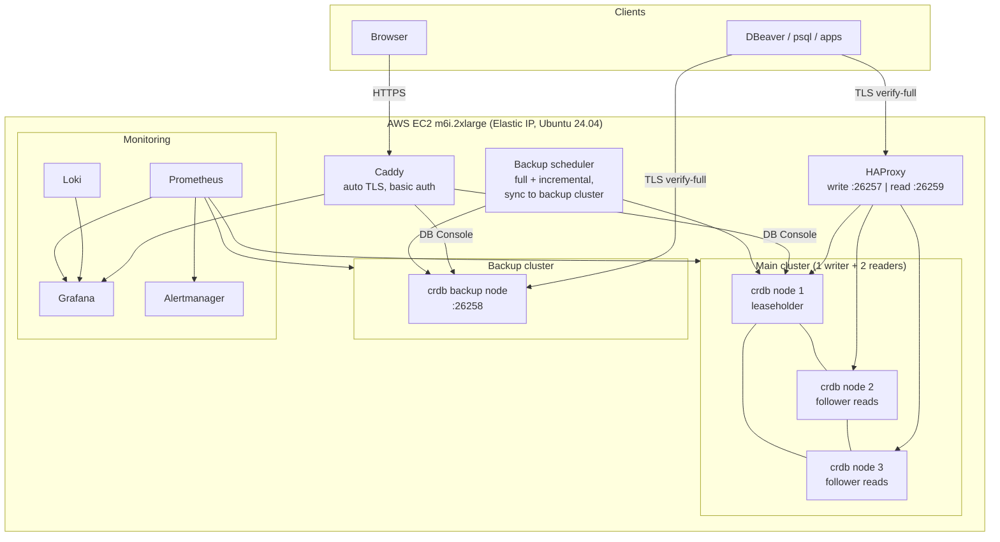
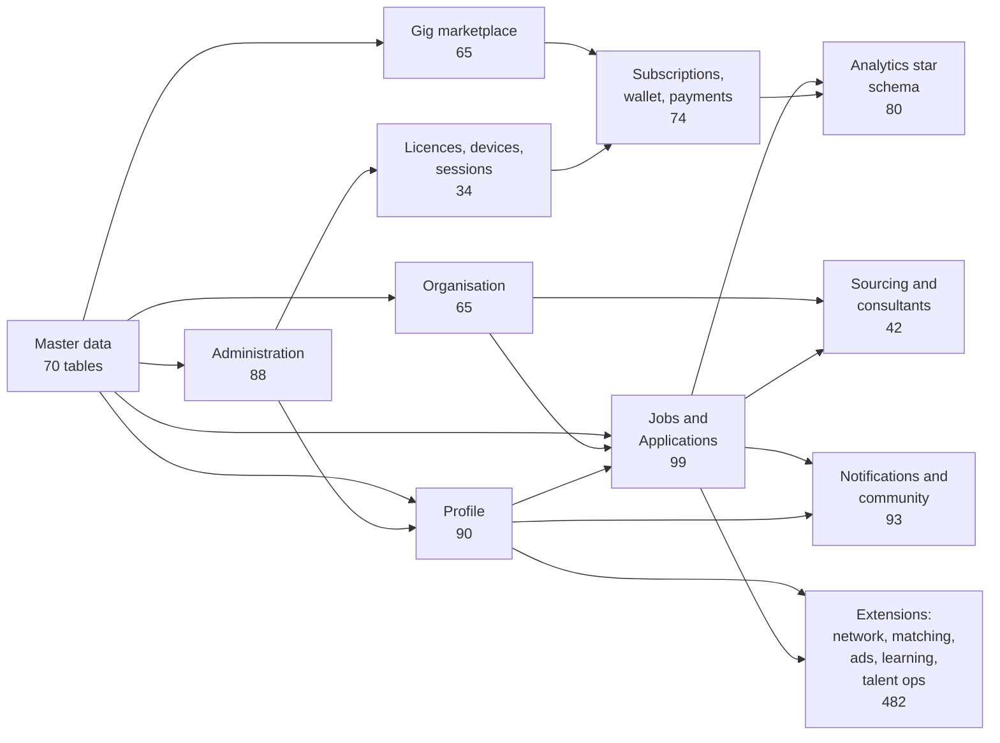
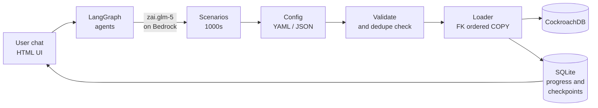

<div align="center">

# Talentra

**A LinkedIn / Naukri-class job search and demand management database, designed, secured and deployed on CockroachDB.**

[](https://www.cockroachlabs.com/)
[](docs/05_data_dictionary.xlsx)
[](docs/06_business_rules.xlsx)
[](docs/02_adr_log.md)
[](infra/)
[](infra/aws-scripts/)
[](infra/monitoring/)
[](infra/caddy/)
[](ingestion-engine/)
[](ingestion-engine/)
[](ingestion-engine/)
[](LICENSE)

</div>

---

## At a glance

- **Product:** the full data backbone of a job platform, covering candidates, employers, recruiters, consultants, gigs, billing, messaging and analytics
- **Engine:** CockroachDB v26.2 (PostgreSQL wire), self-hosted, 3-node main cluster plus a separate backup cluster
- **Built for:** the Talentra Database Design Hackathon ([docket](talentra_docket.md)), every Section 5 data rule honoured or deviation recorded
- **Delivered:** design docs, DDL generator, secured production stack, monitoring, and an AI-driven data ingestion engine

## Scale

| Measure | Value |
|---|---|
| Tables | **1,306** (768 entity tables + 538 enumeration lookups) |
| Columns | **15,784**, each with type, domain, nullability reason and sensitivity class |
| Foreign keys | **2,951**, all enforced |
| Indexes | **4,600+** (hash-sharded, partial, computed, inverted, vector) |
| Business views | **78**, plus masking and viewer-scoped views |
| Business rules | **457**, each mapped to its enforcement mechanism |
| Design decisions | **43** ADRs |
| Modules | **11** docket modules + 5 extension modules + optional Tier 3 |
| Target data volume | **10M** candidate profiles, **1M** jobs, **100M** applications |
| Laptop seed volume | 1M profiles, 100K jobs, 5M applications |

## Architecture



## Data model



## Key features

**Data model**
- Gigs live in their own subsystem, sharing master data, organisations and users with the core job model
- Enumerations are lookup tables with a code, a name per language, an active flag and a sort order
- UI strings are stored by key with per-language translations and a defined fallback
- Soft-delete on business entities, hard-delete on transient ones, stated per entity
- Every business table carries `created_at`, `created_by`, `updated_at`, `updated_by`

**Integrity enforced in the database**
- Device limit enforced at login with row locking, safe under concurrent logins
- No overlapping gig windows or subscription periods, via slot tables (CockroachDB has no exclusion constraints)
- Append-only wallet, payment, audit, download and view ledgers, enforced by privileges and triggers
- Correction entries reference the original entry, never an update
- CHECK constraints for date ranges, salary ranges, E.164 phones, lowercase emails and percentages

**Security**
- Role-based access across the documented actors, enforced through grants, views and viewer-scoped functions
- Recruiters see only their own company's jobs, and a blocked party cannot see the blocker's candidate
- Sensitive data classified in four tiers, with masking views for personal fields
- argon2id password hashing, a tamper-evident audit chain, and session revocation as an audited action
- TLS everywhere with `sslmode=verify-full`, and SCRAM password auth on the cluster

**Performance and scale**
- Hash-sharded indexes on time-ordered, high-volume tables to avoid hotspots
- Follower reads on two reader nodes for read-heavy and analytical traffic
- Row-level TTL for retention and inactivity deletion
- Full-scale projection from measured laptop-scale results, naming the query expected to degrade first

**Operations**
- Separate backup cluster, kept in sync on a schedule while main stays up
- Full monitoring stack: 26 Grafana dashboards, 90 alert rules, host, container, database and TLS metrics
- Local and production Docker Compose files for every stack, driven from one Makefile
- Whole prod environment rebuildable from this repo plus a secrets file

## Ingestion engine



- **AI-designed scenarios:** agents invent realistic populations, for example fresher hiring in Bangalore or blue-collar staffing in the Gulf
- **Distribution control:** each scenario takes its own distribution (normal, lognormal, zipf, pareto, uniform, poisson, bimodal and more) and a record count
- **Chat with tools:** edit, validate and diff the config in plain language, then accept or reject
- **Resumable:** pause, resume, and restart after a crash with exact row counts and no duplicates
- **Scenario memory:** warns before re-ingesting a scenario already in the database
- **Observable:** per-run progress, rate and history in the browser

## Repository layout

| Path | Contents |
|---|---|
| [`docs/`](docs/README.md) | ER diagrams, data dictionary, ADRs, business rules, RBAC matrix, threat model, security note, compliance table, performance plan |
| [`infra/`](infra/README.md) | Docker Compose stacks (caddy, main-db, backup-db, monitoring), schema generator, AWS scripts, Makefile |
| [`ingestion-engine/`](ingestion-engine/README.md) | LangGraph scenario agents, loader, FastAPI UI |
| [`tests/`](tests/README.md) | pytest suites for conformance, rules and access control |
| [`talentra_docket.md`](talentra_docket.md) | The hackathon brief |

## Quick start

```bash
# local stacks (Docker Desktop)
make -C infra up-local-all

# generate DDL from the data dictionary
make -C infra schema-gen

# production host
bash infra/aws-scripts/provision.sh     # EC2 + Elastic IP
make -C infra deploy-prod               # git clone on host + compose up
```

- Connecting from DBeaver: see [`infra/DBEAVER_CONNECT.md`](infra/DBEAVER_CONNECT.md)
- Rebuilding prod from scratch: see [`infra/PROD_RUNBOOK.md`](infra/PROD_RUNBOOK.md)

## Connect with psql

```bash
# Where to get these:
#   <DB_USER> / <DB_PASSWORD>  ->  .aws-creds/prod-credentials.txt (local, gitignored; generated at deploy time)
#       main, admin       user: talentra_admin      password var: TALENTRA_ADMIN_PASSWORD
#       main, read-only   user: talentra_app_ro     password var: TALENTRA_APP_RO_PASSWORD
#       backup            user: backup_admin        password var: BACKUP_ADMIN_PASSWORD
#   CA certificates       ->  infra/certs/main-ca.crt and infra/certs/backup-ca.crt (public, in this repo)
#   Full role list and DBeaver settings  ->  infra/DBEAVER_CONNECT.md

# Main DB, write port (leaseholder node)
PGPASSWORD='<DB_PASSWORD>' psql "host=db.talentra.thearpanhq.in port=26257 dbname=talentra user=<DB_USER> sslmode=verify-full sslrootcert=infra/certs/main-ca.crt"

# Main DB, read port (follower reads, read-only roles)
PGPASSWORD='<DB_PASSWORD>' psql "host=db.talentra.thearpanhq.in port=26259 dbname=talentra user=<DB_USER> sslmode=verify-full sslrootcert=infra/certs/main-ca.crt"

# Backup DB
PGPASSWORD='<DB_PASSWORD>' psql "host=backup.talentra.thearpanhq.in port=26258 dbname=talentra user=<DB_USER> sslmode=verify-full sslrootcert=infra/certs/backup-ca.crt"
```

- Run from the repo root, or point `sslrootcert` at the CA file
- Passwords are alphanumeric, so no shell escaping is needed
- Smoke check: `-c "select count(*) from information_schema.tables where table_schema='public'"` should return 2077 (1,306 tables + 771 views)

## Documentation index

| Deliverable | File |
|---|---|
| ER diagrams (per module + map) | [`docs/01_er/`](docs/01_er/module_map.md) |
| Architecture decision log | [`docs/02_adr_log.md`](docs/02_adr_log.md) |
| Data dictionary (single source of truth) | [`docs/05_data_dictionary.xlsx`](docs/05_data_dictionary.xlsx) |
| Business rules and enforcement | [`docs/06_business_rules.xlsx`](docs/06_business_rules.xlsx) |
| Schema justification | [`docs/07_schema_justification.md`](docs/07_schema_justification.md) |
| Section 5 rule compliance | [`docs/08_rule_compliance.xlsx`](docs/08_rule_compliance.xlsx) |
| RBAC matrix | [`docs/13_rbac_matrix.xlsx`](docs/13_rbac_matrix.xlsx) |
| Threat model | [`docs/14_threat_model.md`](docs/14_threat_model.md) |
| Security design note | [`docs/15_security_design_note.md`](docs/15_security_design_note.md) |
| Performance and indexing plan | [`docs/11_performance_indexing_plan.md`](docs/11_performance_indexing_plan.md) |
| Backup and restore log | [`docs/20_backup_restore_log.xlsx`](docs/20_backup_restore_log.xlsx) |

## Status

- [x] Design documentation suite (milestones B1 to B59, plus PII notes, threat model and security note)
- [x] Production stack on EC2: 3-node main cluster, backup cluster, HAProxy, Caddy, monitoring
- [x] Ingestion engine built and tested against a stub schema
- [x] Full schema applied from empty (1,306 tables, 765 views, 4,614 indexes, 2,951 FKs), repeatable, backup cluster synced on a schedule
- [ ] Test suites, RBAC verification and independent doc-vs-database check
- [ ] Engine aligned to the real schema and run against production
- [ ] Seeding, query performance and backup/restore timing on EC2 (milestones B60 to B74, B79, B80, B82)

## License

Apache 2.0, see [`LICENSE`](LICENSE).
