# ER diagram: Administration

Module key `administration`, owner Member A, 88 tables (42 lookups). Generated from `05_data_dictionary.xlsx` (do not edit by hand). Columns shown: primary key, foreign keys, unique/natural keys and a few business columns; see the dictionary for all columns. Edges to lookup (enumeration) tables are listed under *Lookup references* rather than drawn.

## Design notes

<!-- administration.yaml -->
## Scope and entity list (B24, B27, B30)
Administration owns identity (app_user), authorisation (app_role, permission, app_role_permission, app_user_role + hierarchy/eligibility), secrets (user_credential, mfa_factor,
reset/verification tokens, identity_session, api_key), consent (consent_document, user_consent), the audit tier (audit_event + hash-chain heads/checkpoints, error_log, security_event),
blocking (user_block, organisation_block) and governance (DSR, retention policy, purge runs, legal hold, break-glass, four-eyes, impersonation, moderation, merge/duplicates).
Login attempts, devices and device slots belong to licences_devices and are NOT duplicated; identity_session holds only the token family.

## One identity table
app_user is the only identity table. Candidate, employer, recruiter, consultant, placement officer, admin are (a) actor_type (immutable primary class) and (b) rows in app_user_role
plus profile extensions in other modules. Guest has no row (audit/security rows use actor_type=guest with NULL actor). Email and phone are unique only among live rows (partial unique).
Phone-only accounts are legal (OTP login), hence nullable email with null_why. Erasure anonymises in place (id kept) so audit/ledger FKs stay valid.

## Where each privilege is enforced (docket Section 3: DB or access layer, not UI only)
1. DB roles (CockroachDB CREATE ROLE + GRANT): app_rw (CRUD on business tables, SELECT only on audit_event, no access to user_credential/mfa_factor/*_token), auth_svc (only
   credential/token/session tables), audit_writer (INSERT+SELECT audit_event, UPDATE audit_chain_head), audit_reader (SELECT, vw_audit_event_redacted), purge_svc (DELETE only on tables
   named in data_retention_policy), changefeed_svc (SELECT + CHANGEFEED on audit_event), analytics_ro (views/marts only), dba_break_glass (membership only via privileged_access_request).
   `REVOKE UPDATE, DELETE ON TABLE audit_event, user_consent, user_credential_history FROM app_rw, audit_writer;` (INSERT/SELECT only).
2. Views as row-level security: vw_candidate_visible_to_user (blocking + candidate visibility), vw_user_effective_permission, vw_app_user_public (masked columns). Service roles
   receive SELECT on views, not on base tables, for candidate data. Optional hardening (version-gated, not relied on): CRDB row-level security policies.
3. Constraints: registration_policy (who may create which actor type), block_policy, app_role_eligibility, composite FKs in app_user_role (scope + actor type), CHECKs.
4. Application layer: permission.enforcement_layer_id records the layer per permission; data_scope on app_role_permission is applied as a mandatory predicate by the data-access
   layer (recruiter -> recruiter_organisation_mapping join; consultant -> job_requirement.open_to_consultants). Every permission with is_sensitive writes audit_event.
   Docket rules: recruiter sees only own company's requirements (data_scope=assigned_requirement/organisation); consultant only requirements open to consultants (data_scope=open_to_consultants).

## Recruiters cannot register candidates
Mechanism: app_user has composite FK (actor_type_id, registrar_actor_type_id, registration_channel_id) -> registration_policy. Seeded rows permit (candidate,candidate,self_signup),
(candidate,admin|super_admin,admin_created), (candidate,service,legacy_migration|bulk_import), (recruiter,account_admin,employer_invited) etc.; (candidate,recruiter,*) and
(candidate,employer,*) are never inserted, so such an INSERT fails with an FK violation regardless of application bugs. Recruiters may only contact candidates (outreach in
sourcing module, which writes no app_user row). Placement-officer-invited students are an extension (add policy rows + invitation acceptance step).

## Audit design (B33, B59, B75)
audit_event is append_only, 32 parallel hash chains: writer takes `SELECT ... FOR UPDATE` on audit_chain_head(chain_no), assigns chain_seq, copies prev_hash, computes
row_hash = SHA-256(canonical fields || prev_hash) and updates the head in the same txn. A single global chain would serialise all writes; 32 chains keep contention bounded while
still giving per-chain tamper evidence. audit_chain_checkpoint anchors segments (signed) in an object-lock sink. Time index is hash-sharded (bucket_count=16) so inserts do not
hot-spot one range. CockroachDB changefeed (CREATE CHANGEFEED FOR TABLE audit_event INTO 's3://...' WITH ...) streams rows to an immutable bucket; row-level TTL (400 days) deletes
hot rows only after sink_confirmed_at; `ttl_pause` while a legal hold on audit_event is active. TTL runs as a background job under the table owner, so REVOKE on app roles
does not block it; the DELETE privilege is never granted to application roles. Verify exact TTL storage parameters on the deployed version (ttl_expire_after,
ttl_expiration_expression, ttl_job_cron are documented in CockroachDB row-level TTL docs).
PII minimisation: before/after hold changed fields only; Personal values are masked or replaced by an HMAC token; credentials are never included.

## Blocking and visibility (B50, B53, B59)
user_block(blocker, blocked) effective-dated; open row = effective_to IS NULL; unique partial (blocker, blocked). Types pinned by composite FKs to app_user and block_policy.
organisation_block covers candidate-blocks-company and company-blocks-candidate. Columns are named blocker_app_user_id/blocked_app_user_id (lint requires FK columns to end in the
referenced table name). Exact predicate is in vw_candidate_visible_to_user: a viewer (employer/recruiter/consultant) sees a candidate unless an open user_block exists with
blocker = candidate's user and blocked = viewer, or an open organisation_block exists between the candidate and any organisation the viewer currently acts for (any direction).
Performance: both NOT EXISTS probes are point lookups on the partial unique indexes (blocker,blocked) and (organisation,candidate,direction); search does the reverse probe via
(blocked, blocker) and (candidate, organisation) partial indexes. The same view also feeds the search-index export (blocked viewers excluded at query time, never copied into
the search index, so un-blocking is immediate).

## Credentials, sessions, tokens (B56, B75)
argon2id with parameters stored per row (argon2_memory_kib etc.) so a query finds rows needing rehash; PHC string carries salt; optional pepper from KMS (pepper_version).
One active credential per user: partial unique index on (app_user_id) WHERE is_active. MFA secrets AES-256-GCM envelope encrypted (encryption_key_ref); recovery codes and all tokens
stored as hashes. Refresh-token rotation: each use inserts a child row; reuse of a revoked token revokes the family (token_family_ref) and raises security_event(refresh_token_reuse).
identity_session TTL: 7 days after expires_at. PII classes: credentials/MFA/token hashes = Sensitive; e-mail, phone, IP, user agent, display name = Personal.

## Governance
DSR: data_subject_request with due_at (30 days default; per-jurisdiction override via country_id) and an SLA queue index. data_retention_policy rows drive purge jobs (purge_job_run
logs counts); legal_hold (user, organisation or table scope, exactly one) is honoured by purge, DSR and audit TTL. Break-glass and four-eyes are separate tables
(privileged_access_request, admin_action_approval) because break-glass grants a role for a window while four-eyes authorises one action.

## Deviations and trade-offs
* created_by/updated_by/deleted_by not FK-enforced (D-04); app_user_id-bearing audit columns that matter (actor, blocker, consent subject) ARE FK-enforced.
* audit_event.entity_ref, organisation_ref, request_ref, identity_session_ref and error_log.actor_ref are deliberately FK-less: polymorphic or survive the referenced row; the write path
  avoids an FK check per audit write. The orphan check job covers them.
* MFA secret lives in mfa_factor (1:N factors) rather than user_credential; user_credential only models the password. user_credential_history is event-only.
* Lookup FKs are not individually indexed (low cardinality, lookups never deleted) via index_exempt; every other FK leads an index.
* candidate_profile.app_user_id and recruiter_organisation_mapping(recruiter app_user, organisation, effective dates) are assumed by the views; confirm with profile/organisation modules.

## Extension path: sub-roles inside an employer organisation (out of scope now)
app_user_role already carries organisation_id and role scope, so adding posting/interviewing/pipeline roles = inserting new app_role rows (is_organisation_scoped=true), their
permissions in app_role_permission with data_scope organisation or assigned_requirement, and eligibility rows. Per-requirement assignment would add a job_requirement_member link
(job_requirement_id, app_user_id, app_role_id). No Administration table changes; role hierarchy (app_role_inheritance) covers 'pipeline manager includes interviewer'.

## Competitor / industry observations (public help pages and engineering write-ups; not re-verified at authoring time)
* LinkedIn: member block is mutual invisibility; separate admin roles per company page (super admin, content admin, recruiter admin); audit of data export for DSAR. We match
  mutual hiding (view + organisation_block both directions) and exceed with effective-dated, reasoned blocks and a DSR SLA table.
* Naukri: 'block companies' hides profile from named recruiters/companies; recruiter sub-user roles (admin vs sub-user) under one employer licence. We model company blocks as first class and
  defer sub-roles via the extension path above.
* Monster/Indeed: employer team roles and per-job assignment; login-history views per user. Login history sits in licences_devices.
* Industry IAM practice (OWASP ASVS, NIST 800-63B, Auth0/Okta/Keycloak schemas): separate user/credential/federated-identity tables, hashed tokens, refresh-token rotation with reuse
  detection, append-only audit with request correlation, hash chains + WORM sinks (immutability), break-glass with time-boxed grants.

Decision F-01 detail: `audit_event` (400-day TTL) and `identity_session` (7-day TTL) remain TTL tables; their inbound children (licences_devices, tier3_reference) were changed to ON DELETE SET NULL, see the notes of those modules.

Audit vocabulary extended (finding F-09 of 13_rbac_matrix): 7 audit_action codes and 12 audit_entity_type codes needed by BR-LIC-06/09, BR-SRC-05 and the refund/payment/legal-hold flows.

<!-- legacy_sync.yaml -->
# Legacy job and candidate system synchronisation (integration boundary 'Legacy job & candidate systems')
Closes the gaps L-01..L-04 of docs/09_integration_boundaries.xlsx ('Legacy sync'). Four tables, two lookups, owned by the administration module because source systems, run
schedules and conflict decisions are operational/administrative data that every business module (profile, jobs, organisation) shares.

## Design
* `legacy_source_system` is the registry of external systems (legacy candidate system, legacy job system, ATS). Its `import_source_id` reuses the existing profile lookup; the default
  `sync_conflict_policy_id` reuses the existing `sync_conflict_policy` lookup (source_wins / platform_wins / newest_wins / manual_review), which is the conflict resolution rule vocabulary.
  Secrets are never stored: `connection_ref` is a secret-manager reference.
* `legacy_sync_run` is one execution per (source system, entity kind) with the watermark (`watermark_from_ref` -> `watermark_to_ref`) and result counts. Idempotency: UNIQUE
  (legacy_source_system_id, run_key); a partial unique index allows at most one open run per source and entity kind; the next run starts from the `watermark_to_ref` of the last
  completed run only (the watermark of a failed run is never advanced).
* `legacy_record_map` is the idempotency anchor: UNIQUE (legacy_source_system_id, legacy_entity_kind_id, source_record_ref) -> exactly one platform record. A second UNIQUE
  (source, kind, platform_record_ref) prevents two legacy records claiming one platform record. `platform_record_ref` is polymorphic (candidate_profile, organisation, job_requirement,
  job_application ids chosen by the entity kind) and therefore carries no FK; a nightly orphan check job verifies it. Deletes in legacy are tombstoned, never propagated.
* `legacy_sync_conflict` is an append-only, TTL-limited log of field-level conflicts: which field, keyed hashes of both values (raw values are not copied), the rule applied
  (`sync_conflict_policy_id`) and the outcome (`legacy_conflict_outcome`). A manual-review decision is a new row that supersedes the earlier one.
* `job_requirement` gains `legacy_source_system_id` and the partial unique (legacy_source_system_id, external_job_ref) so a re-run cannot create duplicate jobs (L-01).
  `candidate_profile.legacy_candidate_ref` stays unique globally; with several source systems new imports resolve through `legacy_record_map` (L-02).
* Existing `profile_import` stays the per-candidate raw payload audit; `legacy_sync_run` is the batch level above it. Field-level mapping beyond a version string
  (`field_mapping_version`) is intentionally configuration in code.

## Retention
Runs and record maps live while the source system is enabled; conflicts expire after 24 months (row-level TTL, no table references them with RESTRICT).

## Diagram

```mermaid
erDiagram
  admin_action_approval {
    UUID id PK
    UUID permission_id FK
    UUID requested_by_app_user_id FK
    UUID approver_app_user_id FK
    UUID approval_status_id FK
    UUID audit_entity_type_id FK
    UUID target_entity_ref
    JSONB proposed_change
    STRING_500 request_note
  }
  api_client {
    UUID id PK
    UUID organisation_id FK
    STRING_150 name
    UUID api_client_kind_id FK
    UUID app_role_id FK
    UUID owner_app_user_id FK
    INT4 rate_limit_per_minute
    STRING_254 contact_email
  }
  api_key {
    UUID id PK
    UUID api_client_id FK
    STRING_12 key_prefix
    STRING_128 key_hash
    TIMESTAMPTZ expires_at
  }
  app_role {
    UUID id PK
    STRING_64 code
    JSONB name_i18n
    STRING_500 description
    BOOL is_organisation_scoped UK
  }
  app_role_eligibility {
    UUID id PK
    UUID app_role_id FK
    UUID actor_type_id FK
  }
  app_role_inheritance {
    UUID id PK
    UUID child_app_role_id FK
    UUID parent_app_role_id FK
  }
  app_role_permission {
    UUID id PK
    UUID app_role_id FK
    UUID permission_id FK
    UUID data_scope_id FK
  }
  app_user {
    UUID id PK
    STRING_254 email
    TIMESTAMPTZ email_verified_at
    STRING_16 phone
    UUID phone_country_id FK
    UUID actor_type_id FK
    UUID registrar_actor_type_id FK
    UUID registration_channel_id FK
    UUID registrar_app_user_id FK
    UUID user_status_id FK
    UUID preferred_language_id FK
    UUID erasure_state_id FK
    UUID merged_into_app_user_id FK
  }
  app_user_role {
    UUID id PK
    UUID app_user_id FK
    UUID app_role_id FK
    UUID organisation_id FK
    UUID actor_type_id FK
    BOOL is_organisation_scoped FK
    TIMESTAMPTZ effective_from
    TIMESTAMPTZ effective_to
    STRING_300 revoke_reason
  }
  audit_chain_checkpoint {
    UUID id PK
    UUID audit_chain_head_id FK
    INT8 from_chain_seq UK
    INT8 to_chain_seq
    BYTES tip_hash
    BYTES signature
  }
  audit_chain_head {
    UUID id PK
    INT2 chain_no UK
    INT8 last_chain_seq
    BYTES last_row_hash
  }
  audit_event {
    UUID id PK
    TIMESTAMPTZ occurred_at
    UUID actor_app_user_id FK
    UUID actor_type_id FK
    UUID impersonator_app_user_id FK
    UUID audit_action_id FK
    UUID audit_entity_type_id FK
    UUID entity_ref
    UUID organisation_ref
    UUID audit_outcome_id FK
    INT2 chain_no UK
    INT8 chain_seq UK
  }
  audit_export {
    UUID id PK
    UUID requested_by_app_user_id FK
    UUID admin_action_approval_id FK
    STRING_500 purpose
    JSONB filter_criteria
    TIMESTAMPTZ period_from_at
    UUID job_run_status_id FK
  }
  block_policy {
    UUID id PK
    UUID blocker_actor_type_id FK
    UUID blocked_actor_type_id FK
  }
  consent_document {
    UUID id PK
    UUID consent_type_id FK
    UUID language_id FK
    STRING_32 version_label UK
    STRING_200 title
    STRING_500 document_url
    BYTES content_sha256
  }
  data_retention_policy {
    UUID id PK
    STRING_64 entity_table_name
    UUID retention_trigger_id FK
    INT4 retention_days
    UUID retention_action_id FK
    JSONB anonymise_columns
    UUID country_id FK
  }
  data_subject_request {
    UUID id PK
    UUID app_user_id FK
    UUID dsr_type_id FK
    UUID dsr_status_id FK
    UUID request_channel_id FK
    UUID country_id FK
    TIMESTAMPTZ received_at
    TIMESTAMPTZ due_at
    TIMESTAMPTZ identity_verified_at
    UUID assigned_to_app_user_id FK
  }
  duplicate_candidate_match {
    UUID id PK
    UUID primary_app_user_id FK
    UUID duplicate_app_user_id FK
    UUID duplicate_match_rule_id FK
    DECIMAL_5_2 match_confidence
    UUID duplicate_match_status_id FK
    JSONB evidence
    TIMESTAMPTZ reviewed_at
    UUID reviewed_by_app_user_id FK
  }
  email_verification_token {
    UUID id PK
    UUID app_user_id FK
    UUID email_verification_purpose_id FK
    STRING_254 target_email
    STRING_128 token_hash
    TIMESTAMPTZ expires_at
  }
  error_log {
    UUID id PK
    TIMESTAMPTZ occurred_at
    UUID error_code_id FK
    UUID event_severity_id FK
    STRING_64 service_name
    STRING_32 release_version
  }
  identity_session {
    UUID id PK
    UUID app_user_id FK
    STRING_128 refresh_token_hash
    UUID token_family_ref
    UUID parent_identity_session_id FK
    UUID auth_method_id FK
    BOOL mfa_satisfied
    UUID acting_organisation_id FK
    UUID device_session_id FK
    UUID session_revoke_reason_id FK
  }
  impersonation_session {
    UUID id PK
    UUID support_app_user_id FK
    UUID impersonated_app_user_id FK
    UUID impersonation_reason_id FK
    UUID support_ticket_id FK
    UUID admin_action_approval_id FK
    BOOL is_read_only
    TIMESTAMPTZ started_at
    TIMESTAMPTZ ended_at
  }
  legacy_record_map {
    UUID id PK
    UUID legacy_source_system_id FK
    UUID legacy_entity_kind_id FK
    STRING_200 source_record_ref UK
    UUID platform_record_ref UK
    UUID first_seen_legacy_sync_run_id FK
    UUID last_seen_legacy_sync_run_id FK
    STRING_64 source_payload_sha256
    TIMESTAMPTZ source_updated_at
    TIMESTAMPTZ last_synced_at
  }
  legacy_source_system {
    UUID id PK
    STRING_64 code
    STRING_150 display_name
    UUID import_source_id FK
    UUID sync_conflict_policy_id FK
    STRING_20 field_mapping_version
  }
  legacy_sync_conflict {
    UUID id PK
    UUID legacy_sync_run_id FK
    UUID legacy_record_map_id FK
    STRING_100 field_name
    STRING_64 legacy_value_hash
    STRING_64 platform_value_hash
    UUID sync_conflict_policy_id FK
    UUID legacy_conflict_outcome_id FK
    UUID supersedes_legacy_sync_conflict_id FK
    UUID resolved_by_app_user_id FK
  }
  legacy_sync_run {
    UUID id PK
    UUID legacy_source_system_id FK
    UUID legacy_entity_kind_id FK
    UUID import_status_id FK
    UUID sync_conflict_policy_id FK
    STRING_150 run_key UK
    STRING_300 watermark_from_ref
    STRING_300 watermark_to_ref
    BOOL is_active_run
  }
  legal_hold {
    UUID id PK
    STRING_64 hold_reference UK
    STRING_500 reason_text
    UUID app_user_id FK
    UUID organisation_id FK
    STRING_64 entity_table_name
    TIMESTAMPTZ placed_at
  }
  mfa_factor {
    UUID id PK
    UUID app_user_id FK
    UUID mfa_method_id FK
    STRING_100 label
    BYTES secret_encrypted
    STRING_64 encryption_key_ref
  }
  mfa_recovery_code {
    UUID id PK
    UUID app_user_id FK
    STRING_128 code_hash
    TIMESTAMPTZ used_at
  }
  moderation_case {
    UUID id PK
    UUID moderation_target_type_id FK
    UUID target_ref
    UUID target_app_user_id FK
    UUID reporter_app_user_id FK
    UUID moderation_reason_id FK
    UUID moderation_case_status_id FK
    STRING_2000 narrative
    JSONB evidence
    UUID assigned_to_app_user_id FK
  }
  moderation_case_action {
    UUID id PK
    UUID moderation_case_id FK
    UUID moderation_action_id FK
    STRING_1000 note
    UUID approval_app_user_id FK
  }
  organisation_block {
    UUID id PK
    UUID organisation_id FK
    UUID candidate_profile_id FK
    UUID block_direction_id FK
    UUID block_reason_id FK
    UUID initiated_by_app_user_id FK
    STRING_500 note
    TIMESTAMPTZ effective_from
    TIMESTAMPTZ effective_to
  }
  password_reset_token {
    UUID id PK
    UUID app_user_id FK
    STRING_128 token_hash
    TIMESTAMPTZ expires_at
    TIMESTAMPTZ consumed_at
  }
  permission {
    UUID id PK
    STRING_96 code UK
    UUID permission_group_id FK
    STRING_64 resource_name
    UUID permission_operation_id FK
    UUID enforcement_layer_id FK
    BOOL is_sensitive
    BOOL requires_four_eyes
  }
  permission_group {
    UUID id PK
    STRING_64 code
    JSONB name_i18n
    INT4 sort_order
  }
  privileged_access_request {
    UUID id PK
    UUID requesting_app_user_id FK
    UUID requested_app_role_id FK
    STRING_1000 justification
    STRING_64 incident_ref
    UUID approval_status_id FK
    UUID approver_app_user_id FK
    TIMESTAMPTZ requested_at
    UUID granted_app_user_role_id FK
    UUID reviewed_by_app_user_id FK
  }
  purge_job_run {
    UUID id PK
    UUID data_retention_policy_id FK
    UUID job_run_status_id FK
    TIMESTAMPTZ cutoff_at
    TIMESTAMPTZ started_at
    TIMESTAMPTZ finished_at
  }
  registration_policy {
    UUID id PK
    UUID actor_type_id FK
    UUID registrar_actor_type_id FK
    UUID registration_channel_id FK
    STRING_300 rationale
  }
  security_event {
    UUID id PK
    TIMESTAMPTZ occurred_at
    UUID security_event_type_id FK
    UUID event_severity_id FK
    UUID app_user_id FK
    INET ip_address
    JSONB details
    UUID acknowledged_by_app_user_id FK
  }
  trusted_ip {
    UUID id PK
    UUID ip_rule_kind_id FK
    INET ip_network
    UUID organisation_id FK
    UUID app_role_id FK
    STRING_150 label
    TIMESTAMPTZ effective_from
  }
  user_block {
    UUID id PK
    UUID blocker_app_user_id FK
    UUID blocked_app_user_id FK
    UUID blocker_actor_type_id FK
    UUID blocked_actor_type_id FK
    UUID block_reason_id FK
    STRING_500 note
    TIMESTAMPTZ effective_from
    TIMESTAMPTZ effective_to
  }
  user_consent {
    UUID id PK
    UUID app_user_id FK
    UUID consent_type_id FK
    UUID consent_document_id FK
    UUID consent_action_id FK
    UUID consent_source_id FK
    TIMESTAMPTZ occurred_at
    INET ip_address
    STRING_512 user_agent
    UUID recorded_by_app_user_id FK
  }
  user_credential {
    UUID id PK
    UUID app_user_id FK
    STRING_255 password_hash
    UUID hash_algorithm_id FK
    INT4 argon2_memory_kib
    INT2 argon2_iterations
    UUID credential_change_reason_id FK
  }
  user_credential_history {
    UUID id PK
    UUID app_user_id FK
    UUID user_credential_id FK
    UUID credential_event_type_id FK
    INET ip_address
    STRING_512 user_agent
    UUID request_ref
  }
  user_merge_request {
    UUID id PK
    UUID surviving_app_user_id FK
    UUID merged_app_user_id FK
    UUID duplicate_candidate_match_id FK
    UUID admin_action_approval_id FK
    UUID approval_status_id FK
    JSONB merge_plan
    TIMESTAMPTZ executed_at
    TIMESTAMPTZ undo_until_at
  }
  user_status_history {
    UUID id PK
    UUID app_user_id FK
    UUID previous_user_status_id FK
    UUID user_status_id FK
    STRING_500 reason_text
    UUID audit_event_ref
  }
  candidate_profile {
    UUID id PK
  }
  country {
    UUID id PK
  }
  device_session {
    UUID id PK
  }
  language {
    UUID id PK
  }
  organisation {
    UUID id PK
  }
  support_ticket {
    UUID id PK
  }
  admin_action_approval |o--o{ audit_export : "admin_action_approval_id"
  admin_action_approval |o--o{ impersonation_session : "admin_action_approval_id"
  admin_action_approval |o--o{ user_merge_request : "admin_action_approval_id"
  api_client ||--o{ api_key : "api_client_id"
  app_role |o--o{ trusted_ip : "app_role_id"
  app_role ||--o{ api_client : "app_role_id"
  app_role ||--o{ app_role_eligibility : "app_role_id"
  app_role ||--o{ app_role_inheritance : "child_app_role_id"
  app_role ||--o{ app_role_inheritance : "parent_app_role_id"
  app_role ||--o{ app_role_permission : "app_role_id"
  app_role ||--o{ app_user_role : "app_role_id"
  app_role ||--o{ privileged_access_request : "requested_app_role_id"
  app_role_eligibility ||--o{ app_user_role : "app_role_id"
  app_user |o--o{ admin_action_approval : "approver_app_user_id"
  app_user |o--o{ api_client : "owner_app_user_id"
  app_user |o--o{ app_user : "merged_into_app_user_id"
  app_user |o--o{ app_user : "registrar_app_user_id"
  app_user |o--o{ audit_event : "actor_app_user_id"
  app_user |o--o{ audit_event : "impersonator_app_user_id"
  app_user |o--o{ data_subject_request : "assigned_to_app_user_id"
  app_user |o--o{ duplicate_candidate_match : "reviewed_by_app_user_id"
  app_user |o--o{ legacy_sync_conflict : "resolved_by_app_user_id"
  app_user |o--o{ legal_hold : "app_user_id"
  app_user |o--o{ moderation_case : "assigned_to_app_user_id"
  app_user |o--o{ moderation_case : "reporter_app_user_id"
  app_user |o--o{ moderation_case : "target_app_user_id"
  app_user |o--o{ moderation_case_action : "approval_app_user_id"
  app_user |o--o{ organisation_block : "initiated_by_app_user_id"
  app_user |o--o{ privileged_access_request : "approver_app_user_id"
  app_user |o--o{ privileged_access_request : "reviewed_by_app_user_id"
  app_user |o--o{ security_event : "acknowledged_by_app_user_id"
  app_user |o--o{ security_event : "app_user_id"
  app_user |o--o{ user_consent : "recorded_by_app_user_id"
  app_user ||--o{ admin_action_approval : "requested_by_app_user_id"
  app_user ||--o{ app_user_role : "app_user_id"
  app_user ||--o{ audit_export : "requested_by_app_user_id"
  app_user ||--o{ data_subject_request : "app_user_id"
  app_user ||--o{ duplicate_candidate_match : "duplicate_app_user_id"
  app_user ||--o{ duplicate_candidate_match : "primary_app_user_id"
  app_user ||--o{ email_verification_token : "app_user_id"
  app_user ||--o{ identity_session : "app_user_id"
  app_user ||--o{ impersonation_session : "impersonated_app_user_id"
  app_user ||--o{ impersonation_session : "support_app_user_id"
  app_user ||--o{ mfa_factor : "app_user_id"
  app_user ||--o{ mfa_recovery_code : "app_user_id"
  app_user ||--o{ password_reset_token : "app_user_id"
  app_user ||--o{ privileged_access_request : "requesting_app_user_id"
  app_user ||--o{ user_block : "blocked_app_user_id"
  app_user ||--o{ user_block : "blocker_app_user_id"
  app_user ||--o{ user_consent : "app_user_id"
  app_user ||--o{ user_credential : "app_user_id"
  app_user ||--o{ user_credential_history : "app_user_id"
  app_user ||--o{ user_merge_request : "merged_app_user_id"
  app_user ||--o{ user_merge_request : "surviving_app_user_id"
  app_user ||--o{ user_status_history : "app_user_id"
  app_user_role |o--o{ privileged_access_request : "granted_app_user_role_id"
  audit_chain_head ||--o{ audit_chain_checkpoint : "audit_chain_head_id"
  block_policy ||--o{ user_block : "blocker_actor_type_id"
  candidate_profile ||--o{ organisation_block : "candidate_profile_id"
  consent_document ||--o{ user_consent : "consent_document_id"
  country |o--o{ app_user : "phone_country_id"
  country |o--o{ data_retention_policy : "country_id"
  country |o--o{ data_subject_request : "country_id"
  data_retention_policy ||--o{ purge_job_run : "data_retention_policy_id"
  device_session |o--o{ identity_session : "device_session_id"
  duplicate_candidate_match |o--o{ user_merge_request : "duplicate_candidate_match_id"
  identity_session |o--o{ identity_session : "parent_identity_session_id"
  language ||--o{ app_user : "preferred_language_id"
  language ||--o{ consent_document : "language_id"
  legacy_record_map ||--o{ legacy_sync_conflict : "legacy_record_map_id"
  legacy_source_system ||--o{ legacy_record_map : "legacy_source_system_id"
  legacy_source_system ||--o{ legacy_sync_run : "legacy_source_system_id"
  legacy_sync_conflict |o--o{ legacy_sync_conflict : "supersedes_legacy_sync_conflict_id"
  legacy_sync_run |o--o{ legacy_record_map : "first_seen_legacy_sync_run_id"
  legacy_sync_run |o--o{ legacy_record_map : "last_seen_legacy_sync_run_id"
  legacy_sync_run ||--o{ legacy_sync_conflict : "legacy_sync_run_id"
  moderation_case ||--o{ moderation_case_action : "moderation_case_id"
  organisation |o--o{ api_client : "organisation_id"
  organisation |o--o{ app_user_role : "organisation_id"
  organisation |o--o{ identity_session : "acting_organisation_id"
  organisation |o--o{ legal_hold : "organisation_id"
  organisation |o--o{ trusted_ip : "organisation_id"
  organisation ||--o{ organisation_block : "organisation_id"
  permission ||--o{ admin_action_approval : "permission_id"
  permission ||--o{ app_role_permission : "permission_id"
  permission_group ||--o{ permission : "permission_group_id"
  registration_policy ||--o{ app_user : "actor_type_id"
  support_ticket |o--o{ impersonation_session : "support_ticket_id"
  user_credential |o--o{ user_credential_history : "user_credential_id"
```

## Lookup tables in this module

| Lookup | Values | Description |
|---|---|---|
| `actor_type` | 10 | Primary actor class of an app_user (docket Section 3). guest has no app_user row but is used by audit/security rows for unauthenticated callers; service is the machine actor. |
| `api_client_kind` | 5 | Kind of API consumer. |
| `approval_status` | 6 | State of a four-eyes, break-glass or merge approval. |
| `audit_action` | 33 | Catalogue of audited actions (what happened). |
| `audit_entity_type` | 36 | Entity kinds that audit, approval, moderation and retention rows may point to (polymorphic reference vocabulary). |
| `audit_outcome` | 3 | Result of an audited action. |
| `auth_method` | 6 | How the session was authenticated. |
| `block_direction` | 2 | Direction of an organisation-level block. |
| `consent_action` | 4 | Event type of a consent record. |
| `consent_source` | 5 | Channel through which a consent event was captured. |
| `consent_type` | 10 | Kinds of consent and policy acceptance captured per user (versioned text lives in consent_document). |
| `credential_change_reason` | 7 | Why a credential row was created. |
| `credential_event_type` | 10 | Event kinds in the credential history. |
| `data_scope` | 7 | Row-visibility scope a role-permission grant carries. |
| `dsr_status` | 7 | Workflow state of a data subject request. |
| `dsr_type` | 5 | Data subject request kinds (GDPR/DPDP). |
| `duplicate_match_rule` | 5 | Rule that flagged a possible duplicate account. |
| `duplicate_match_status` | 4 | Review state of a duplicate match. |
| `email_verification_purpose` | 3 | Reason an e-mail verification token was issued. |
| `enforcement_layer` | 5 | Where a permission is enforced (docket Section 3: every privilege enforced in DB or access layer). |
| `erasure_state` | 5 | Right-to-erasure progress of an account. |
| `error_code` | 11 | Stable application error codes (error_log.error_code_id); http_status is the HTTP mapping returned to clients. |
| `event_severity` | 5 | Severity scale shared by error_log and security_event. |
| `hash_algorithm` | 4 | Password hashing algorithm (argon2id is the target; others exist only for migration and are forced to rehash on login). |
| `impersonation_reason` | 4 | Why support impersonated a user. |
| `ip_rule_kind` | 2 | Allow or deny semantics of a trusted_ip rule. |
| `job_run_status` | 6 | State of a background job run (purge, export). |
| `legacy_conflict_outcome` | 5 | Result of resolving one field-level legacy sync conflict. |
| `legacy_entity_kind` | 7 | Kind of entity synchronised from a legacy system (decides the target table of legacy_record_map.platform_record_ref). |
| `mfa_method` | 4 | Second-factor methods. |
| `moderation_action` | 11 | Outcome applied to a moderation case. |
| `moderation_case_status` | 7 | Moderation workflow state. |
| `moderation_reason` | 8 | Reason for a report or flag. |
| `moderation_target_type` | 7 | Kinds of content or accounts that may be reported. |
| `permission_operation` | 8 | Operation family of a permission code. |
| `registration_channel` | 7 | How an account came into existence; with the registrar actor type it is validated against registration_policy. |
| `request_channel` | 5 | Channel through which a request was lodged. |
| `retention_action` | 4 | What a retention policy does when the period lapses. |
| `retention_trigger` | 5 | Clock start for a retention period. |
| `security_event_type` | 8 | Security anomaly categories. |
| `session_revoke_reason` | 8 | Why an identity session ended before expiry. |
| `user_status` | 7 | Lifecycle state of an app_user account. |

## Lookup references (enumeration FKs)

| Table | Lookup tables referenced |
|---|---|
| `admin_action_approval` | `approval_status`, `audit_entity_type` |
| `api_client` | `api_client_kind` |
| `app_role_eligibility` | `actor_type` |
| `app_role_permission` | `data_scope` |
| `app_user` | `actor_type`, `erasure_state`, `registration_channel`, `user_status` |
| `app_user_role` | `actor_type` |
| `audit_event` | `actor_type`, `audit_action`, `audit_entity_type`, `audit_outcome` |
| `audit_export` | `job_run_status` |
| `block_policy` | `actor_type` |
| `consent_document` | `consent_type` |
| `data_retention_policy` | `retention_action`, `retention_trigger` |
| `data_subject_request` | `dsr_status`, `dsr_type`, `request_channel` |
| `duplicate_candidate_match` | `duplicate_match_rule`, `duplicate_match_status` |
| `email_verification_token` | `email_verification_purpose` |
| `error_log` | `error_code`, `event_severity` |
| `identity_session` | `auth_method`, `session_revoke_reason` |
| `impersonation_session` | `impersonation_reason` |
| `legacy_record_map` | `legacy_entity_kind` |
| `legacy_source_system` | `import_source`, `sync_conflict_policy` |
| `legacy_sync_conflict` | `legacy_conflict_outcome`, `sync_conflict_policy` |
| `legacy_sync_run` | `import_status`, `legacy_entity_kind`, `sync_conflict_policy` |
| `mfa_factor` | `mfa_method` |
| `moderation_case` | `moderation_case_status`, `moderation_reason`, `moderation_target_type` |
| `moderation_case_action` | `moderation_action` |
| `organisation_block` | `block_direction`, `block_reason` |
| `permission` | `enforcement_layer`, `permission_operation` |
| `privileged_access_request` | `approval_status` |
| `purge_job_run` | `job_run_status` |
| `registration_policy` | `actor_type`, `registration_channel` |
| `security_event` | `event_severity`, `security_event_type` |
| `trusted_ip` | `ip_rule_kind` |
| `user_block` | `actor_type`, `block_reason` |
| `user_consent` | `consent_action`, `consent_source`, `consent_type` |
| `user_credential` | `credential_change_reason`, `hash_algorithm` |
| `user_credential_history` | `credential_event_type` |
| `user_merge_request` | `approval_status` |
| `user_status_history` | `user_status` |

## Tables

| Table | Kind | Delete | Volume | Description |
|---|---|---|---|---|
| `admin_action_approval` | event | hard | medium | Four-eyes approval: a sensitive action (permission.requires_four_eyes) is requested by one admin and must be approved by a different admin before the executing service role performs it. The approval row is referenced from the resulting audit_event. |
| `api_client` | entity | soft | medium | Registered machine consumer (partner ATS, job aggregator, internal service). Authorises through a service role; key material lives in api_key (hash only). |
| `api_key` | entity | hard | medium | API key of a client; only a hash and a public prefix are stored. The secret is shown once at creation. |
| `app_role` | entity | soft | low | Role definition. A role is a named bundle of permissions; organisation-scoped roles (e.g. recruiter inside a company) are granted through app_user_role with an organisation_id. |
| `app_role_eligibility` | link | hard | low | Which actor types may hold a role (a candidate can never be granted admin). app_user_role composite-FKs into this table with the holder's actor type. |
| `app_role_inheritance` | link | hard | low | Role hierarchy: a child role inherits every permission of its parent (admin inherits account_admin read set; recruiter inherits employer-user read set). Resolved by vw_user_effective_permission with a recursive CTE; depth is capped at 5 by application validation. |
| `app_role_permission` | link | hard | low | Role-to-permission grant with the row scope the grant carries (own / organisation / assigned requirement / open to consultants ...). |
| `app_user` | entity | soft | high | The single identity table. Candidate, employer, recruiter, consultant, placement officer and admin are roles plus profile extensions hanging off app_user (candidate_profile, recruiter_organisation_mapping, account_admin ...). Holds only identity, status and lifecycle; profile data lives in the profile module. Rows are never hard-deleted: erasure anonymises in place. |
| `app_user_role` | link | hard | medium | User-to-role assignment, effective-dated. Platform roles have organisation_id NULL; organisation-scoped roles carry the tenant (D-11). Actor-type eligibility and scope-consistency are enforced by composite FKs, not application code. |
| `audit_chain_checkpoint` | snapshot | append_only | medium | Periodic (every 5 minutes) anchor of a chain segment: first/last sequence and the tip hash, shipped to the immutable sink. Lets an auditor verify the chain without trusting the live database and gates TTL deletion of hot rows. |
| `audit_chain_head` | config | hard | low | Head pointer of each of 32 parallel audit hash chains. The audit writer locks one row (SELECT ... FOR UPDATE) to take the next chain_seq and previous hash, so chains are tamper-evident without one global serialisation point. |
| `audit_event` | audit | append_only | very_high | Append-only, hash-chained audit trail of sensitive actions (docket Tier 1 'audit and error logging'). Application roles have INSERT+SELECT only; UPDATE/DELETE are revoked. row_hash = SHA-256(canonical row fields // prev_hash); prev_hash = row_hash of (chain_no, chain_seq-1). A changefeed streams every row to an immutable (object-lock) sink before the hot-table TTL may delete it. before/after JSON is PII-minimised: only changed fields; Personal values replaced by HMAC token or masked. |
| `audit_export` | event | hard | medium | Request to export audit events (regulator, internal investigation). Large exports and PII exports need four-eyes approval; output is an encrypted file with a SHA-256 for chain of custody. |
| `block_policy` | config | hard | low | Allow-list of (blocker actor type, blocked actor type) pairs that user_block accepts: candidates may block employers, recruiters and consultants; those parties may block candidates (do-not-contact). Enforced by composite FK from user_block. |
| `consent_document` | entity | soft | low | Versioned legal text a user can consent to (terms, privacy policy, marketing opt-in wording), per language. Consent events point at the exact version accepted. |
| `data_retention_policy` | entity | soft | low | Per-entity retention rule used by purge jobs: table, clock trigger, period, action (anonymise/delete/archive) and legal basis. Every retention statement in this dictionary has a row here. |
| `data_subject_request` | entity | soft | medium | Data subject request (GDPR Art.15-21, India DPDP s.11-14): erasure, export, rectification, restriction, objection. Tracks identity verification and the statutory deadline (SLA). |
| `duplicate_candidate_match` | entity | hard | high | Detected pair of possibly duplicate accounts (candidates seeded with duplicates, B60). Pair stored once in canonical order (primary id < duplicate id) per rule. |
| `email_verification_token` | entity | hard | high | Single-use token proving control of an e-mail address (sign-up, address change, invitation). |
| `error_log` | event | append_only | very_high | Application and database error log (docket: audit and error logging, system errors). Scrubbed of PII at source. Very high volume, short retention via row-level TTL. |
| `identity_session` | event | hard | very_high | Authentication session = refresh-token family member. Refresh tokens rotate on every use (new row, parent_identity_session_id chain, same token_family_ref); reuse of a rotated token revokes the whole family. Device-limit slots are owned by licences_devices.device_session; this table is the identity/token side only. |
| `impersonation_session` | event | hard | medium | Support staff acting as a user ('view as'). Read-only by default, ticket-linked, time-boxed; every action under it carries impersonator_app_user_id in audit_event. |
| `legacy_record_map` | entity | hard | high | Idempotency map from (legacy source system, entity kind, source record reference) to exactly one platform record, with payload hash and tombstone flag. |
| `legacy_source_system` | config | soft | low | Registry of external legacy candidate/job/ATS systems that are synchronised into the platform: kind, default conflict rule, schedule and secret reference. |
| `legacy_sync_conflict` | event | append_only | medium | Append-only log of field-level conflicts between a legacy value and the platform value: field, both value hashes, rule applied, outcome and review decision. |
| `legacy_sync_run` | entity | hard | medium | One synchronisation run of one entity kind from one legacy source system: watermark window, status and result counts. Batch level above profile_import. |
| `legal_hold` | entity | hard | medium | Litigation/regulatory hold suspending erasure, anonymisation and TTL for a user, an organisation, a table or the audit trail. Purge jobs and DSR workflow must check it. |
| `mfa_factor` | entity | hard | medium | Registered second factor. TOTP/OTP shared secret stored encrypted (envelope encryption; key id recorded), WebAuthn stores public key only. |
| `mfa_recovery_code` | entity | hard | medium | One-time MFA recovery codes, stored only as hashes. |
| `moderation_case` | entity | soft | medium | Report/abuse case about a user or content (fake profile, scam job, harassment). Auto-flags and user reports land here; outcome actions logged in moderation_case_action. |
| `moderation_case_action` | event | append_only | medium | Append-only actions taken in a moderation case (warn, hide, suspend, ban). |
| `organisation_block` | entity | hard | medium | Block between a candidate and a company, in either direction: a candidate hides from a company (all its users/recruiters) or a company blacklists a candidate. Both directions remove the candidate from the company's view; candidate-blocks-company also hides the company's postings from the candidate. |
| `password_reset_token` | entity | hard | high | Single-use, short-lived password reset token (hash only). |
| `permission` | entity | soft | low | Atomic privilege: resource.operation (e.g. profile_download.create). States where it is enforced and whether it is sensitive (always audited) or needs four-eyes approval. |
| `permission_group` | entity | soft | low | Grouping of permissions for admin UI and bulk grants (e.g. 'Candidate data', 'Billing', 'Moderation'). |
| `privileged_access_request` | entity | hard | medium | Break-glass: time-boxed elevation of a user to a privileged role with justification, approver and mandatory post-use review. On approval an app_user_role row with effective_to is created. |
| `purge_job_run` | event | hard | medium | Execution log of a retention purge: counts of rows scanned, purged and skipped due to legal hold, plus error status. Provides the evidence for B66 retention validation. |
| `registration_policy` | config | hard | low | Allow-list of (target actor type, registrar actor type, registration channel) combinations. app_user carries a composite FK into this table, so an account whose combination is absent cannot exist. This is the database mechanism for 'recruiters cannot register candidates': no row (candidate, recruiter, *) is ever seeded. |
| `security_event` | event | append_only | high | Detected security anomaly (impossible travel, credential stuffing, mass download, refresh-token reuse, audit chain break). Raised by detectors, triaged by security staff. |
| `trusted_ip` | config | hard | low | IP allow/deny list scoped to the platform, an organisation or a role (e.g. admin console only from the office range). |
| `user_block` | entity | hard | high | Block of one user by another. Main use: a candidate blocks employers, recruiters and consultants; a blocked party must not see the blocker's candidate (vw_candidate_visible_to_user). Effective-dated: unblock closes the row, re-block opens a new one. |
| `user_consent` | event | append_only | high | Append-only consent ledger: every grant, withdrawal, expiry or renewal is a new row. Current state is derived (vw_user_consent_current = latest event per user and consent type). Nothing is updated, so the full proof of consent history survives (GDPR Art. 7, DPDP s.6). |
| `user_credential` | entity | hard | high | Password credential. Every password set inserts a new row and deactivates the previous (is_active=false); a partial unique index guarantees exactly one active credential per user. SENSITIVE class: hash only, readable solely by the auth_svc DB role. |
| `user_credential_history` | event | append_only | high | Append-only log of credential lifecycle events (set, change, reset, rotation, MFA enrolment, lock-out). No secrets stored. |
| `user_merge_request` | entity | hard | medium | Workflow to merge a duplicate account into a surviving one (child rows re-pointed by a controlled job). Requires a four-eyes approval. |
| `user_status_history` | event | append_only | medium | Append-only history of account status transitions (who suspended whom, when, why). |
| `actor_type` | lookup | hard | low | Primary actor class of an app_user (docket Section 3). guest has no app_user row but is used by audit/security rows for unauthenticated callers; service is the machine actor. |
| `api_client_kind` | lookup | hard | low | Kind of API consumer. |
| `approval_status` | lookup | hard | low | State of a four-eyes, break-glass or merge approval. |
| `audit_action` | lookup | hard | low | Catalogue of audited actions (what happened). |
| `audit_entity_type` | lookup | hard | low | Entity kinds that audit, approval, moderation and retention rows may point to (polymorphic reference vocabulary). |
| `audit_outcome` | lookup | hard | low | Result of an audited action. |
| `auth_method` | lookup | hard | low | How the session was authenticated. |
| `block_direction` | lookup | hard | low | Direction of an organisation-level block. |
| `consent_action` | lookup | hard | low | Event type of a consent record. |
| `consent_source` | lookup | hard | low | Channel through which a consent event was captured. |
| `consent_type` | lookup | hard | low | Kinds of consent and policy acceptance captured per user (versioned text lives in consent_document). |
| `credential_change_reason` | lookup | hard | low | Why a credential row was created. |
| `credential_event_type` | lookup | hard | low | Event kinds in the credential history. |
| `data_scope` | lookup | hard | low | Row-visibility scope a role-permission grant carries. |
| `dsr_status` | lookup | hard | low | Workflow state of a data subject request. |
| `dsr_type` | lookup | hard | low | Data subject request kinds (GDPR/DPDP). |
| `duplicate_match_rule` | lookup | hard | low | Rule that flagged a possible duplicate account. |
| `duplicate_match_status` | lookup | hard | low | Review state of a duplicate match. |
| `email_verification_purpose` | lookup | hard | low | Reason an e-mail verification token was issued. |
| `enforcement_layer` | lookup | hard | low | Where a permission is enforced (docket Section 3: every privilege enforced in DB or access layer). |
| `erasure_state` | lookup | hard | low | Right-to-erasure progress of an account. |
| `error_code` | lookup | hard | low | Stable application error codes (error_log.error_code_id); http_status is the HTTP mapping returned to clients. |
| `event_severity` | lookup | hard | low | Severity scale shared by error_log and security_event. |
| `hash_algorithm` | lookup | hard | low | Password hashing algorithm (argon2id is the target; others exist only for migration and are forced to rehash on login). |
| `impersonation_reason` | lookup | hard | low | Why support impersonated a user. |
| `ip_rule_kind` | lookup | hard | low | Allow or deny semantics of a trusted_ip rule. |
| `job_run_status` | lookup | hard | low | State of a background job run (purge, export). |
| `legacy_conflict_outcome` | lookup | hard | low | Result of resolving one field-level legacy sync conflict. |
| `legacy_entity_kind` | lookup | hard | low | Kind of entity synchronised from a legacy system (decides the target table of legacy_record_map.platform_record_ref). |
| `mfa_method` | lookup | hard | low | Second-factor methods. |
| `moderation_action` | lookup | hard | low | Outcome applied to a moderation case. |
| `moderation_case_status` | lookup | hard | low | Moderation workflow state. |
| `moderation_reason` | lookup | hard | low | Reason for a report or flag. |
| `moderation_target_type` | lookup | hard | low | Kinds of content or accounts that may be reported. |
| `permission_operation` | lookup | hard | low | Operation family of a permission code. |
| `registration_channel` | lookup | hard | low | How an account came into existence; with the registrar actor type it is validated against registration_policy. |
| `request_channel` | lookup | hard | low | Channel through which a request was lodged. |
| `retention_action` | lookup | hard | low | What a retention policy does when the period lapses. |
| `retention_trigger` | lookup | hard | low | Clock start for a retention period. |
| `security_event_type` | lookup | hard | low | Security anomaly categories. |
| `session_revoke_reason` | lookup | hard | low | Why an identity session ended before expiry. |
| `user_status` | lookup | hard | low | Lifecycle state of an app_user account. |
