# ER diagram: Gig marketplace

Module key `gig_marketplace`, owner Member C, 65 tables (31 lookups). Generated from `05_data_dictionary.xlsx` (do not edit by hand). Columns shown: primary key, foreign keys, unique/natural keys and a few business columns; see the dictionary for all columns. Edges to lookup (enumeration) tables are listed under *Lookup references* rather than drawn.

## Design notes

<!-- gig_marketplace.yaml -->
## Gig marketplace: design notes (milestones B26, B29, B32, B35, B75)

### 1. Shared vs separate (D-15) and why
Decision: gigs are a SEPARATE subsystem (gig_*), sharing only master data (job_category, skill, country, city, currency, language,
proficiency_level), organisation, app_user, and the wallet/payment/notification services. Candidates/permanent roles keep
job_requirement/job_application.
Why separate (cardinality and semantics differ):
* Window + price: a gig has a start/end window on a 15-minute grid and a fixed OR rate-based price; job_requirement has openings,
  salary bands and a posting lifecycle. Forcing both into one table would need 10+ nullable discriminator-dependent columns and
  type-dependent CHECKs.
* Direction: gig bids are one-direction (worker applies, requester accepts/rejects, no counter-offer); job_application has a
  multi-stage pipeline (shortlist, interview, offer, join) owned by recruiters.
* Fulfilment: accepted gigs are executed in an external system (handoff_ref, idempotency key, reconciled status, external earnings);
  jobs end at "joined". Gig rows therefore carry reconciliation and webhook state that makes no sense for jobs.
* Integrity: overlap prevention (gig_slot), "rate only completed", "one list entry" are expressed as DB constraints specific to gigs.
Trade-offs accepted:
* Reporting: cross-type demand/supply reports (e.g. all open demand for a category/city) need a UNION. Mitigation: view
  vw_unified_demand (job_requirement UNION ALL gig_request on a common column set: demand_type, organisation_id, job_category_id,
  city_id, status_code, opened_at, window/price summary) and the analytics bridge (bridge_demand_source) built from it; the analytics
  module consumes the view, so BI users see one table.
* Future change: a new "type" (e.g. managed remote workforce) can be a third subsystem plus a branch in the view; no migration of
  existing tables. A future merge of types would be a backfill into a unified table via the same view column set (cheap).
* Duplication: skill/category matching code exists twice; mitigated by shared master tables, so ontology changes apply to both.
Alternatives considered: (A) single job_requirement with job_kind discriminator (rejected: sparse columns, weak CHECKs, shared
pipeline wrongly applied to gigs); (B) shared "work_item" supertype with gig/job subtype tables (rejected: CockroachDB has no table
inheritance; supertype+subtype needs 1:1 FKs and joins on every read for little reuse); (C) separate (chosen) + union view.

### 2. Overlap rule (B35) with no exclusion constraints
Pattern P2 SLOT_TABLE. gig_assignment stores the window (window_start_at/window_end_at, both CHECKed to the 15-min grid, end >
start, max 31 days). In the SAME transaction as accepting the assignment the app inserts one gig_slot row per 15-minute slot:
UNIQUE (gig_worker_profile_id, slot_start_at). Any overlapping window collides on at least one slot -> unique violation -> txn
aborts, no application-level race even under concurrency (SERIALIZABLE + unique index).
Sizing: 31 days * 96 slots/day = 2,976 slots max per assignment (CHECK expected_slot_count BETWEEN 1 AND 2976). A typical gig
(4 h) = 16 rows. Realistic load: 1M assignments * ~40 slots = ~40M rows total; ~16 bytes of key + overhead each, plus TTL keeps only
the trailing 90 days (row-level TTL on slot_start_at). The unique key leads with the worker UUID (random, no hot range); the only
time-ordered index (slot_start_at) is hash-sharded (16 buckets). Writes are batched in multi-row INSERT (<= 2,976 rows, one
statement). Time-off (gig_time_off) is materialised into the same table (gig_slot.gig_time_off_id, exactly one owner via CHECK), so a
worker cannot be assigned during approved leave and cannot add leave over an assignment (the unique violation tells the UI).
Cleanup: cancellation/no_show/reschedule deletes slots by gig_assignment_id (idx) in the txn that writes gig_cancellation; a nightly
job re-checks gig_cancellation.slots_released_at IS NULL and the invariant count(slots) = expected_slot_count for statuses with
holds_slots. Composite FK (gig_assignment_id, gig_worker_profile_id) guarantees slot.worker = assignment.worker.
Availability interplay (advisory vs enforced): gig_availability_rule (weekly recurrence, local time) and gig_availability_window
(one-off extra windows) describe when a worker WANTS work; they drive search/matching and are validated by the app when accepting an
application (window must be inside rules/windows). Only gig_slot (assignments + time off) is hard-enforced. Rationale: availability
is soft preference that changes weekly; slots are commitments.
Alternatives: (a) btree_gist exclusion constraints (not in CRDB); (b) range column + app check (race-prone); (c) per-worker row lock
(P4) - used additionally (SELECT worker FOR UPDATE) only to give friendly errors, correctness comes from UNIQUE.

### 3. Other integrity mechanisms (all declarative)
* Price consistency: gig_price_type.is_rate_based + composite FK (gig_price_type_id, is_rate_based) + CHECK that fixed_price xor
  (rate_amount, rate_unit) are populated according to the flag.
* Accept/assign chain: gig_application.is_accepted pinned by composite FK to gig_application_status(id,is_accepted); gig_assignment
  composite FK (application, request, worker, application_is_accepted=true) -> gig_application: an assignment can exist only for an
  accepted application of the same worker and request. Assignment currency pinned to the request currency, tenant pinned to the request.
* Headcount: accepted_count <= headcount CHECK; increment under SELECT gig_request FOR UPDATE (P4).
* Rating: composite FK (gig_assignment_id, assignment_is_completed=true) -> gig_assignment(id,is_completed) where is_completed is
  pinned to gig_assignment_status.is_completed; one live rating per assignment via partial unique index; stars 1..5 CHECK; the
  assignment cannot leave completed while a rating exists (ON UPDATE RESTRICT semantic via FK).
* Favourite XOR blacklist: single table gig_requester_worker_list, partial unique (organisation_id, gig_worker_profile_id) WHERE
  deleted_at IS NULL, list_type lookup; moving a worker between lists = UPDATE of list_type, so mutual exclusion holds by
  construction. List scope is organisation (tenant, D-11); added_by_app_user_id records the user. Blacklist is enforced at apply/invite
  time in the txn (TXN_LOCK + read of the list row), not by FK.
* Idempotent handoff: handoff_idempotency_key unique; webhook idempotency unique (source_system, idempotency_key); earnings snapshots
  unique (source_system, idempotency_key).

### 4. Integration boundary (external fulfilment system)
Outbound: assignment insert -> outbox/handoff with handoff_idempotency_key; response stores handoff_ref. Inbound: webhook ->
gig_fulfilment_event (immutable, signature verified, minimal JSONB payload, 395-day TTL) -> processor writes
gig_fulfilment_event_attempt rows, updates gig_assignment (external_status_code, status, reconcile state), appends
gig_assignment_status_history, gig_earnings_snapshot, gig_payout_reference, gig_timesheet_entry. Earnings on gig_assignment
(estimated/total/projected) are COPIES with earnings_as_of_at and earnings_reconciled_at: the external system is source of truth.
A reconciliation job compares and sets gig_reconcile_state (drift_detected -> manual_review). The platform never stores bank/UPI
data: only payout_ref + channel + status.

### 5. PII (B75) in this module
Sensitive: gig_worker_profile.kyc_token (vendor token only, no ID document data). Personal: home coordinates (full precision stored,
masked to 2 dp in vw_gig_worker_public), check-in coordinates (nulled after 180 d), bio/review/dispute/report free text (encrypted at
rest, D-17), certification credential numbers, requester site coordinates (exact only to accepted worker), webhook payloads (contract
forbids PII, schema-validated). Erasure: anonymise-in-place of soft rows; ratings are kept with reviewer text removed.

### 6. Competitor coverage (public docs/knowledge; Upwork GraphQL docs were consulted, others from product knowledge - not re-verified)
* Upwork: fixed-price contracts with milestones vs hourly with work diary -> gig_request_milestone + gig_timesheet_entry; job success
  score/ratings -> gig_rating/summary; availability setting -> gig_availability_status. Connects/bids pricing is not modelled
  (credits live in the wallet module). Escrow not modelled (external).
* Fiverr: packages basic/standard/premium, revisions, delivery days -> gig_service_offering/gig_service_package. Seller levels not
  modelled (derivable from completed_gig_count + rating).
* TaskRabbit: tasker hourly rate, task categories, service radius/home base, schedule availability, favourite taskers -> profile
  columns, availability rules, gig_requester_worker_list.
* Uber driver onboarding / Urban Company partner: KYC/background verification, document expiry, partner ratings -> kyc_token,
  gig_worker_certification (expiry job), verification_status. Background-check vendor results stay at the vendor.
* Toptal: vetting tiers -> verification_status lookup (extendable). Freelancer.com: milestone payments and bids -> milestones,
  application; contests not modelled.
Extensions: team/agency gig accounts, multi-worker joint assignment (a GROUP of slots per worker already works), recurring
bookings (assignment series table), surge pricing.

### 7. Volumes/hash sharding
very_high: gig_slot, gig_timesheet_entry, gig_fulfilment_event(+attempt) each with a hash-sharded time index; high:
histories, earnings snapshots, gig_request, gig_application, gig_assignment (human-paced; no sequential index leads, so
no_hash_why recorded). Trigram search (GIN gin_trgm_ops) on gig_request.title / gig_service_offering.title; ranking beyond that is the
search service fed by changefeed (D-16).
Registry tables relied on from other modules: country, city, currency, language, skill, job_category, geo_source,
proficiency_level, verification_status, organisation, app_user, job_requirement (view only).

## Diagram

```mermaid
erDiagram
  gig_application {
    UUID id PK
    UUID gig_request_id FK
    UUID gig_worker_profile_id FK
    UUID gig_application_status_id FK
    BOOL is_accepted FK
    STRING_2000 cover_note
    DECIMAL_12_2 proposed_amount
    UUID currency_id FK
    TIMESTAMPTZ applied_at
    UUID decided_by_app_user_id FK
  }
  gig_assignment {
    UUID id PK
    UUID gig_application_id FK
    UUID gig_request_id FK
    UUID gig_worker_profile_id FK
    UUID organisation_id FK
    BOOL application_is_accepted FK
    UUID gig_assignment_status_id FK
    BOOL is_completed FK
    TIMESTAMPTZ window_start_at
    TIMESTAMPTZ window_end_at
    INT4 expected_slot_count
    UUID gig_rate_unit_id FK
    UUID currency_id FK
    UUID gig_reconcile_state_id FK
    UUID earnings_currency_id FK
  }
  gig_assignment_status_history {
    UUID id PK
    UUID gig_assignment_id FK
    UUID from_gig_assignment_status_id FK
    UUID to_gig_assignment_status_id FK
    UUID gig_actor_party_id FK
    STRING_32 external_status_code
    TIMESTAMPTZ changed_at
    STRING_300 reason
  }
  gig_availability_rule {
    UUID id PK
    UUID gig_worker_profile_id FK
    UUID gig_weekday_id FK
    TIME local_start_time
    TIME local_end_time
    DATE effective_from_date
  }
  gig_availability_window {
    UUID id PK
    UUID gig_worker_profile_id FK
    TIMESTAMPTZ window_start_at
    TIMESTAMPTZ window_end_at
    STRING_300 note
  }
  gig_cancellation {
    UUID id PK
    UUID gig_assignment_id FK
    UUID cancelled_by_gig_actor_party_id FK
    UUID gig_cancellation_reason_id FK
    TIMESTAMPTZ cancelled_at
    INT4 notice_hours
    INT4 slots_released_count
  }
  gig_dispute {
    UUID id PK
    UUID gig_assignment_id FK
    UUID raised_by_gig_actor_party_id FK
    UUID raised_by_app_user_id FK
    UUID gig_dispute_reason_id FK
    STRING_3000 description
    DECIMAL_12_2 disputed_amount
    UUID currency_id FK
    UUID gig_dispute_status_id FK
    TIMESTAMPTZ opened_at
    UUID resolved_by_app_user_id FK
  }
  gig_earnings_snapshot {
    UUID id PK
    UUID gig_worker_profile_id FK
    UUID gig_assignment_id FK
    UUID gig_earnings_kind_id FK
    DECIMAL_18_4 amount
    UUID currency_id FK
    DATE period_start_date
    DATE period_end_date
    STRING_32 source_system UK
    STRING_128 idempotency_key UK
  }
  gig_fulfilment_event {
    UUID id PK
    STRING_32 source_system UK
    STRING_128 idempotency_key UK
    UUID gig_fulfilment_event_type_id FK
    STRING_128 handoff_ref
    UUID gig_assignment_id FK
    TIMESTAMPTZ occurred_at
    TIMESTAMPTZ received_at
  }
  gig_fulfilment_event_attempt {
    UUID id PK
    UUID gig_fulfilment_event_id FK
    INT2 attempt_no UK
    UUID gig_event_process_status_id FK
    TIMESTAMPTZ processed_at
    STRING_64 error_code
    STRING_500 error_detail
  }
  gig_invite {
    UUID id PK
    UUID gig_request_id FK
    UUID gig_worker_profile_id FK
    UUID invited_by_app_user_id FK
    UUID gig_invite_status_id FK
    STRING_1000 message
    TIMESTAMPTZ expires_at
    TIMESTAMPTZ responded_at
    UUID gig_application_id FK
  }
  gig_payout_reference {
    UUID id PK
    UUID gig_assignment_id FK
    UUID gig_worker_profile_id FK
    STRING_32 source_system UK
    STRING_128 payout_ref UK
    UUID gig_payout_status_id FK
    UUID gig_payout_channel_id FK
    DECIMAL_18_4 amount
    UUID currency_id FK
    TIMESTAMPTZ paid_at
    TIMESTAMPTZ reconciled_at
  }
  gig_rating {
    UUID id PK
    UUID gig_assignment_id FK
    UUID gig_worker_profile_id FK
    UUID organisation_id FK
    UUID rater_app_user_id FK
    BOOL assignment_is_completed FK
    INT2 stars
    INT2 quality_stars
    INT2 punctuality_stars
  }
  gig_report {
    UUID id PK
    UUID reporter_app_user_id FK
    UUID gig_worker_profile_id FK
    UUID gig_request_id FK
    UUID gig_report_reason_id FK
    STRING_2000 details
    UUID gig_report_status_id FK
    TIMESTAMPTZ reviewed_at
    UUID reviewed_by_app_user_id FK
  }
  gig_request {
    UUID id PK
    UUID organisation_id FK
    UUID requester_app_user_id FK
    STRING_200 title
    STRING_4000 description
    UUID job_category_id FK
    UUID gig_work_mode_id FK
    UUID gig_experience_level_id FK
    UUID city_id FK
    UUID country_id FK
    DECIMAL_9_6 latitude
    UUID geo_source_id FK
    UUID gig_price_type_id FK
    BOOL is_rate_based FK
    UUID gig_rate_unit_id FK
    UUID currency_id FK
    UUID gig_request_status_id FK
    UUID gig_request_visibility_id FK
  }
  gig_request_attachment {
    UUID id PK
    UUID gig_request_id FK
    UUID gig_attachment_type_id FK
    STRING_255 file_name
    STRING_512 storage_ref
    STRING_100 mime_type
  }
  gig_request_milestone {
    UUID id PK
    UUID gig_request_id FK
    INT2 sequence_no UK
    STRING_200 title
    STRING_1000 deliverable_description
    TIMESTAMPTZ due_at
    UUID currency_id FK
    UUID gig_milestone_status_id FK
  }
  gig_request_skill {
    UUID id PK
    UUID gig_request_id FK
    UUID skill_id FK
    BOOL is_required
    UUID proficiency_level_id FK
  }
  gig_request_status_history {
    UUID id PK
    UUID gig_request_id FK
    UUID from_gig_request_status_id FK
    UUID to_gig_request_status_id FK
    TIMESTAMPTZ changed_at
    UUID gig_actor_party_id FK
    STRING_300 reason
  }
  gig_requester_worker_list {
    UUID id PK
    UUID organisation_id FK
    UUID gig_worker_profile_id FK
    UUID gig_worker_list_type_id FK
    UUID added_by_app_user_id FK
    STRING_500 reason
  }
  gig_search_alert {
    UUID id PK
    UUID gig_worker_profile_id FK
    STRING_100 alert_name
    UUID job_category_id FK
    STRING_100 keyword
    UUID city_id FK
    DECIMAL_12_2 min_rate
    UUID currency_id FK
    UUID gig_work_mode_id FK
    UUID gig_alert_frequency_id FK
  }
  gig_service_offering {
    UUID id PK
    UUID gig_worker_profile_id FK
    STRING_200 title
    STRING_3000 description
    UUID job_category_id FK
    UUID gig_work_mode_id FK
    DECIMAL_12_2 starting_price
    UUID currency_id FK
  }
  gig_service_offering_skill {
    UUID id PK
    UUID gig_service_offering_id FK
    UUID skill_id FK
  }
  gig_service_package {
    UUID id PK
    UUID gig_service_offering_id FK
    UUID gig_package_tier_id FK
    STRING_100 package_name
    STRING_1000 description
    DECIMAL_12_2 price
    UUID currency_id FK
    UUID gig_rate_unit_id FK
  }
  gig_slot {
    UUID id PK
    UUID gig_worker_profile_id FK
    UUID gig_assignment_id FK
    UUID gig_time_off_id FK
    TIMESTAMPTZ slot_start_at UK
  }
  gig_time_off {
    UUID id PK
    UUID gig_worker_profile_id FK
    UUID gig_time_off_type_id FK
    TIMESTAMPTZ time_off_start_at
    TIMESTAMPTZ time_off_end_at
    STRING_300 reason
  }
  gig_timesheet_entry {
    UUID id PK
    UUID gig_assignment_id FK
    UUID gig_worker_profile_id FK
    TIMESTAMPTZ check_in_at
    TIMESTAMPTZ check_out_at
    UUID gig_checkin_method_id FK
    DECIMAL_9_6 check_in_latitude
    UUID geo_source_id FK
  }
  gig_worker_certification {
    UUID id PK
    UUID gig_worker_profile_id FK
    STRING_200 certificate_name
    STRING_200 issuer_name
    STRING_128 credential_ref
    UUID verification_status_id FK
  }
  gig_worker_language {
    UUID id PK
    UUID gig_worker_profile_id FK
    UUID language_id FK
    UUID proficiency_level_id FK
  }
  gig_worker_portfolio_item {
    UUID id PK
    UUID gig_worker_profile_id FK
    STRING_200 title
    STRING_1000 description
    UUID gig_portfolio_media_type_id FK
    STRING_1024 media_url
  }
  gig_worker_profile {
    UUID id PK
    UUID app_user_id FK
    STRING_160 headline
    STRING_2000 bio
    DECIMAL_12_2 hourly_rate
    UUID currency_id FK
    UUID geo_source_id FK
    UUID home_city_id FK
    UUID home_country_id FK
    UUID verification_status_id FK
    UUID gig_availability_status_id FK
  }
  gig_worker_project {
    UUID id PK
    UUID gig_worker_profile_id FK
    STRING_200 project_title
    STRING_150 role_title
    STRING_200 client_name
    UUID gig_assignment_id FK
  }
  gig_worker_rating_summary {
    UUID id PK
    UUID gig_worker_profile_id FK
    INT4 rating_count
    INT8 rating_sum
    INT4 star_1_count
  }
  gig_worker_skill {
    UUID id PK
    UUID gig_worker_profile_id FK
    UUID skill_id FK
    UUID proficiency_level_id FK
    DECIMAL_4_1 years_experience
    BOOL is_primary
    INT4 endorsement_count
  }
  app_user {
    UUID id PK
  }
  city {
    UUID id PK
  }
  country {
    UUID id PK
  }
  currency {
    UUID id PK
  }
  job_category {
    UUID id PK
  }
  language {
    UUID id PK
  }
  organisation {
    UUID id PK
  }
  skill {
    UUID id PK
  }
  app_user |o--o{ gig_application : "decided_by_app_user_id"
  app_user |o--o{ gig_dispute : "resolved_by_app_user_id"
  app_user |o--o{ gig_report : "reviewed_by_app_user_id"
  app_user ||--o{ gig_dispute : "raised_by_app_user_id"
  app_user ||--o{ gig_invite : "invited_by_app_user_id"
  app_user ||--o{ gig_rating : "rater_app_user_id"
  app_user ||--o{ gig_report : "reporter_app_user_id"
  app_user ||--o{ gig_request : "requester_app_user_id"
  app_user ||--o{ gig_requester_worker_list : "added_by_app_user_id"
  app_user ||--o{ gig_worker_profile : "app_user_id"
  city |o--o{ gig_request : "city_id"
  city |o--o{ gig_search_alert : "city_id"
  city |o--o{ gig_worker_profile : "home_city_id"
  country ||--o{ gig_request : "country_id"
  country ||--o{ gig_worker_profile : "home_country_id"
  currency |o--o{ gig_assignment : "earnings_currency_id"
  currency |o--o{ gig_dispute : "currency_id"
  currency |o--o{ gig_search_alert : "currency_id"
  currency ||--o{ gig_application : "currency_id"
  currency ||--o{ gig_earnings_snapshot : "currency_id"
  currency ||--o{ gig_payout_reference : "currency_id"
  currency ||--o{ gig_request : "currency_id"
  currency ||--o{ gig_request_milestone : "currency_id"
  currency ||--o{ gig_service_offering : "currency_id"
  currency ||--o{ gig_service_package : "currency_id"
  currency ||--o{ gig_worker_profile : "currency_id"
  gig_application |o--o{ gig_invite : "gig_application_id"
  gig_application ||--o{ gig_assignment : "gig_application_id"
  gig_assignment |o--o{ gig_earnings_snapshot : "gig_assignment_id"
  gig_assignment |o--o{ gig_fulfilment_event : "gig_assignment_id"
  gig_assignment |o--o{ gig_slot : "gig_assignment_id"
  gig_assignment |o--o{ gig_worker_project : "gig_assignment_id"
  gig_assignment ||--o{ gig_assignment_status_history : "gig_assignment_id"
  gig_assignment ||--o{ gig_dispute : "gig_assignment_id"
  gig_assignment ||--o{ gig_payout_reference : "gig_assignment_id"
  gig_assignment ||--o{ gig_rating : "gig_assignment_id"
  gig_assignment ||--o{ gig_timesheet_entry : "gig_assignment_id"
  gig_assignment ||--o| gig_cancellation : "gig_assignment_id"
  gig_fulfilment_event ||--o{ gig_fulfilment_event_attempt : "gig_fulfilment_event_id"
  gig_request |o--o{ gig_report : "gig_request_id"
  gig_request ||--o{ gig_application : "gig_request_id"
  gig_request ||--o{ gig_assignment : "gig_request_id"
  gig_request ||--o{ gig_invite : "gig_request_id"
  gig_request ||--o{ gig_request_attachment : "gig_request_id"
  gig_request ||--o{ gig_request_milestone : "gig_request_id"
  gig_request ||--o{ gig_request_skill : "gig_request_id"
  gig_request ||--o{ gig_request_status_history : "gig_request_id"
  gig_service_offering ||--o{ gig_service_offering_skill : "gig_service_offering_id"
  gig_service_offering ||--o{ gig_service_package : "gig_service_offering_id"
  gig_time_off |o--o{ gig_slot : "gig_time_off_id"
  gig_worker_profile |o--o{ gig_report : "gig_worker_profile_id"
  gig_worker_profile ||--o{ gig_application : "gig_worker_profile_id"
  gig_worker_profile ||--o{ gig_availability_rule : "gig_worker_profile_id"
  gig_worker_profile ||--o{ gig_availability_window : "gig_worker_profile_id"
  gig_worker_profile ||--o{ gig_earnings_snapshot : "gig_worker_profile_id"
  gig_worker_profile ||--o{ gig_invite : "gig_worker_profile_id"
  gig_worker_profile ||--o{ gig_requester_worker_list : "gig_worker_profile_id"
  gig_worker_profile ||--o{ gig_search_alert : "gig_worker_profile_id"
  gig_worker_profile ||--o{ gig_service_offering : "gig_worker_profile_id"
  gig_worker_profile ||--o{ gig_slot : "gig_worker_profile_id"
  gig_worker_profile ||--o{ gig_time_off : "gig_worker_profile_id"
  gig_worker_profile ||--o{ gig_worker_certification : "gig_worker_profile_id"
  gig_worker_profile ||--o{ gig_worker_language : "gig_worker_profile_id"
  gig_worker_profile ||--o{ gig_worker_portfolio_item : "gig_worker_profile_id"
  gig_worker_profile ||--o{ gig_worker_project : "gig_worker_profile_id"
  gig_worker_profile ||--o{ gig_worker_skill : "gig_worker_profile_id"
  gig_worker_profile ||--o| gig_worker_rating_summary : "gig_worker_profile_id"
  job_category |o--o{ gig_search_alert : "job_category_id"
  job_category ||--o{ gig_request : "job_category_id"
  job_category ||--o{ gig_service_offering : "job_category_id"
  language ||--o{ gig_worker_language : "language_id"
  organisation ||--o{ gig_request : "organisation_id"
  organisation ||--o{ gig_requester_worker_list : "organisation_id"
  skill ||--o{ gig_request_skill : "skill_id"
  skill ||--o{ gig_service_offering_skill : "skill_id"
  skill ||--o{ gig_worker_skill : "skill_id"
```

## Lookup tables in this module

| Lookup | Values | Description |
|---|---|---|
| `gig_actor_party` | 4 | Which party performed an action. |
| `gig_alert_frequency` | 3 | Delivery frequency of a gig search alert. |
| `gig_application_status` | 6 | Status of a worker's application. is_accepted pinned by composite FK so assignments can only hang off accepted applications. |
| `gig_assignment_status` | 8 | Assignment lifecycle (platform view, reconciled with the external fulfilment system). is_completed pinned by composite FK; holds_slots marks statuses whose slot rows must exist. |
| `gig_attachment_type` | 4 | Kind of request attachment. |
| `gig_availability_status` | 4 | Worker's current availability switch (search filter). |
| `gig_cancellation_reason` | 6 | Why an assignment was cancelled. |
| `gig_checkin_method` | 5 | How a check-in/out was captured. |
| `gig_dispute_reason` | 5 | Dispute reason. |
| `gig_dispute_status` | 5 | Dispute lifecycle. |
| `gig_earnings_kind` | 3 | Kind of earnings figure reported by the external system. |
| `gig_event_process_status` | 5 | Outcome of one processing attempt of an inbound event. |
| `gig_experience_level` | 3 | Seniority wanted/offered. |
| `gig_fulfilment_event_type` | 8 | Inbound event types from the external fulfilment system. |
| `gig_invite_status` | 5 | Invite lifecycle. |
| `gig_milestone_status` | 5 | Milestone/deliverable progress. |
| `gig_package_tier` | 3 | Rate-card package tier (Fiverr-style). |
| `gig_payout_channel` | 4 | Channel of an external payout (no account data stored). |
| `gig_payout_status` | 4 | Status of an external payout. |
| `gig_portfolio_media_type` | 4 | Portfolio item media class. |
| `gig_price_type` | 2 | Pricing model of a gig request or offering. is_rate_based is the machine flag enforced by composite FK so price columns stay consistent. |
| `gig_rate_unit` | 3 | Unit of a rate-based price or a worker charge rate. |
| `gig_reconcile_state` | 4 | State of reconciliation between platform and external fulfilment system. |
| `gig_report_reason` | 6 | Reason a gig worker or request is reported. |
| `gig_report_status` | 4 | Report moderation status. |
| `gig_request_status` | 7 | Lifecycle of a gig request. |
| `gig_request_visibility` | 3 | Who can see a gig request. |
| `gig_time_off_type` | 4 | Reason class of worker time off. |
| `gig_weekday` | 7 | ISO weekday for recurring availability. |
| `gig_work_mode` | 3 | Where the gig work is performed. |
| `gig_worker_list_type` | 2 | Requester's list a worker is on (single table, mutually exclusive). |

## Lookup references (enumeration FKs)

| Table | Lookup tables referenced |
|---|---|
| `gig_application` | `gig_application_status` |
| `gig_assignment` | `gig_assignment_status`, `gig_rate_unit`, `gig_reconcile_state` |
| `gig_assignment_status_history` | `gig_actor_party`, `gig_assignment_status` |
| `gig_availability_rule` | `gig_weekday` |
| `gig_cancellation` | `gig_actor_party`, `gig_cancellation_reason` |
| `gig_dispute` | `gig_actor_party`, `gig_dispute_reason`, `gig_dispute_status` |
| `gig_earnings_snapshot` | `gig_earnings_kind` |
| `gig_fulfilment_event` | `gig_fulfilment_event_type` |
| `gig_fulfilment_event_attempt` | `gig_event_process_status` |
| `gig_invite` | `gig_invite_status` |
| `gig_payout_reference` | `gig_payout_channel`, `gig_payout_status` |
| `gig_report` | `gig_report_reason`, `gig_report_status` |
| `gig_request` | `geo_source`, `gig_experience_level`, `gig_price_type`, `gig_rate_unit`, `gig_request_status`, `gig_request_visibility`, `gig_work_mode` |
| `gig_request_attachment` | `gig_attachment_type` |
| `gig_request_milestone` | `gig_milestone_status` |
| `gig_request_skill` | `proficiency_level` |
| `gig_request_status_history` | `gig_actor_party`, `gig_request_status` |
| `gig_requester_worker_list` | `gig_worker_list_type` |
| `gig_search_alert` | `gig_alert_frequency`, `gig_work_mode` |
| `gig_service_offering` | `gig_work_mode` |
| `gig_service_package` | `gig_package_tier`, `gig_rate_unit` |
| `gig_time_off` | `gig_time_off_type` |
| `gig_timesheet_entry` | `geo_source`, `gig_checkin_method` |
| `gig_worker_certification` | `verification_status` |
| `gig_worker_language` | `proficiency_level` |
| `gig_worker_portfolio_item` | `gig_portfolio_media_type` |
| `gig_worker_profile` | `geo_source`, `gig_availability_status`, `verification_status` |
| `gig_worker_skill` | `proficiency_level` |

## Tables

| Table | Kind | Delete | Volume | Description |
|---|---|---|---|---|
| `gig_application` | entity | soft | high | Worker's application to a request. One direction: requester accepts or rejects; no counter-offer. |
| `gig_assignment` | entity | soft | high | Accepted work. Fulfilment is external: stores handoff_ref + idempotency key, reconciled status and external earnings. |
| `gig_assignment_status_history` | event | append_only | high | Append-only assignment status transitions incl. reconciliation results. |
| `gig_availability_rule` | entity | soft | medium | Recurring weekly availability of a worker (local time). |
| `gig_availability_window` | entity | soft | medium | One-off extra availability window (beyond recurring rules). |
| `gig_cancellation` | entity | soft | medium | Cancellation of an assignment (one per assignment) and slot-release bookkeeping. |
| `gig_dispute` | entity | soft | medium | Dispute raised on an assignment. |
| `gig_earnings_snapshot` | snapshot | append_only | high | Append-only earnings figures received from the external system (integration boundary). |
| `gig_fulfilment_event` | event | append_only | very_high | Inbound webhook events from the external fulfilment system; immutable. |
| `gig_fulfilment_event_attempt` | event | append_only | very_high | Append-only processing attempts of an inbound event (keeps the event immutable). |
| `gig_invite` | entity | soft | medium | Requester invites a worker to a request. |
| `gig_payout_reference` | entity | soft | medium | Reference to a payout executed by the external system. No bank/UPI details stored. |
| `gig_rating` | entity | soft | medium | Requester's rating of a completed assignment; one per assignment; only completed assignments (chain FK). |
| `gig_report` | entity | soft | medium | Abuse/fraud report against a gig worker or a gig request. |
| `gig_request` | entity | soft | high | A requester's short-duration gig with window and price (fixed or rate based). |
| `gig_request_attachment` | entity | soft | medium | Files attached to a request (briefs, photos). |
| `gig_request_milestone` | entity | soft | medium | Milestone/deliverable of a fixed-price request (Upwork/Freelancer style). |
| `gig_request_skill` | link | hard | medium | Skills a gig request needs. |
| `gig_request_status_history` | event | append_only | high | Append-only status transitions of a request. |
| `gig_requester_worker_list` | entity | soft | medium | Requester organisation's favourite and blacklisted workers; one row per (organisation, worker) so lists are mutually exclusive. |
| `gig_search_alert` | entity | soft | medium | Worker's saved search / job alert for gig requests. |
| `gig_service_offering` | entity | soft | medium | A service the worker sells (TaskRabbit/Urban Company 'service', Fiverr 'gig'). |
| `gig_service_offering_skill` | link | hard | medium | Skills an offering requires/uses. |
| `gig_service_package` | config | hard | medium | Rate-card package (basic/standard/premium) of an offering. |
| `gig_slot` | link | hard | very_high | 15-minute slot rows owned by an assignment or a time-off block; UNIQUE (worker, slot_start_at) enforces no overlap per worker (pattern P2). |
| `gig_time_off` | entity | soft | medium | Blocked period of a worker; materialised into gig_slot rows so assignments cannot overlap it. |
| `gig_timesheet_entry` | event | soft | very_high | Check-in/check-out sessions of an assignment (Upwork work diary / TaskRabbit start-stop). |
| `gig_worker_certification` | entity | soft | medium | Licences/certificates a gig worker holds (trade licence, safety card, etc.). |
| `gig_worker_language` | link | hard | medium | Languages a gig worker can work in. |
| `gig_worker_portfolio_item` | entity | soft | medium | Portfolio samples (images/links) shown on a worker profile. |
| `gig_worker_profile` | entity | soft | medium | Marketplace profile of a gig worker; separate from candidate_profile (D-15). One per app_user. |
| `gig_worker_project` | entity | soft | medium | Gig projects on a worker's profile with role, duration, outcome (docket 'profile projects'; candidate_project is owned by profile module). |
| `gig_worker_rating_summary` | agg | hard | medium | Derived rating histogram per worker, maintained in the rating txn and rebuilt nightly. |
| `gig_worker_skill` | link | hard | medium | Skills a gig worker offers with proficiency. |
| `gig_actor_party` | lookup | hard | low | Which party performed an action. |
| `gig_alert_frequency` | lookup | hard | low | Delivery frequency of a gig search alert. |
| `gig_application_status` | lookup | hard | low | Status of a worker's application. is_accepted pinned by composite FK so assignments can only hang off accepted applications. |
| `gig_assignment_status` | lookup | hard | low | Assignment lifecycle (platform view, reconciled with the external fulfilment system). is_completed pinned by composite FK; holds_slots marks statuses whose slot rows must exist. |
| `gig_attachment_type` | lookup | hard | low | Kind of request attachment. |
| `gig_availability_status` | lookup | hard | low | Worker's current availability switch (search filter). |
| `gig_cancellation_reason` | lookup | hard | low | Why an assignment was cancelled. |
| `gig_checkin_method` | lookup | hard | low | How a check-in/out was captured. |
| `gig_dispute_reason` | lookup | hard | low | Dispute reason. |
| `gig_dispute_status` | lookup | hard | low | Dispute lifecycle. |
| `gig_earnings_kind` | lookup | hard | low | Kind of earnings figure reported by the external system. |
| `gig_event_process_status` | lookup | hard | low | Outcome of one processing attempt of an inbound event. |
| `gig_experience_level` | lookup | hard | low | Seniority wanted/offered. |
| `gig_fulfilment_event_type` | lookup | hard | low | Inbound event types from the external fulfilment system. |
| `gig_invite_status` | lookup | hard | low | Invite lifecycle. |
| `gig_milestone_status` | lookup | hard | low | Milestone/deliverable progress. |
| `gig_package_tier` | lookup | hard | low | Rate-card package tier (Fiverr-style). |
| `gig_payout_channel` | lookup | hard | low | Channel of an external payout (no account data stored). |
| `gig_payout_status` | lookup | hard | low | Status of an external payout. |
| `gig_portfolio_media_type` | lookup | hard | low | Portfolio item media class. |
| `gig_price_type` | lookup | hard | low | Pricing model of a gig request or offering. is_rate_based is the machine flag enforced by composite FK so price columns stay consistent. |
| `gig_rate_unit` | lookup | hard | low | Unit of a rate-based price or a worker charge rate. |
| `gig_reconcile_state` | lookup | hard | low | State of reconciliation between platform and external fulfilment system. |
| `gig_report_reason` | lookup | hard | low | Reason a gig worker or request is reported. |
| `gig_report_status` | lookup | hard | low | Report moderation status. |
| `gig_request_status` | lookup | hard | low | Lifecycle of a gig request. |
| `gig_request_visibility` | lookup | hard | low | Who can see a gig request. |
| `gig_time_off_type` | lookup | hard | low | Reason class of worker time off. |
| `gig_weekday` | lookup | hard | low | ISO weekday for recurring availability. |
| `gig_work_mode` | lookup | hard | low | Where the gig work is performed. |
| `gig_worker_list_type` | lookup | hard | low | Requester's list a worker is on (single table, mutually exclusive). |
