# ER diagram: Licences, seats, devices and sessions

Module key `licences_devices`, owner Member A, 34 tables (15 lookups). Generated from `05_data_dictionary.xlsx` (do not edit by hand). Columns shown: primary key, foreign keys, unique/natural keys and a few business columns; see the dictionary for all columns. Edges to lookup (enumeration) tables are listed under *Lookup references* rather than drawn.

## Design notes

<!-- licences_devices.yaml -->

**Scope.** Licence ownership, seat allocation, device registration, device slots, sessions, login attempts, revocation and limit-violation evidence (docket Rule group 9, D-13).
The licence is the *parent* of commercial objects: `subscription` / `subscription_period` (subscriptions_payments) reference `licence`, never the reverse.

**Two-level slot model (declarative twin of the transactional lock).**
* `licence_seat_slot` pre-creates slot_no 1..max_users per licence; a seat claims exactly one slot (`uq_licence_seat_licence_seat_slot_id` partial unique over live seats). A licence therefore cannot hold more live seats than slots even if the application forgets the lock.
* `device_slot` pre-creates slot_no 1..max_devices_per_user per `licence_seat`; each active `device_session` claims one slot (`uq_device_session_device_slot_id WHERE ended_at IS NULL`). Slot count == `licence.max_devices_per_user` is maintained by the seat-assignment txn and by the 'licence limit change' job (extra slots are marked `is_retired`, never deleted while a session holds them).
* TXN_LOCK (D-12 P4): seat assignment locks the `licence` row, login locks the `licence_seat` row `FOR UPDATE`. Slots give the constraint that cannot be bypassed; the lock gives ordered, low-retry execution and a clean place to record the violation.

**Counting an active session.** A session counts iff `ended_at IS NULL` (slot held). Expired sessions are physically released lazily inside the login txn (step 3 of BR-LIC-06) and eagerly by a 1-minute JOB; revoked sessions are released in the revoke txn; TTL (13 months on `ended_at`) only purges *finished* rows (NULL ended_at never expires). `expires_at` (absolute) and `last_activity_at + idle timeout` drive expiry.

**Decisions.** login history = view `vw_login_history` over `login_attempt` (successful rows) joined to `device_session`; the append-only `login_attempt` (very high, hash-sharded, 24-month TTL) is the single write path, so no duplicate store. Revocations are two append-only event tables (`device_revocation`, `session_revocation`) *and* an `audit_event` row (FK) for the audit trail. A limit breach writes `device_limit_violation` + `audit_event` + `login_attempt(device_limit_denied)` in a txn that COMMITs the evidence and returns the denial (it is not rolled back).
`device_limit_policy` lookup: `deny_new` (docket default) or `replace_oldest` (Netflix/Okta-style 'sign out oldest session'); per licence.

**Real-world models checked.** Microsoft 365 / Slack / LinkedIn Recruiter: seat = named user assignment on a licence with reassignment history (-> `licence_seat`, `licence_user_invitation`, `licence_transfer`); Netflix/Okta: device or session cap with 'sign out other device' (-> `device_limit_policy`, `device_session.end_reason`). CockroachDB docs verified: `SELECT ... FOR UPDATE` is supported under SERIALIZABLE and mainly serves to queue contended txns (correctness comes from SERIALIZABLE; the unique indexes are the declarative guard); row-level TTL deletes in background ranges by `ttl_expire_after`/expression. NULL TTL expression = row not expired (relied on for active sessions; verify on target version before go-live).

**Contention.** Locks are per `licence_seat` (one user) so logins for different users never conflict; only the same user's concurrent logins queue. Seat assignment contends per licence (rare admin operation). Expected 40001 rate is near zero in normal use; the client retries the whole txn up to 5 times with jittered backoff (BR-LIC-06). `login_attempt` and `session_activity_sample` use hash-sharded time indexes to avoid a hot range.

**Deviations / extension.** Fingerprints are stored as HMAC-SHA256 hashes only (never raw device ids). `licence_usage_snapshot` is a low-volume daily snapshot owned here; KPI marts live in analytics. Sub-roles within a licence (e.g. seat admin vs member) can be added via `licence_seat.seat_role_id` later (out of scope per docket section 3).
Ownership: `licence.account_id` (the paying account) and `organisation_id` (the tenant using it, NULL for individual/consultant licences).

## TTL versus foreign keys (decision F-01)
CockroachDB row-level TTL deletes fail while a RESTRICT/NO ACTION child references the expiring row, so every foreign key that points at a TTL table now states
what happens when the parent expires:
* `device_session.identity_session_id` -> `identity_session`: ON DELETE SET NULL (column now nullable)
* `device_revocation.audit_event_id` -> `audit_event`: ON DELETE SET NULL (column now nullable)
* `session_revocation.audit_event_id` -> `audit_event`: ON DELETE SET NULL (column now nullable)
* `device_limit_violation.audit_event_id` -> `audit_event`: ON DELETE SET NULL (column now nullable)
* `session_activity_sample.device_session_id` -> `device_session`: ON DELETE CASCADE
* `session_revocation.device_session_id` -> `device_session`: ON DELETE SET NULL (column now nullable)
* `device_limit_violation.replaced_device_session_id` -> `device_session`: ON DELETE SET NULL (column now nullable)
* `device_limit_violation.login_attempt_id` -> `login_attempt`: ON DELETE SET NULL (column now nullable)
* Foreign-key actions are executed by the engine, not by an application role, so the INSERT/SELECT-only grants of append-only children stay intact; the nulled column is
  excluded from any row_hash/prev_hash computation (hash only immutable business columns).
* Rule applied everywhere: evidence rows outlive the row they point at (SET NULL); high-volume samples that are only meaningful with the parent follow it (CASCADE).
  A TTL table must never be the target of a RESTRICT/NO ACTION foreign key (checked by rule check A09 in 08_rule_compliance).

## Diagram

```mermaid
erDiagram
  device {
    UUID id PK
    UUID app_user_id FK
    BYTES device_fingerprint_hash
    UUID device_platform_id FK
    STRING_100 device_model
    STRING_50 os_version
  }
  device_limit_violation {
    UUID id PK
    UUID licence_seat_id FK
    UUID app_user_id FK
    UUID device_id FK
    BYTES attempted_fingerprint_hash
    INT4 active_session_count
    INT4 max_devices_allowed
    UUID device_limit_policy_id FK
    UUID replaced_device_session_id FK
    UUID login_attempt_id FK
    UUID audit_event_id FK
  }
  device_revocation {
    UUID id PK
    UUID device_id FK
    UUID app_user_id FK
    UUID revoked_by_app_user_id FK
    UUID revocation_source_id FK
    UUID revocation_reason_id FK
    INT4 sessions_ended
    UUID audit_event_id FK
    STRING_500 note
    TIMESTAMPTZ revoked_at
  }
  device_session {
    UUID id PK
    UUID identity_session_id FK
    UUID app_user_id FK
    UUID device_id FK
    UUID licence_seat_id FK
    UUID device_slot_id FK
    TIMESTAMPTZ started_at
    TIMESTAMPTZ last_activity_at
    TIMESTAMPTZ expires_at
    UUID session_end_reason_id FK
    UUID authentication_method_id FK
  }
  device_slot {
    UUID id PK
    UUID licence_seat_id FK
    INT4 slot_no UK
    BOOL is_retired
  }
  device_trust_challenge {
    UUID id PK
    UUID device_id FK
    UUID app_user_id FK
    UUID trust_challenge_type_id FK
    UUID trust_challenge_status_id FK
    BYTES code_hash
    INT4 attempt_count
    INET ip_address
  }
  licence {
    UUID id PK
    STRING_32 licence_code
    UUID account_id FK
    UUID organisation_id FK
    UUID licence_status_id FK
    INT4 max_users
    INT4 max_devices_per_user
    UUID device_limit_policy_id FK
  }
  licence_feature_override {
    UUID id PK
    UUID licence_id FK
    UUID licence_feature_id FK
    BOOL is_enabled
    INT4 limit_value
    TIMESTAMPTZ valid_from
  }
  licence_ip_allowlist {
    UUID id PK
    UUID licence_id FK
    INET ip_network
    STRING_100 label
    BOOL is_active
  }
  licence_seat {
    UUID id PK
    UUID licence_id FK
    UUID licence_seat_slot_id FK
    UUID app_user_id FK
    UUID seat_status_id FK
    TIMESTAMPTZ assigned_at
    UUID assigned_by_app_user_id FK
    TIMESTAMPTZ revoked_at
    TIMESTAMPTZ last_login_at
  }
  licence_seat_slot {
    UUID id PK
    UUID licence_id FK
    INT4 slot_no UK
    BOOL is_retired
  }
  licence_status_history {
    UUID id PK
    UUID licence_id FK
    UUID from_licence_status_id FK
    UUID to_licence_status_id FK
    TIMESTAMPTZ changed_at
    UUID changed_by_app_user_id FK
    STRING_500 reason_note
  }
  licence_transfer {
    UUID id PK
    UUID licence_id FK
    UUID from_account_id FK
    UUID to_account_id FK
    UUID transfer_status_id FK
    UUID requested_by_app_user_id FK
    UUID approved_by_app_user_id FK
    TIMESTAMPTZ requested_at
    TIMESTAMPTZ completed_at
  }
  licence_usage_snapshot {
    UUID id PK
    UUID licence_id FK
    DATE snapshot_date UK
    INT4 seats_in_use
    INT4 active_devices
    INT4 peak_active_sessions
  }
  licence_user_invitation {
    UUID id PK
    UUID licence_id FK
    STRING_254 invited_email
    UUID invited_app_user_id FK
    UUID licence_invitation_status_id FK
    BYTES token_hash UK
    UUID invited_by_app_user_id FK
    TIMESTAMPTZ expires_at
    TIMESTAMPTZ closed_at
    UUID licence_seat_id FK
  }
  login_attempt {
    UUID id PK
    UUID app_user_id FK
    BYTES identifier_hmac
    UUID login_outcome_id FK
    UUID authentication_method_id FK
    UUID licence_id FK
    UUID device_id FK
    BYTES device_fingerprint_hash
    INET ip_address
    UUID country_id FK
    STRING_64 request_ref UK
  }
  push_registration {
    UUID id PK
    UUID device_id FK
    UUID push_provider_id FK
    BYTES push_token
    BYTES push_token_hash
    TIMESTAMPTZ registered_at
  }
  session_activity_sample {
    UUID id PK
    UUID device_session_id FK
    TIMESTAMPTZ sampled_at
    INET ip_address
    STRING_40 endpoint_group
  }
  session_revocation {
    UUID id PK
    UUID device_session_id FK
    UUID device_revocation_id FK
    UUID app_user_id FK
    UUID revoked_by_app_user_id FK
    UUID revocation_source_id FK
    UUID revocation_reason_id FK
    UUID audit_event_id FK
    TIMESTAMPTZ revoked_at
  }
  account {
    UUID id PK
  }
  app_user {
    UUID id PK
  }
  audit_event {
    UUID id PK
  }
  country {
    UUID id PK
  }
  identity_session {
    UUID id PK
  }
  organisation {
    UUID id PK
  }
  account ||--o{ licence : "account_id"
  account ||--o{ licence_transfer : "from_account_id"
  account ||--o{ licence_transfer : "to_account_id"
  app_user |o--o{ device_revocation : "revoked_by_app_user_id"
  app_user |o--o{ licence_seat : "assigned_by_app_user_id"
  app_user |o--o{ licence_status_history : "changed_by_app_user_id"
  app_user |o--o{ licence_transfer : "approved_by_app_user_id"
  app_user |o--o{ licence_user_invitation : "invited_app_user_id"
  app_user |o--o{ login_attempt : "app_user_id"
  app_user |o--o{ session_revocation : "revoked_by_app_user_id"
  app_user ||--o{ device : "app_user_id"
  app_user ||--o{ device_limit_violation : "app_user_id"
  app_user ||--o{ device_revocation : "app_user_id"
  app_user ||--o{ device_trust_challenge : "app_user_id"
  app_user ||--o{ licence_seat : "app_user_id"
  app_user ||--o{ licence_transfer : "requested_by_app_user_id"
  app_user ||--o{ licence_user_invitation : "invited_by_app_user_id"
  app_user ||--o{ session_revocation : "app_user_id"
  audit_event |o--o{ device_limit_violation : "audit_event_id"
  audit_event |o--o{ device_revocation : "audit_event_id"
  audit_event |o--o{ session_revocation : "audit_event_id"
  country |o--o{ login_attempt : "country_id"
  device |o--o{ device_limit_violation : "device_id"
  device |o--o{ login_attempt : "device_id"
  device ||--o{ device_revocation : "device_id"
  device ||--o{ device_session : "device_id"
  device ||--o{ device_trust_challenge : "device_id"
  device ||--o{ push_registration : "device_id"
  device_revocation |o--o{ session_revocation : "device_revocation_id"
  device_session |o--o{ device_limit_violation : "replaced_device_session_id"
  device_session |o--o| session_revocation : "device_session_id"
  device_session ||--o{ session_activity_sample : "device_session_id"
  device_slot ||--o{ device_session : "licence_seat_id"
  identity_session |o--o| device_session : "identity_session_id"
  licence |o--o{ login_attempt : "licence_id"
  licence ||--o{ licence_feature_override : "licence_id"
  licence ||--o{ licence_ip_allowlist : "licence_id"
  licence ||--o{ licence_seat : "licence_id"
  licence ||--o{ licence_seat_slot : "licence_id"
  licence ||--o{ licence_status_history : "licence_id"
  licence ||--o{ licence_transfer : "licence_id"
  licence ||--o{ licence_usage_snapshot : "licence_id"
  licence ||--o{ licence_user_invitation : "licence_id"
  licence_seat |o--o{ licence_user_invitation : "licence_seat_id"
  licence_seat ||--o{ device_limit_violation : "licence_seat_id"
  licence_seat ||--o{ device_session : "licence_seat_id"
  licence_seat ||--o{ device_slot : "licence_seat_id"
  licence_seat_slot ||--o{ licence_seat : "licence_id"
  login_attempt |o--o{ device_limit_violation : "login_attempt_id"
  organisation |o--o{ licence : "organisation_id"
```

## Lookup tables in this module

| Lookup | Values | Description |
|---|---|---|
| `authentication_method` | 5 | How the user authenticated. |
| `device_limit_policy` | 2 | What happens when a login would exceed max_devices_per_user. |
| `device_platform` | 6 | Client platform of a registered device. |
| `licence_feature` | 6 | Feature or limit that can be overridden per licence. |
| `licence_invitation_status` | 5 | Status of a licence user invitation. |
| `licence_status` | 5 | Lifecycle status of a licence. |
| `login_outcome` | 11 | Result of a login attempt (success or failure reason). |
| `push_provider` | 3 | Push notification provider. |
| `revocation_reason` | 6 | Reason a device or session was revoked. |
| `revocation_source` | 4 | Who initiated a revocation. |
| `seat_status` | 4 | Status of a licence seat. |
| `session_end_reason` | 10 | Why a device session ended (released its slot). |
| `transfer_status` | 4 | Status of a licence ownership transfer. |
| `trust_challenge_status` | 4 | State of a device trust challenge. |
| `trust_challenge_type` | 4 | Type of device trust challenge. |

## Lookup references (enumeration FKs)

| Table | Lookup tables referenced |
|---|---|
| `device` | `device_platform` |
| `device_limit_violation` | `device_limit_policy` |
| `device_revocation` | `revocation_reason`, `revocation_source` |
| `device_session` | `authentication_method`, `session_end_reason` |
| `device_trust_challenge` | `trust_challenge_status`, `trust_challenge_type` |
| `licence` | `device_limit_policy`, `licence_status` |
| `licence_feature_override` | `licence_feature` |
| `licence_seat` | `seat_status` |
| `licence_status_history` | `licence_status` |
| `licence_transfer` | `transfer_status` |
| `licence_user_invitation` | `licence_invitation_status` |
| `login_attempt` | `authentication_method`, `login_outcome` |
| `push_registration` | `push_provider` |
| `session_revocation` | `revocation_reason`, `revocation_source` |

## Tables

| Table | Kind | Delete | Volume | Description |
|---|---|---|---|---|
| `device` | entity | soft | high | A registered client device of a user (fingerprint hash, platform, trust). |
| `device_limit_violation` | event | append_only | medium | Evidence that a login tried to exceed max_devices_per_user (docket Rule 9); paired with an audit_event. |
| `device_revocation` | event | append_only | medium | Auditable event: a device was revoked (all its sessions end). |
| `device_session` | entity | hard | very_high | An authenticated session on a device, holding one device slot while ended_at IS NULL (the licence limit counter). |
| `device_slot` | entity | hard | medium | Pre-created device slots 1..max_devices_per_user for a seat; an active session claims one (D-13). |
| `device_trust_challenge` | entity | hard | high | Challenge issued to prove possession of a new/untrusted device. |
| `licence` | entity | soft | low | A commercial licence owned by an account/organisation: how many users (seats) and devices per user it allows. Parent of subscriptions; seats hang off it. |
| `licence_feature_override` | entity | soft | low | Per-licence override of a feature flag or numeric limit (outside the plan entitlements). |
| `licence_ip_allowlist` | entity | soft | low | Allowed network ranges for logins under a licence. |
| `licence_seat` | entity | soft | medium | Allocation of one licence seat to one user (one live seat per user per licence). |
| `licence_seat_slot` | entity | hard | low | Pre-allocated seat slots 1..max_users per licence; a seat claims one slot (declarative seat-limit twin). |
| `licence_status_history` | audit | append_only | low | Append-only history of licence status changes. |
| `licence_transfer` | entity | soft | low | Transfer of licence ownership between accounts. |
| `licence_usage_snapshot` | snapshot | append_only | medium | Daily snapshot of seat/device/session usage per licence. |
| `licence_user_invitation` | entity | hard | low | Invitation for a person to take a seat on a licence. |
| `login_attempt` | event | append_only | very_high | Append-only record of every login attempt, success or failure (very high volume). |
| `push_registration` | entity | hard | high | Push notification token bound to a device. |
| `session_activity_sample` | event | append_only | very_high | Sampled activity heartbeats of a session (security forensics, idle detection). |
| `session_revocation` | event | append_only | medium | Auditable event: a single session was revoked. |
| `authentication_method` | lookup | hard | low | How the user authenticated. |
| `device_limit_policy` | lookup | hard | low | What happens when a login would exceed max_devices_per_user. |
| `device_platform` | lookup | hard | low | Client platform of a registered device. |
| `licence_feature` | lookup | hard | low | Feature or limit that can be overridden per licence. |
| `licence_invitation_status` | lookup | hard | low | Status of a licence user invitation. |
| `licence_status` | lookup | hard | low | Lifecycle status of a licence. |
| `login_outcome` | lookup | hard | low | Result of a login attempt (success or failure reason). |
| `push_provider` | lookup | hard | low | Push notification provider. |
| `revocation_reason` | lookup | hard | low | Reason a device or session was revoked. |
| `revocation_source` | lookup | hard | low | Who initiated a revocation. |
| `seat_status` | lookup | hard | low | Status of a licence seat. |
| `session_end_reason` | lookup | hard | low | Why a device session ended (released its slot). |
| `transfer_status` | lookup | hard | low | Status of a licence ownership transfer. |
| `trust_challenge_status` | lookup | hard | low | State of a device trust challenge. |
| `trust_challenge_type` | lookup | hard | low | Type of device trust challenge. |
