# ER diagram: Master data

Module key `master_data`, owner Team, 70 tables (42 lookups). Generated from `05_data_dictionary.xlsx` (do not edit by hand). Columns shown: primary key, foreign keys, unique/natural keys and a few business columns; see the dictionary for all columns. Edges to lookup (enumeration) tables are listed under *Lookup references* rather than drawn.

## Design notes

<!-- master_data.yaml -->
# master_data - design decisions
**Scope.** Shared reference data for every module: geography (country > state_region > city > locality, postal_code, time_zone), language/i18n
(language, ui_label, ui_label_translation), currency, skill graph (skill_category, skill, skill_alias, skill_relation), education
(qualification_level lookup, qualification, field_of_study, institution, institution_alias), industry (tree + closure), roles
(job_category, job_role, job_role_alias, job_role_skill, job_function/seniority lookups), employer dedupe (employer_name_canonical/alias),
tax_id_type, and ~40 enumerations as lookups.

**Lookup vs rich master (D-03).** A table is a `lookups:` enumeration when it is a small closed set whose values drive behaviour or filters and
whose only attributes are code, i18n name, order, active (employment_type, work_type, gender, ... reason codes). It is a rich master when rows
carry their own attributes, hierarchy or volume (country, city, skill, qualification, industry, job_role, job_category, language, currency,
institution, tax_id_type). Consequence: FKs to a lookup use domain `enum_ref`, FKs to a rich master use `identifier` (lint enforced).
Registry tables owned: country, state_region, city, language, currency, skill, skill_category, qualification, industry, job_role,
job_category, employment_type, work_type, ui_label, ui_label_translation, geo_source, tax_id_type, document_type, gender, proficiency_level,
salary_period, verification_status, visibility_level, notification_channel, address_type.

**Delete policy.** Everything is `hard` with `is_active` retirement: reference rows are referenced by millions of history rows, so they are
never deleted (FKs are ON DELETE RESTRICT); retire via is_active=false. Merges (skill, job_role, institution, employer_name_canonical) use a
`merged_into_*_id` self-FK pointer instead of delete so old references keep resolving.

**i18n (docket rule group 7).**
* Supported UI languages (language.is_ui_supported): en (default), hi, ta, bn, es, ar (rtl). Seed `language` also holds content-only languages
  (mr, te, kn, ml, gu, pa, ur, fr, de, ...) with is_ui_supported=false so resumes and language skills can reference them.
* Fallback chain: requested language -> language.fallback_language_id (e.g. ta -> en, hi -> en; regional dialects such as hi-IN -> hi -> en) ->
  default language en -> ui_label.source_text. Every non-default language MUST declare a fallback (CHECK), the default one terminates the chain
  (CHECK + partial unique index `is_default`), so resolution always ends. Cycles across rows (a->b->a) cannot be CHECKed in CRDB; a nightly
  job and the language admin transaction walk the chain (BR-MST-04).
* Lookup display names: `name_i18n` JSONB {tag: text}, 'en' mandatory (CHECK). Rich masters also carry name_i18n. UI strings: ui_label
  (key + source_text) and ui_label_translation unique (ui_label_id, language_id). Keys are never displayed.
* User-entered text is not translated here; modules record `language_id` next to it.

**Geography.** city.country_id plus composite FK (country_id, state_region_id) -> state_region(country_id, id) guarantees the state belongs
to the same country (MATCH SIMPLE skips it for city-states, which is why country_id has its own FK). Coordinates are DECIMAL(9,6) with range
CHECK and a mandatory geo_source_id (CHECK: coordinates present => source present). city.name_search is a STORED computed lower(ascii_name)
with a trigram GIN index (`USING GIN (name_search gin_trgm_ops)`, CockroachDB 22.2+) for typeahead; prefix search uses the B-tree
(country_id, name_search). India specifics: city_tier (Naukri/HRA style), state_region.gst_state_code (validates GSTIN prefix), postal_code
keeps many post offices per PIN. A `time_zone` table (IANA) lets locations/users display UTC timestamps correctly.

**Skills / roles / institutions / employers.** Free-text input is mapped to canonical rows: skill_alias, job_role_alias, institution_alias and
employer_name_alias are unique on (language, lower(alias)) so parsing is deterministic. Typeahead = trigram GIN on STORED lower() columns.
Skill graph edges live in skill_relation (related/parent/prerequisite/implies/substitute, optional strength 0..1) and job_role_skill gives
default role skills (required/preferred/nice_to_have). industry carries a parent pointer plus industry_closure (ancestor, descendant, distance)
so subtree filters are a single indexed join; closure is rebuilt by a job. job_category is shared with gigs (applies_to_jobs / applies_to_gigs).
employer_name_canonical lets candidate work history point at a canonical company before the company registers; organisation_id (registry table
owned by organisation_account) is filled once claimed and is unique-when-present.

**tax_id_type.** Per country: code, anchored validation_regex, min/max length, checksum lookup (none, luhn, mod_97, mod_11, mod_36 for GSTIN,
verhoeff for Aadhaar), mask_pattern, is_sensitive. CHECK: individual identifiers must be sensitive. Values are stored by the owning modules as
Sensitive (ciphertext/token + HMAC blind index); this table only validates. Examples to seed: IN gstin, IN pan, IN cin, IN tan, US ein, GB vat,
AE trn, DE ust_idnr.

**Deliberate omissions.** No religion, caste, disability, nationality-of-origin or ethnicity master: not needed to match candidates to jobs
and high legal risk (DPDP Act 2023, GDPR art. 9, EEOC/ADA). marital_status and gender are kept optional (Naukri collects them): hidden by default,
excluded from search/ranking; flagged in notes of the profile module. Gender includes non_binary/transgender/prefer_not_to_say (NALSA 2014).
Disability can be added later as a consented accessibility-accommodation table, not as a master.

**Competitor coverage.** LinkedIn: ~39-41k skills, 26 languages, ~374k aliases, >200k skill-to-skill links (LinkedIn Engineering blog 2022-23)
-> matched structurally by skill/skill_alias/skill_relation/language; 26 job functions, 10-level seniority, company-size bands, ~400 industries
(industry tree) matched. Naukri: functional area/role/industry tree, notice-period buckets, city tier, engagement type (permanent/contractual/
third-party payroll), marital status, key-skills -> matched (notice_period with max_days, engagement_basis, city_tier). Monster/Indeed: job type
list, salary period (hourly..annual), shift -> matched (salary_period, work_shift). We exceed them with: multilingual aliases, closure table,
canonical employers/institutions, per-country tax id validation and reason codes (rejection, withdrawal, block, report).

**Extension points.** New UI language = INSERT language row (is_ui_supported) + translations; no DDL. New enumeration = new lookup entry.
Taxonomy import (ESCO/O*NET/Lightcast) writes skill.external_taxonomy_ref + skill_taxonomy_source. Seed volumes (laptop): country ~250,
state_region ~4k, city ~150k (GeoNames cities >=1000 pop), postal_code ~200k, skill ~40k, skill_alias ~350k, job_role ~25k,
institution ~60k, employer_name_canonical ~500k; all low-write, so no hash-sharded indexes are needed (hash-sharding is for time-ordered high-volume tables).
Other modules' lookups (statuses, job/application states, plans) are NOT defined here to avoid duplicates.

## Diagram

```mermaid
erDiagram
  city {
    UUID id PK
    UUID country_id FK
    UUID state_region_id FK
    UUID place_type_id FK
    UUID time_zone_id FK
    UUID geo_source_id FK
    STRING_150 display_name
    STRING_150 ascii_name UK
    STRING_150 native_name
    STRING_150 name_search
  }
  country {
    UUID id PK
    STRING_2 iso2_code UK
    STRING_3 iso3_code UK
    STRING_3 iso_numeric_code UK
    STRING_100 display_name
    STRING_100 native_name
    JSONB name_i18n
    UUID geo_source_id FK
    UUID default_currency_id FK
    UUID default_language_id FK
    UUID default_time_zone_id FK
  }
  country_language {
    UUID id PK
    UUID country_id FK
    UUID language_id FK
    BOOL is_official
    BOOL is_primary
  }
  currency {
    UUID id PK
    STRING_3 currency_code UK
    STRING_3 iso_numeric UK
    STRING_100 display_name
    JSONB name_i18n
    STRING_8 symbol
  }
  employer_name_alias {
    UUID id PK
    UUID employer_name_canonical_id FK
    UUID alias_kind_id FK
    STRING_200 alias_text
    STRING_200 alias_lower UK
  }
  employer_name_canonical {
    UUID id PK
    UUID organisation_id FK
    UUID country_id FK
    UUID industry_id FK
    UUID company_size_band_id FK
    UUID verification_status_id FK
    UUID merged_into_employer_name_canonical_id FK
    STRING_200 canonical_name
    STRING_200 name_search UK
    STRING_253 website_domain
    BOOL is_active
  }
  field_of_study {
    UUID id PK
    UUID parent_field_of_study_id FK
    STRING_100 slug UK
    STRING_150 canonical_name
    JSONB name_i18n
    STRING_6 isced_f_code
  }
  industry {
    UUID id PK
    UUID parent_industry_id FK
    UUID industry_scheme_id FK
    STRING_100 slug UK
    STRING_150 canonical_name
    JSONB name_i18n
    INT2 depth
  }
  industry_closure {
    UUID id PK
    UUID ancestor_industry_id FK
    UUID descendant_industry_id FK
    INT2 distance
  }
  institution {
    UUID id PK
    UUID institution_type_id FK
    UUID country_id FK
    UUID state_region_id FK
    UUID city_id FK
    UUID accreditation_status_id FK
    UUID verification_status_id FK
    UUID merged_into_institution_id FK
    STRING_200 canonical_name
    STRING_200 name_search UK
    STRING_50 short_name
    STRING_500 website_url
  }
  institution_alias {
    UUID id PK
    UUID institution_id FK
    UUID alias_kind_id FK
    STRING_200 alias_text
    STRING_200 alias_lower UK
  }
  job_category {
    UUID id PK
    UUID parent_job_category_id FK
    STRING_100 slug UK
    STRING_150 display_name
    JSONB name_i18n
    INT2 depth
  }
  job_role {
    UUID id PK
    UUID job_category_id FK
    UUID job_function_id FK
    UUID seniority_level_id FK
    UUID default_industry_id FK
    UUID merged_into_job_role_id FK
    STRING_100 slug UK
    STRING_150 canonical_name
    STRING_150 canonical_name_lower UK
    JSONB name_i18n
    STRING_20 occupation_ref
  }
  job_role_alias {
    UUID id PK
    UUID job_role_id FK
    UUID language_id FK
    UUID alias_kind_id FK
    STRING_150 alias_text
    STRING_150 alias_lower UK
  }
  job_role_skill {
    UUID id PK
    UUID job_role_id FK
    UUID skill_id FK
    UUID skill_importance_id FK
  }
  language {
    UUID id PK
    STRING_35 language_tag UK
    STRING_2 iso639_1
    STRING_3 iso639_3
    STRING_100 display_name
    UUID text_direction_id FK
    UUID fallback_language_id FK
  }
  locality {
    UUID id PK
    UUID city_id FK
    STRING_150 display_name
    STRING_150 ascii_name UK
    STRING_150 name_search
    DECIMAL_9_6 latitude
    UUID geo_source_id FK
  }
  postal_code {
    UUID id PK
    UUID country_id FK
    UUID city_id FK
    UUID locality_id FK
    STRING_12 postal_code UK
    STRING_150 area_name UK
    DECIMAL_9_6 latitude
    DECIMAL_9_6 longitude
    BOOL is_active
    UUID geo_source_id FK
  }
  qualification {
    UUID id PK
    UUID qualification_level_id FK
    UUID country_id FK
    STRING_100 slug UK
    STRING_150 canonical_name
    STRING_30 abbreviation
    JSONB name_i18n
  }
  skill {
    UUID id PK
    UUID skill_category_id FK
    UUID skill_type_id FK
    UUID skill_taxonomy_source_id FK
    UUID merged_into_skill_id FK
    STRING_100 slug UK
    STRING_150 canonical_name
    STRING_150 canonical_name_lower UK
    JSONB name_i18n
    STRING_500 description
  }
  skill_alias {
    UUID id PK
    UUID skill_id FK
    UUID language_id FK
    UUID alias_kind_id FK
    STRING_150 alias_text
    STRING_150 alias_lower UK
    BOOL is_active
  }
  skill_category {
    UUID id PK
    UUID parent_skill_category_id FK
    STRING_100 slug UK
    STRING_150 display_name
    JSONB name_i18n
    INT2 depth
  }
  skill_relation {
    UUID id PK
    UUID skill_id FK
    UUID related_skill_id FK
    UUID skill_relation_type_id FK
    DECIMAL_4_3 strength
  }
  state_region {
    UUID id PK
    UUID country_id FK
    UUID subdivision_type_id FK
    STRING_10 subdivision_code UK
    STRING_150 display_name
    STRING_150 native_name
    JSONB name_i18n
  }
  tax_id_type {
    UUID id PK
    UUID country_id FK
    UUID tax_id_subject_id FK
    UUID tax_id_checksum_id FK
    STRING_40 code UK
    STRING_150 display_name
    JSONB name_i18n
    STRING_500 validation_regex
  }
  time_zone {
    UUID id PK
    STRING_64 iana_name UK
    STRING_100 display_name
    INT4 standard_utc_offset_minutes
    BOOL observes_dst
  }
  ui_label {
    UUID id PK
    UUID ui_label_context_id FK
    STRING_150 label_key UK
    STRING_2000 source_text
    STRING_500 translator_note
    INT4 max_length
  }
  ui_label_translation {
    UUID id PK
    UUID ui_label_id FK
    UUID language_id FK
    UUID translation_status_id FK
    STRING_2000 translated_text
    TIMESTAMPTZ reviewed_at
  }
  organisation {
    UUID id PK
  }
  city |o--o{ institution : "city_id"
  city |o--o{ postal_code : "city_id"
  city ||--o{ locality : "city_id"
  country |o--o{ employer_name_canonical : "country_id"
  country |o--o{ qualification : "country_id"
  country ||--o{ city : "country_id"
  country ||--o{ country_language : "country_id"
  country ||--o{ institution : "country_id"
  country ||--o{ postal_code : "country_id"
  country ||--o{ state_region : "country_id"
  country ||--o{ tax_id_type : "country_id"
  currency ||--o{ country : "default_currency_id"
  employer_name_canonical |o--o{ employer_name_canonical : "merged_into_employer_name_canonical_id"
  employer_name_canonical ||--o{ employer_name_alias : "employer_name_canonical_id"
  field_of_study |o--o{ field_of_study : "parent_field_of_study_id"
  industry |o--o{ employer_name_canonical : "industry_id"
  industry |o--o{ industry : "parent_industry_id"
  industry |o--o{ job_role : "default_industry_id"
  industry ||--o{ industry_closure : "ancestor_industry_id"
  industry ||--o{ industry_closure : "descendant_industry_id"
  institution |o--o{ institution : "merged_into_institution_id"
  institution ||--o{ institution_alias : "institution_id"
  job_category |o--o{ job_category : "parent_job_category_id"
  job_category ||--o{ job_role : "job_category_id"
  job_role |o--o{ job_role : "merged_into_job_role_id"
  job_role ||--o{ job_role_alias : "job_role_id"
  job_role ||--o{ job_role_skill : "job_role_id"
  language |o--o{ country : "default_language_id"
  language |o--o{ language : "fallback_language_id"
  language ||--o{ country_language : "language_id"
  language ||--o{ job_role_alias : "language_id"
  language ||--o{ skill_alias : "language_id"
  language ||--o{ ui_label_translation : "language_id"
  locality |o--o{ postal_code : "locality_id"
  organisation |o--o{ employer_name_canonical : "organisation_id"
  skill |o--o{ skill : "merged_into_skill_id"
  skill ||--o{ job_role_skill : "skill_id"
  skill ||--o{ skill_alias : "skill_id"
  skill ||--o{ skill_relation : "related_skill_id"
  skill ||--o{ skill_relation : "skill_id"
  skill_category |o--o{ skill_category : "parent_skill_category_id"
  skill_category ||--o{ skill : "skill_category_id"
  state_region |o--o{ city : "state_region_id"
  state_region |o--o{ institution : "state_region_id"
  state_region ||--o{ city : "country_id"
  time_zone |o--o{ city : "time_zone_id"
  time_zone |o--o{ country : "default_time_zone_id"
  ui_label ||--o{ ui_label_translation : "ui_label_id"
```

## Lookup tables in this module

| Lookup | Values | Description |
|---|---|---|
| `accreditation_status` | 4 | Accreditation state of an institution. |
| `address_type` | 8 | Role of an address (candidate home, organisation registered office, billing...). |
| `alias_kind` | 6 | Kind of alias recorded for skills, roles, institutions and employers. |
| `block_reason` | 14 | Reason recorded when one party blocks/blacklists another (administration blocking lists). |
| `company_size_band` | 9 | Employee-count band of an organisation (LinkedIn company size bands). |
| `document_type` | 19 | Kinds of uploaded documents (candidate, organisation, verification). |
| `education_mode` | 5 | Mode of study of a qualification. |
| `employment_type` | 10 | Contract/hours basis of a job or work-history entry (LinkedIn-style employment type list). |
| `engagement_basis` | 3 | Payroll/engagement basis used in India (Naukri job type: permanent, contractual, third-party payroll). |
| `gender` | 6 | Self-declared gender options; optional field, never used for ranking or matching. |
| `geo_source` | 7 | Provenance of a coordinate pair (stated source required by docket rule group 3). |
| `industry_scheme` | 5 | Classification scheme an industry node maps to. |
| `institution_type` | 8 | Type of education institution. |
| `job_function` | 26 | Flat list of job functions (LinkedIn publishes 26 job functions). |
| `language_proficiency_level` | 5 | Spoken/written language proficiency scale (LinkedIn five-step scale, mapped to CEFR in notes). |
| `marital_status` | 6 | Optional Naukri-style marital status; kept because Indian recruiters expect it, hidden by default and excluded from search/ranking. |
| `notice_period` | 7 | Candidate notice period buckets (Naukri-style filter); max_days supports numeric filtering. |
| `notification_channel` | 5 | Delivery channel for notifications and alerts. |
| `phone_type` | 5 | Kind of phone number. |
| `place_type` | 5 | Settlement class of a city row. |
| `proficiency_level` | 4 | Skill proficiency scale (candidate_skill, gig worker skills). |
| `qualification_level` | 10 | Education level ladder (ISCED-aligned) used by qualification and education filters. |
| `rejection_reason` | 17 | Employer-side reason when rejecting an application (shown to candidate as feedback category). |
| `report_reason` | 17 | Reason a user gives when reporting content (job, post, profile, message). |
| `salary_period` | 6 | Pay period a salary figure refers to. |
| `seniority_level` | 13 | Seniority of a job role or position (LinkedIn seniority levels). |
| `skill_importance` | 3 | How important a skill is for a role (job_role_skill). |
| `skill_relation_type` | 5 | Edge type between two skills in the skill graph. |
| `skill_taxonomy_source` | 5 | Origin of a skill entry or of its external taxonomy reference. |
| `skill_type` | 6 | Classification of a skill entry. |
| `social_link_type` | 7 | Kind of external profile link. |
| `subdivision_type` | 8 | Administrative type of a state_region (state, union territory, province...). |
| `tax_id_checksum` | 6 | Checksum algorithm used to validate a tax id after regex match. |
| `tax_id_subject` | 3 | Whom a tax or registration identifier type applies to. |
| `text_direction` | 2 | Script writing direction of a language. |
| `translation_status` | 5 | Workflow state of a ui_label_translation. |
| `ui_label_context` | 9 | Surface where a UI string appears (drives translation workflow and length limits). |
| `verification_status` | 6 | Generic verification state for identities, documents, organisations, institutions and skills. |
| `visibility_level` | 5 | Who may see a profile section or contact detail (privacy settings). |
| `withdrawal_reason` | 12 | Candidate-side reason for withdrawing an application or declining an offer. |
| `work_shift` | 6 | Shift pattern preference or requirement. |
| `work_type` | 4 | Workplace arrangement (LinkedIn workplace type: on-site, hybrid, remote). |

## Lookup references (enumeration FKs)

| Table | Lookup tables referenced |
|---|---|
| `city` | `geo_source`, `place_type` |
| `country` | `geo_source` |
| `employer_name_alias` | `alias_kind` |
| `employer_name_canonical` | `company_size_band`, `verification_status` |
| `industry` | `industry_scheme` |
| `institution` | `accreditation_status`, `institution_type`, `verification_status` |
| `institution_alias` | `alias_kind` |
| `job_role` | `job_function`, `seniority_level` |
| `job_role_alias` | `alias_kind` |
| `job_role_skill` | `skill_importance` |
| `language` | `text_direction` |
| `locality` | `geo_source` |
| `postal_code` | `geo_source` |
| `qualification` | `qualification_level` |
| `skill` | `skill_taxonomy_source`, `skill_type` |
| `skill_alias` | `alias_kind` |
| `skill_relation` | `skill_relation_type` |
| `state_region` | `subdivision_type` |
| `tax_id_type` | `tax_id_checksum`, `tax_id_subject` |
| `ui_label` | `ui_label_context` |
| `ui_label_translation` | `translation_status` |

## Tables

| Table | Kind | Delete | Volume | Description |
|---|---|---|---|---|
| `city` | entity | hard | medium | City/town/village place used for candidate location, job location and search filters (GeoNames-aligned). |
| `country` | config | hard | low | ISO 3166-1 country with telephony, currency, language, privacy-regime and operating-market flags. |
| `country_language` | link | hard | low | Languages spoken in a country (official/primary flags) used to preselect resume and UI languages. |
| `currency` | config | hard | low | ISO 4217 currency; minor_unit drives rounding of every money column system-wide. |
| `employer_name_alias` | entity | hard | medium | Variant spellings (TCS, Tata Consultancy Services Ltd.) mapped to a canonical employer. |
| `employer_name_canonical` | entity | hard | medium | Canonical company names for de-duplicating free-text employer names in work history before an organisation claims a page. |
| `field_of_study` | entity | hard | low | Specialisation/major (Computer Science, Marketing) aligned to ISCED-F; paired with qualification in education rows. |
| `industry` | entity | hard | low | Industry taxonomy tree (LinkedIn ~400 industries, Naukri industry list) with mappings to NIC/NAICS/ISIC. |
| `industry_closure` | bridge | hard | low | Transitive closure of the industry tree (ancestor, descendant, distance) so 'all IT sub-industries' is one indexed lookup. |
| `institution` | entity | hard | medium | Canonical university/college/school used to normalise free-text education entries (LinkedIn schools, Naukri institute list). |
| `institution_alias` | entity | hard | medium | Alternative names of an institution (acronyms, former names, regional spellings) for dedupe of free text. |
| `job_category` | entity | hard | low | Job/gig category tree shared by job requirements and gig requests (D-15). |
| `job_role` | entity | hard | medium | Canonical job title/role (Naukri 'role', LinkedIn standardized title) used for normalising titles and search. |
| `job_role_alias` | entity | hard | medium | Title variants (SDE II, Software Engineer 2) resolving to a canonical job_role. |
| `job_role_skill` | link | hard | medium | Typical skills of a role with importance, used to suggest skills on job posts and profiles. |
| `language` | config | hard | low | Languages known to the platform: UI languages, resume/content languages, proficiency languages. Drives i18n fallback. |
| `locality` | entity | hard | medium | Neighbourhood/area within a city (e.g. Koramangala) for fine-grained job and address search. |
| `postal_code` | entity | hard | medium | Postal/PIN/ZIP code to area mapping (India PIN has many post offices per code). |
| `qualification` | entity | hard | low | Degree/diploma catalogue (B.Tech, MBA, ITI...) with level and typical duration. |
| `skill` | entity | hard | medium | Canonical skill entity (LinkedIn Skills Graph / Naukri key-skills style); free-text skills are mapped to it. |
| `skill_alias` | entity | hard | medium | Synonyms, abbreviations, misspellings and translations resolving to a skill (LinkedIn keeps ~9 aliases/skill). |
| `skill_category` | entity | hard | low | Hierarchical grouping of skills (e.g. IT > Databases); depth-limited tree. |
| `skill_relation` | link | hard | medium | Directed edges of the skill graph (related, prerequisite, implies, substitute). |
| `state_region` | config | hard | low | First-level administrative division (state, union territory, province) of a country. |
| `tax_id_type` | config | hard | low | Tax/registration identifier types per country (GSTIN, PAN, EIN, VAT) with validation rules; values themselves are stored elsewhere as Sensitive tokens. |
| `time_zone` | config | hard | low | IANA time zone catalogue used for display (store timestamps in UTC, show in zone). |
| `ui_label` | entity | hard | medium | UI string key with the source (default-language) text; keys are never shown to users. |
| `ui_label_translation` | entity | hard | medium | One row per (label, language). Fallback: requested language -> language.fallback_language_id chain -> default 'en' -> ui_label.source_text. |
| `accreditation_status` | lookup | hard | low | Accreditation state of an institution. |
| `address_type` | lookup | hard | low | Role of an address (candidate home, organisation registered office, billing...). |
| `alias_kind` | lookup | hard | low | Kind of alias recorded for skills, roles, institutions and employers. |
| `block_reason` | lookup | hard | low | Reason recorded when one party blocks/blacklists another (administration blocking lists). |
| `company_size_band` | lookup | hard | low | Employee-count band of an organisation (LinkedIn company size bands). |
| `document_type` | lookup | hard | low | Kinds of uploaded documents (candidate, organisation, verification). |
| `education_mode` | lookup | hard | low | Mode of study of a qualification. |
| `employment_type` | lookup | hard | low | Contract/hours basis of a job or work-history entry (LinkedIn-style employment type list). |
| `engagement_basis` | lookup | hard | low | Payroll/engagement basis used in India (Naukri job type: permanent, contractual, third-party payroll). |
| `gender` | lookup | hard | low | Self-declared gender options; optional field, never used for ranking or matching. |
| `geo_source` | lookup | hard | low | Provenance of a coordinate pair (stated source required by docket rule group 3). |
| `industry_scheme` | lookup | hard | low | Classification scheme an industry node maps to. |
| `institution_type` | lookup | hard | low | Type of education institution. |
| `job_function` | lookup | hard | low | Flat list of job functions (LinkedIn publishes 26 job functions). |
| `language_proficiency_level` | lookup | hard | low | Spoken/written language proficiency scale (LinkedIn five-step scale, mapped to CEFR in notes). |
| `marital_status` | lookup | hard | low | Optional Naukri-style marital status; kept because Indian recruiters expect it, hidden by default and excluded from search/ranking. |
| `notice_period` | lookup | hard | low | Candidate notice period buckets (Naukri-style filter); max_days supports numeric filtering. |
| `notification_channel` | lookup | hard | low | Delivery channel for notifications and alerts. |
| `phone_type` | lookup | hard | low | Kind of phone number. |
| `place_type` | lookup | hard | low | Settlement class of a city row. |
| `proficiency_level` | lookup | hard | low | Skill proficiency scale (candidate_skill, gig worker skills). |
| `qualification_level` | lookup | hard | low | Education level ladder (ISCED-aligned) used by qualification and education filters. |
| `rejection_reason` | lookup | hard | low | Employer-side reason when rejecting an application (shown to candidate as feedback category). |
| `report_reason` | lookup | hard | low | Reason a user gives when reporting content (job, post, profile, message). |
| `salary_period` | lookup | hard | low | Pay period a salary figure refers to. |
| `seniority_level` | lookup | hard | low | Seniority of a job role or position (LinkedIn seniority levels). |
| `skill_importance` | lookup | hard | low | How important a skill is for a role (job_role_skill). |
| `skill_relation_type` | lookup | hard | low | Edge type between two skills in the skill graph. |
| `skill_taxonomy_source` | lookup | hard | low | Origin of a skill entry or of its external taxonomy reference. |
| `skill_type` | lookup | hard | low | Classification of a skill entry. |
| `social_link_type` | lookup | hard | low | Kind of external profile link. |
| `subdivision_type` | lookup | hard | low | Administrative type of a state_region (state, union territory, province...). |
| `tax_id_checksum` | lookup | hard | low | Checksum algorithm used to validate a tax id after regex match. |
| `tax_id_subject` | lookup | hard | low | Whom a tax or registration identifier type applies to. |
| `text_direction` | lookup | hard | low | Script writing direction of a language. |
| `translation_status` | lookup | hard | low | Workflow state of a ui_label_translation. |
| `ui_label_context` | lookup | hard | low | Surface where a UI string appears (drives translation workflow and length limits). |
| `verification_status` | lookup | hard | low | Generic verification state for identities, documents, organisations, institutions and skills. |
| `visibility_level` | lookup | hard | low | Who may see a profile section or contact detail (privacy settings). |
| `withdrawal_reason` | lookup | hard | low | Candidate-side reason for withdrawing an application or declining an offer. |
| `work_shift` | lookup | hard | low | Shift pattern preference or requirement. |
| `work_type` | lookup | hard | low | Workplace arrangement (LinkedIn workplace type: on-site, hybrid, remote). |
