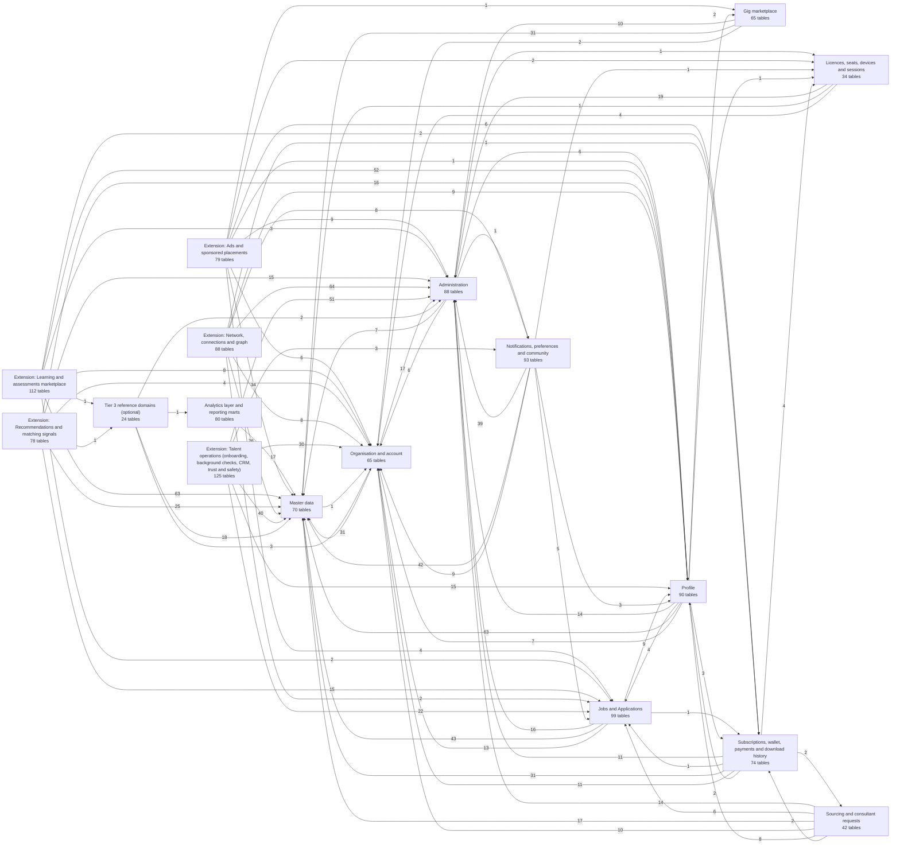

# Module map

High-level dependency map. An arrow `A --> B (n)` means A has n foreign keys pointing into tables owned by B.

| Module | Owner | Tables | Lookups | Detailed ER |
|---|---|---|---|---|
| Master data | Team | 70 | 42 | [master_data.md](master_data.md) |
| Profile | Team | 90 | 38 | [profile.md](profile.md) |
| Jobs and Applications | Team | 99 | 42 | [jobs_applications.md](jobs_applications.md) |
| Administration | Member A | 88 | 42 | [administration.md](administration.md) |
| Organisation and account | Member B | 65 | 27 | [organisation_account.md](organisation_account.md) |
| Gig marketplace | Member C | 65 | 31 | [gig_marketplace.md](gig_marketplace.md) |
| Licences, seats, devices and sessions | Member A | 34 | 15 | [licences_devices.md](licences_devices.md) |
| Sourcing and consultant requests | Member B | 42 | 15 | [sourcing_consultant.md](sourcing_consultant.md) |
| Subscriptions, wallet, payments and download history | Member C | 74 | 35 | [subscriptions_payments.md](subscriptions_payments.md) |
| Notifications, preferences and community | Team | 93 | 28 | [notifications_community.md](notifications_community.md) |
| Analytics layer and reporting marts | Team | 80 | 5 | [analytics.md](analytics.md) |
| Tier 3 reference domains (optional) | Team | 24 | 10 | [tier3_reference.md](tier3_reference.md) |
| Extension: Network, connections and graph | Team | 88 | 36 | [ext_network.md](ext_network.md) |
| Extension: Recommendations and matching signals | Team | 78 | 32 | [ext_matching.md](ext_matching.md) |
| Extension: Ads and sponsored placements | Team | 79 | 36 | [ext_ads.md](ext_ads.md) |
| Extension: Learning and assessments marketplace | Team | 112 | 43 | [ext_learning.md](ext_learning.md) |
| Extension: Talent operations (onboarding, background checks, CRM, trust and safety) | Team | 125 | 61 | [ext_talent_ops.md](ext_talent_ops.md) |
