# ER diagram: Organisation and account

Module key `organisation_account`, owner Member B, 65 tables (27 lookups). Generated from `05_data_dictionary.xlsx` (do not edit by hand). Columns shown: primary key, foreign keys, unique/natural keys and a few business columns; see the dictionary for all columns. Edges to lookup (enumeration) tables are listed under *Lookup references* rather than drawn.

## Design notes

<!-- organisation_account.yaml -->
**Scope and entity rationale.** Module owns the tenant (`organisation`), its sites, the commercial `account` that bills one or more organisations,
account administrators, and the effective-dated recruiter mapping (the single owner of "which recruiter may act for which company"). Depth tables
beyond the five registry tables: corporate tree (`organisation_hierarchy` + `_closure` + `_change`), identity/compliance (`organisation_identifier`,
`organisation_verification`, `organisation_document`, `organisation_domain`), page content (`organisation_media/benefit/social_link/brand/career_page/
industry/department`), engagement (`organisation_follow`, reviews), data-quality (`organisation_alias`, `organisation_merge`, `organisation_tag*`), history
(`organisation_size_history`, `organisation_status_history`, `account_status_history`), commercial (`client_relationship`, `account_setting`, `account_organisation`)
and onboarding (`organisation_invitation`, `organisation_contact`, `organisation_note`).

**Recruiter mapping (BR-ORG-01..05).** Mechanism = P1 CHAIN_FK + P3. Per (recruiter, organisation) rows form a chain: `sequence_no`, `prior_recruiter_organisation_mapping_id`
(UNIQUE -> at most one successor), `prior_ended_at`, composite FK `(prior_id, recruiter_app_user_id, organisation_id, prior_ended_at) -> (id, recruiter_app_user_id,
organisation_id, effective_to)` with ON UPDATE RESTRICT (also pins recruiter/organisation to be identical along the chain), CHECK `effective_from >= prior_ended_at`,
partial unique chain head `WHERE prior_... IS NULL`, and partial unique open row `WHERE effective_to IS NULL` (P3). A predecessor must already be closed (non-NULL effective_to)
before a successor can reference it, so overlap is impossible declaratively. P4 is used only for the workflow: close + insert in one SERIALIZABLE txn after
`SELECT ... FROM organisation WHERE id=$1 FOR UPDATE`. Access predicate = `vw_recruiter_job_requirement`: job_requirement JOIN open, in-force mapping on (recruiter = current user,
organisation = requirement.organisation OR descendant when scope = with_descendants via organisation_hierarchy_closure) AND organisation active AND not in organisation_block for the candidate path.
Application roles have no direct SELECT on job_requirement for recruiter personas; they read only through the view (PRIVILEGE). Consultants use a different path (consultant openness, sourcing module).

**Hierarchy and cycles on CockroachDB (no triggers, no exclusion constraints).** `organisation_hierarchy` keeps ONE row per organisation (adjacency) with `hierarchy_level`
(0..7), `parent_level`, `root_organisation_id` and a materialised `ancestor_path`. A self composite FK `(parent_organisation_id, parent_level) -> (child_organisation_id,
hierarchy_level)` plus CHECK `hierarchy_level = parent_level + 1` means every edge goes strictly down one level, so a cycle would need a level to equal itself plus k -
unrepresentable. Re-parenting a subtree changes levels of descendants; do it in one multi-row UPDATE statement (FK is checked at statement end, ON UPDATE NO ACTION) inside a SERIALIZABLE txn;
the 8-level cap bounds the statement. `organisation_hierarchy_closure` (ancestor, descendant, depth) is derived in the same txn and gives O(1) subtree queries; a nightly job re-derives
and diffs it (JOB). Alternatives rejected: recursive-CTE-only checks (race under concurrency), triggers (D-01). Same trick is reused for `organisation_department`.

**Tax/registration identifiers (B75).** `organisation_identifier.value_encrypted` (AES-GCM envelope, key per tenant, `key_version`), `value_lookup_hash` (HMAC-SHA256 blind index, pepper in KMS),
`masked_value` (last 4). Unique `(country_id, tax_id_type_id, value_lookup_hash)` partial on live rows stops one GSTIN/EIN/VAT being claimed by two companies. Validation: the app normalises
(upper-case, strip spaces/dashes) and validates with the regex+checksum stored on master data `tax_id_type` (e.g. India GSTIN 15 chars with mod-36 check digit, PAN 10 chars `AAAAA9999A`, CIN 21 chars,
US EIN 9 digits) BEFORE hashing; the DB guards digest length. Contacts, notes, reviewer ids are Personal (access-controlled, audited, anonymised in place on erasure); vendor tokens and document refs are Sensitive.

**Verification boundary (Section 6).** Source of truth = the registry/tax vendor; we store status, identifiers used, vendor reference, `idempotency_key` (UNIQUE), checked_at, expires_at. Vendor down: row stays
`pending/unavailable` with `retry_after_at`; the organisation keeps its last verified `verification_status_id` until `expires_at`, never silently flips to verified. Every attempt is a row (audit).

**Reviews.** Mechanics only (reviewer relation, 1-5 dimensions, pros/cons, moderation, employer response, helpful votes, one live review per reviewer+company+relation, anonymity, employment-verified flag).
`organisation_rating_summary` is the live aggregate of OUR reviews; tier3_reference `company_rating_snapshot` holds dated, attributed external ratings - no overlap. Review text is Personal (D-17), encrypted at rest.

**Deviations / decisions.** (1) `account_admin` "at least one active admin" is enforced by counter + CHECK on `account.active_admin_count` maintained under FOR UPDATE (declarative twin), plus app check. (2) Follower counts are not stored
(hot-row contention); `organisation_follow` is the fact, counts come from analytics. (3) `helpful_count` is a denormalised counter updated by batch job, not per vote. (4) Hierarchy has one current row; history in `_change`.
(5) FKs to master_data tables used as lookups (verification_status, tax_id_type, document_type, address_type, visibility_level, employment_type, geo_source) are declared enum_ref; country/city/state_region/currency/language/industry/job_role/skill-like are identifier.

**Out of scope - sub-roles inside an employer organisation.** Docket excludes separate posting/interviewing/pipeline roles. Today an organisation has: account admins (account scope), mapped recruiters (all jobs of mapped
companies) and platform roles from administration. Extension path: add `organisation_member_role(id, organisation_id, app_user_id, role_code FK org_role lookup {poster, interviewer, pipeline_manager, viewer}, department id nullable FK
organisation_department, effective_from/to)` with P1/P3 non-overlap as in recruiter mapping, and extend `vw_recruiter_job_requirement` with `EXISTS member_role WHERE permission covers action`; `organisation_department` already exists to scope roles. No existing table changes.

**Competitor coverage.** LinkedIn Company Page: name, tagline, about, website, industry, size band, type, HQ + locations, founded, specialties, verified badge, page admins, followers, logo/cover, social - all covered (specialties via `organisation_industry`/tags; admin roles collapsed to account_admin by scope). Naukri/Monster employer profile: company type,
GST/CIN, recruiter list, branding/career page, perks, gallery, verified employer - covered (`organisation_career_page`, `organisation_benefit`, `organisation_media`). Glassdoor/AmbitionBox: multi-dimension reviews, pros/cons, would-recommend, employment-verified, employer replies, helpful votes, moderation - covered.
Beyond them: D&B-style parent/ultimate-parent hierarchy with ownership %, staffing client contracts with fee/margin/guarantee, identifier blind-index dedupe, merge workflow with rollback map, effective-dated mapping with chain proof. Falls short (deliberately): LinkedIn employee graph / 'people also viewed', salary data (tier3).
Research note: LinkedIn/Naukri field lists compiled from public company-page UIs and third-party extraction schemas (no official LinkedIn data-model doc is published); CockroachDB partial unique, hash-sharded and FK semantics per CockroachDB docs (hash-sharded + partial combos are tested at seed time).

## Viewer parameter for recruiter views (decision F-02)
`vw_recruiter_job_requirement` has exactly one definition (here). It exposes `viewer_app_user_id` and is read through `fn_recruiter_job_requirement(viewer UUID)` (or a prepared
statement with `viewer_app_user_id = $1`). The earlier variants used two different session variables (`talentra.app_user_id`, `app.user_id`); both were dropped because custom
session variables are not verified on the pinned CockroachDB image. The same explicit-argument mechanism is used by `vw_candidate_visible_to_user` (administration).

Language of user-entered text (finding F-06): free-text tables of this module carry a nullable `language_id` (FK `language`), NULL = unknown.

## Diagram

```mermaid
erDiagram
  account {
    UUID id PK
    STRING_40 account_code
    STRING_200 account_name
    UUID account_status_id FK
    UUID primary_organisation_id FK
    UUID account_manager_app_user_id FK
    UUID billing_currency_id FK
    UUID tax_residence_country_id FK
    UUID payment_term_id FK
    BOOL is_prepaid
    UUID billing_organisation_location_id FK
  }
  account_admin {
    UUID id PK
    UUID account_id FK
    UUID admin_app_user_id FK
    UUID account_admin_level_id FK
    BOOL is_primary_contact
    TIMESTAMPTZ effective_from
    TIMESTAMPTZ effective_to
  }
  account_organisation {
    UUID id PK
    UUID account_id FK
    UUID organisation_id FK
    BOOL is_billing_owner
    TIMESTAMPTZ effective_from UK
    TIMESTAMPTZ effective_to
    STRING_200 end_note
  }
  account_setting {
    UUID id PK
    UUID account_id FK
    UUID account_setting_key_id FK
    JSONB setting_value
    TIMESTAMPTZ effective_from
  }
  account_status_history {
    UUID id PK
    UUID account_id FK
    UUID from_account_status_id FK
    UUID to_account_status_id FK
    TIMESTAMPTZ effective_at
    STRING_300 reason
    UUID actor_app_user_id FK
  }
  client_relationship {
    UUID id PK
    UUID agency_organisation_id FK
    UUID client_organisation_id FK
    UUID client_relationship_status_id FK
    STRING_100 contract_reference
    TIMESTAMPTZ effective_from
    TIMESTAMPTZ effective_to
    UUID fee_model_id FK
    UUID payment_term_id FK
  }
  organisation {
    UUID id PK
    STRING_300 legal_name
    STRING_200 display_name
    STRING_300 legal_name_normalised
    UUID organisation_type_id FK
    UUID organisation_status_id FK
    UUID primary_industry_id FK
    UUID organisation_size_band_id FK
    UUID description_language_id FK
    UUID verification_status_id FK
    UUID visibility_level_id FK
    UUID hq_country_id FK
    UUID hq_city_id FK
  }
  organisation_alias {
    UUID id PK
    UUID organisation_id FK
    STRING_300 alias_name
    STRING_300 alias_normalised
    UUID alias_type_id FK
    UUID language_id FK
  }
  organisation_benefit {
    UUID id PK
    UUID organisation_id FK
    UUID benefit_category_id FK
    STRING_150 title
    STRING_1000 description_text
    UUID language_id FK
    INT4 display_order
  }
  organisation_brand {
    UUID id PK
    UUID organisation_id FK
    STRING_150 brand_name
    STRING_150 brand_name_normalised
    STRING_300 logo_object_ref
  }
  organisation_career_page {
    UUID id PK
    UUID organisation_id FK
    UUID organisation_brand_id FK
    STRING_120 page_slug
    STRING_253 custom_domain
    STRING_200 headline
    UUID language_id FK
  }
  organisation_contact {
    UUID id PK
    UUID organisation_id FK
    UUID contact_role_id FK
    STRING_150 contact_name
    STRING_150 job_title
    STRING_254 email
    UUID phone_country_id FK
    UUID app_user_id FK
    UUID visibility_level_id FK
  }
  organisation_department {
    UUID id PK
    UUID organisation_id FK
    UUID parent_organisation_department_id FK
    INT2 department_level UK
    INT2 parent_level FK
    UUID department_kind_id FK
    STRING_150 department_name
    STRING_30 cost_centre_code
    UUID organisation_location_id FK
    BOOL is_active
  }
  organisation_document {
    UUID id PK
    UUID organisation_id FK
    UUID document_type_id FK
    STRING_200 file_name
    STRING_500 storage_ref
    STRING_100 mime_type
    UUID verification_status_id FK
    UUID moderation_status_id FK
    UUID reviewed_by_app_user_id FK
  }
  organisation_domain {
    UUID id PK
    UUID organisation_id FK
    STRING_253 domain_name
    UUID domain_verification_method_id FK
    UUID verification_status_id FK
    STRING_100 challenge_token
    TIMESTAMPTZ verified_at
  }
  organisation_follow {
    UUID id PK
    UUID organisation_id FK
    UUID follower_app_user_id FK
    BOOL notify_new_jobs
  }
  organisation_hierarchy {
    UUID id PK
    UUID child_organisation_id FK
    UUID parent_organisation_id FK
    UUID root_organisation_id FK
    INT2 hierarchy_level UK
    INT2 parent_level FK
    UUID hierarchy_relationship_type_id FK
    DECIMAL_5_2 ownership_percent
    STRING_400 ancestor_path
    TIMESTAMPTZ effective_from
  }
  organisation_hierarchy_change {
    UUID id PK
    UUID child_organisation_id FK
    UUID from_parent_organisation_id FK
    UUID to_parent_organisation_id FK
    TIMESTAMPTZ effective_at
    STRING_300 reason
    STRING_80 change_batch_ref
  }
  organisation_hierarchy_closure {
    UUID id PK
    UUID ancestor_organisation_id FK
    UUID descendant_organisation_id FK
    INT2 depth
  }
  organisation_identifier {
    UUID id PK
    UUID organisation_id FK
    UUID country_id FK
    UUID tax_id_type_id FK
    BYTES value_encrypted
    BYTES value_lookup_hash
    STRING_32 masked_value
    UUID verification_status_id FK
  }
  organisation_industry {
    UUID id PK
    UUID organisation_id FK
    UUID industry_id FK
  }
  organisation_invitation {
    UUID id PK
    UUID organisation_id FK
    STRING_254 invited_email
    UUID invitation_status_id FK
    UUID mapping_scope_id FK
    STRING_100 token_hash UK
    UUID invited_by_app_user_id FK
    UUID invitee_app_user_id FK
    UUID recruiter_organisation_mapping_id FK
    INT2 resend_count
    TIMESTAMPTZ expires_at
  }
  organisation_location {
    UUID id PK
    UUID organisation_id FK
    STRING_120 location_label
    UUID address_type_id FK
    BOOL is_headquarters
    STRING_200 address_line1
    UUID city_id FK
    UUID state_region_id FK
    UUID country_id FK
    UUID geo_source_id FK
  }
  organisation_media {
    UUID id PK
    UUID organisation_id FK
    UUID media_type_id FK
    STRING_500 storage_ref
    STRING_100 mime_type
    STRING_64 checksum_sha256
    UUID moderation_status_id FK
  }
  organisation_merge {
    UUID id PK
    UUID survivor_organisation_id FK
    UUID merged_organisation_id FK
    UUID merge_status_id FK
    DECIMAL_5_2 match_score
    JSONB match_basis
    STRING_300 reason
    UUID approved_by_app_user_id FK
  }
  organisation_note {
    UUID id PK
    UUID organisation_id FK
    UUID note_category_id FK
    STRING body
    BOOL is_pinned
    UUID language_id FK
  }
  organisation_rating_summary {
    UUID id PK
    UUID organisation_id FK
    INT4 review_count
    DECIMAL_3_2 rating_overall_avg
    JSONB dimension_averages
  }
  organisation_review {
    UUID id PK
    UUID organisation_id FK
    UUID reviewer_app_user_id FK
    UUID reviewer_relation_id FK
    UUID employment_type_id FK
    UUID job_role_id FK
    UUID organisation_location_id FK
    INT2 rating_overall
    INT2 rating_culture
    INT2 rating_work_life
    UUID recommendation_answer_id FK
    UUID language_id FK
    UUID moderation_status_id FK
  }
  organisation_review_moderation {
    UUID id PK
    UUID organisation_review_id FK
    UUID moderation_status_id FK
    UUID moderator_app_user_id FK
    STRING_40 rule_code
    STRING_300 note
  }
  organisation_review_response {
    UUID id PK
    UUID organisation_id FK
    UUID organisation_review_id FK
    UUID responder_app_user_id FK
    STRING body
    UUID language_id FK
    UUID moderation_status_id FK
    BOOL is_published
    TIMESTAMPTZ published_at
  }
  organisation_review_vote {
    UUID id PK
    UUID organisation_review_id FK
    UUID voter_app_user_id FK
    BOOL is_helpful
  }
  organisation_size_history {
    UUID id PK
    UUID organisation_id FK
    DATE as_of_date UK
    UUID organisation_size_band_id FK
    INT4 employee_count
    UUID attribution_source_id FK
    STRING_200 source_ref
  }
  organisation_social_link {
    UUID id PK
    UUID organisation_id FK
    UUID social_platform_id FK
    STRING_500 profile_url
    STRING_100 handle
    BOOL is_verified_link
  }
  organisation_status_history {
    UUID id PK
    UUID organisation_id FK
    UUID from_organisation_status_id FK
    UUID to_organisation_status_id FK
    TIMESTAMPTZ effective_at
    STRING_300 reason
    UUID actor_app_user_id FK
  }
  organisation_tag {
    UUID id PK
    STRING_60 tag_name
    STRING_60 tag_name_normalised
    STRING_200 tag_description
  }
  organisation_tag_assignment {
    UUID id PK
    UUID organisation_id FK
    UUID organisation_tag_id FK
  }
  organisation_verification {
    UUID id PK
    UUID organisation_id FK
    UUID organisation_identifier_id FK
    UUID verification_kind_id FK
    UUID verification_status_id FK
    STRING_40 vendor_code
    STRING_120 vendor_reference
    STRING_100 idempotency_key UK
    INT2 attempt_no UK
    TIMESTAMPTZ requested_at
    UUID requested_by_app_user_id FK
  }
  recruiter_organisation_mapping {
    UUID id PK
    UUID recruiter_app_user_id FK
    UUID organisation_id FK
    UUID mapping_scope_id FK
    INT4 sequence_no UK
    UUID prior_recruiter_organisation_mapping_id FK
    TIMESTAMPTZ prior_ended_at FK
    TIMESTAMPTZ effective_from
    TIMESTAMPTZ effective_to UK
    UUID mapping_end_reason_id FK
    UUID approved_by_app_user_id FK
  }
  app_user {
    UUID id PK
  }
  city {
    UUID id PK
  }
  country {
    UUID id PK
  }
  currency {
    UUID id PK
  }
  industry {
    UUID id PK
  }
  job_role {
    UUID id PK
  }
  language {
    UUID id PK
  }
  state_region {
    UUID id PK
  }
  tax_id_type {
    UUID id PK
  }
  account ||--o{ account_admin : "account_id"
  account ||--o{ account_organisation : "account_id"
  account ||--o{ account_setting : "account_id"
  account ||--o{ account_status_history : "account_id"
  app_user |o--o{ account : "account_manager_app_user_id"
  app_user |o--o{ account_status_history : "actor_app_user_id"
  app_user |o--o{ organisation_contact : "app_user_id"
  app_user |o--o{ organisation_document : "reviewed_by_app_user_id"
  app_user |o--o{ organisation_invitation : "invitee_app_user_id"
  app_user |o--o{ organisation_merge : "approved_by_app_user_id"
  app_user |o--o{ organisation_review : "reviewer_app_user_id"
  app_user |o--o{ organisation_review_moderation : "moderator_app_user_id"
  app_user |o--o{ organisation_review_response : "responder_app_user_id"
  app_user |o--o{ organisation_status_history : "actor_app_user_id"
  app_user |o--o{ organisation_verification : "requested_by_app_user_id"
  app_user |o--o{ recruiter_organisation_mapping : "approved_by_app_user_id"
  app_user ||--o{ account_admin : "admin_app_user_id"
  app_user ||--o{ organisation_follow : "follower_app_user_id"
  app_user ||--o{ organisation_invitation : "invited_by_app_user_id"
  app_user ||--o{ organisation_review_vote : "voter_app_user_id"
  app_user ||--o{ recruiter_organisation_mapping : "recruiter_app_user_id"
  city |o--o{ organisation : "hq_city_id"
  city ||--o{ organisation_location : "city_id"
  country |o--o{ organisation : "hq_country_id"
  country |o--o{ organisation_contact : "phone_country_id"
  country ||--o{ account : "tax_residence_country_id"
  country ||--o{ organisation_identifier : "country_id"
  country ||--o{ organisation_location : "country_id"
  currency ||--o{ account : "billing_currency_id"
  industry |o--o{ organisation : "primary_industry_id"
  industry ||--o{ organisation_industry : "industry_id"
  job_role |o--o{ organisation_review : "job_role_id"
  language |o--o{ organisation : "description_language_id"
  language |o--o{ organisation_alias : "language_id"
  language |o--o{ organisation_benefit : "language_id"
  language |o--o{ organisation_career_page : "language_id"
  language |o--o{ organisation_note : "language_id"
  language |o--o{ organisation_review : "language_id"
  language |o--o{ organisation_review_response : "language_id"
  organisation |o--o{ account : "primary_organisation_id"
  organisation |o--o{ organisation_hierarchy : "parent_organisation_id"
  organisation |o--o{ organisation_hierarchy_change : "from_parent_organisation_id"
  organisation |o--o{ organisation_hierarchy_change : "to_parent_organisation_id"
  organisation ||--o{ account_organisation : "organisation_id"
  organisation ||--o{ client_relationship : "agency_organisation_id"
  organisation ||--o{ client_relationship : "client_organisation_id"
  organisation ||--o{ organisation_alias : "organisation_id"
  organisation ||--o{ organisation_benefit : "organisation_id"
  organisation ||--o{ organisation_brand : "organisation_id"
  organisation ||--o{ organisation_career_page : "organisation_id"
  organisation ||--o{ organisation_contact : "organisation_id"
  organisation ||--o{ organisation_department : "organisation_id"
  organisation ||--o{ organisation_document : "organisation_id"
  organisation ||--o{ organisation_domain : "organisation_id"
  organisation ||--o{ organisation_follow : "organisation_id"
  organisation ||--o{ organisation_hierarchy : "root_organisation_id"
  organisation ||--o{ organisation_hierarchy_change : "child_organisation_id"
  organisation ||--o{ organisation_hierarchy_closure : "ancestor_organisation_id"
  organisation ||--o{ organisation_hierarchy_closure : "descendant_organisation_id"
  organisation ||--o{ organisation_identifier : "organisation_id"
  organisation ||--o{ organisation_industry : "organisation_id"
  organisation ||--o{ organisation_invitation : "organisation_id"
  organisation ||--o{ organisation_location : "organisation_id"
  organisation ||--o{ organisation_media : "organisation_id"
  organisation ||--o{ organisation_merge : "merged_organisation_id"
  organisation ||--o{ organisation_merge : "survivor_organisation_id"
  organisation ||--o{ organisation_note : "organisation_id"
  organisation ||--o{ organisation_review : "organisation_id"
  organisation ||--o{ organisation_review_response : "organisation_id"
  organisation ||--o{ organisation_size_history : "organisation_id"
  organisation ||--o{ organisation_social_link : "organisation_id"
  organisation ||--o{ organisation_status_history : "organisation_id"
  organisation ||--o{ organisation_tag_assignment : "organisation_id"
  organisation ||--o{ organisation_verification : "organisation_id"
  organisation ||--o{ recruiter_organisation_mapping : "organisation_id"
  organisation ||--o| organisation_hierarchy : "child_organisation_id"
  organisation ||--o| organisation_rating_summary : "organisation_id"
  organisation_brand ||--o{ organisation_career_page : "organisation_id"
  organisation_department ||--o{ organisation_department : "organisation_id"
  organisation_hierarchy |o--o{ organisation_hierarchy : "parent_organisation_id"
  organisation_identifier |o--o{ organisation_verification : "organisation_identifier_id"
  organisation_location |o--o{ account : "billing_organisation_location_id"
  organisation_location ||--o{ organisation_department : "organisation_id"
  organisation_location ||--o{ organisation_review : "organisation_id"
  organisation_review ||--o{ organisation_review_moderation : "organisation_review_id"
  organisation_review ||--o{ organisation_review_response : "organisation_id"
  organisation_review ||--o{ organisation_review_vote : "organisation_review_id"
  organisation_tag ||--o{ organisation_tag_assignment : "organisation_tag_id"
  recruiter_organisation_mapping |o--o{ organisation_invitation : "recruiter_organisation_mapping_id"
  recruiter_organisation_mapping |o--o{ recruiter_organisation_mapping : "prior_recruiter_organisation_mapping_id"
  state_region |o--o{ organisation_location : "state_region_id"
  tax_id_type ||--o{ organisation_identifier : "tax_id_type_id"
```

## Lookup tables in this module

| Lookup | Values | Description |
|---|---|---|
| `account_admin_level` | 4 | Responsibility level of an account administrator (account-level only; not an employer sub-role). |
| `account_setting_key` | 6 | Registry of permitted account settings (keys are never free text). |
| `account_status` | 5 | Commercial status of an account. |
| `alias_type` | 6 | Type of alternate organisation name. |
| `attribution_source` | 5 | Provenance of a factual data point about an organisation. |
| `benefit_category` | 8 | Category of a benefit, perk or culture highlight. |
| `client_relationship_status` | 4 | State of an agency-client relationship. |
| `contact_role` | 6 | Role of an organisation contact person. |
| `department_kind` | 4 | Kind of internal organisation unit. |
| `domain_verification_method` | 4 | How domain ownership is proven. |
| `fee_model` | 4 | Commercial model between an agency and its client. |
| `hierarchy_relationship_type` | 6 | How a child organisation relates to its parent (D&B-style linkage). |
| `invitation_status` | 4 | State of a recruiter invitation. |
| `mapping_end_reason` | 6 | Why a recruiter mapping was ended. |
| `mapping_scope` | 2 | Reach of a recruiter mapping on the organisation tree. |
| `media_type` | 9 | Type of company media asset. |
| `merge_status` | 5 | Workflow state of an organisation merge. |
| `moderation_status` | 5 | Moderation state of user-generated content (reviews, responses, media). |
| `note_category` | 5 | Category of an internal staff note. |
| `organisation_size_band` | 9 | Employee-count band shown on the company page (LinkedIn-style bands). |
| `organisation_status` | 6 | Lifecycle status of an organisation record. |
| `organisation_type` | 8 | Kind of organisation on the platform (docket: employer, client, consultancy, TPO/college). |
| `payment_term` | 7 | Credit / payment terms offered on an account or client contract. |
| `recommendation_answer` | 3 | Would-recommend answer on a review (three-valued, never a sentinel). |
| `reviewer_relation` | 5 | Relationship of a reviewer to the company. |
| `social_platform` | 8 | Social platforms for company links. |
| `verification_kind` | 5 | What an organisation verification checks. |

## Lookup references (enumeration FKs)

| Table | Lookup tables referenced |
|---|---|
| `account` | `account_status`, `payment_term` |
| `account_admin` | `account_admin_level` |
| `account_setting` | `account_setting_key` |
| `account_status_history` | `account_status` |
| `client_relationship` | `client_relationship_status`, `fee_model`, `payment_term` |
| `organisation` | `organisation_size_band`, `organisation_status`, `organisation_type`, `verification_status`, `visibility_level` |
| `organisation_alias` | `alias_type` |
| `organisation_benefit` | `benefit_category` |
| `organisation_contact` | `contact_role`, `visibility_level` |
| `organisation_department` | `department_kind` |
| `organisation_document` | `document_type`, `moderation_status`, `verification_status` |
| `organisation_domain` | `domain_verification_method`, `verification_status` |
| `organisation_hierarchy` | `hierarchy_relationship_type` |
| `organisation_identifier` | `verification_status` |
| `organisation_invitation` | `invitation_status`, `mapping_scope` |
| `organisation_location` | `address_type`, `geo_source` |
| `organisation_media` | `media_type`, `moderation_status` |
| `organisation_merge` | `merge_status` |
| `organisation_note` | `note_category` |
| `organisation_review` | `employment_type`, `moderation_status`, `recommendation_answer`, `reviewer_relation` |
| `organisation_review_moderation` | `moderation_status` |
| `organisation_review_response` | `moderation_status` |
| `organisation_size_history` | `attribution_source`, `organisation_size_band` |
| `organisation_social_link` | `social_platform` |
| `organisation_status_history` | `organisation_status` |
| `organisation_verification` | `verification_kind`, `verification_status` |
| `recruiter_organisation_mapping` | `mapping_end_reason`, `mapping_scope` |

## Tables

| Table | Kind | Delete | Volume | Description |
|---|---|---|---|---|
| `account` | entity | soft | medium | Billing/commercial account that groups one or more organisations: status, account manager, currency, tax residence, credit terms. |
| `account_admin` | link | hard | low | Effective-dated assignment of platform users as administrators of an account (Account Admin actor). At least one active admin is guaranteed. |
| `account_organisation` | link | hard | medium | Effective-dated link: which account bills which organisation. One open row per organisation. |
| `account_setting` | config | soft | low | Per-account configuration values keyed by the account_setting_key registry (typed JSON value). |
| `account_status_history` | audit | append_only | medium | Append-only account status transitions (activation, hold, suspension, closure). |
| `client_relationship` | entity | soft | medium | Staffing agency/consultancy -> client company relationship with contract dates and commercial terms. Gates which client jobs an agency's recruiters may post for (together with recruiter mapping). |
| `organisation` | entity | soft | medium | Employer / client / consultancy / college organisation (the tenant, D-11). Company-page core: names, type, industry, size band, website, description, verification, HQ. |
| `organisation_alias` | entity | soft | medium | Alternate names (former, trade, abbreviation, transliteration, merged duplicate) for matching job postings and imports to the right organisation. |
| `organisation_benefit` | entity | soft | medium | Benefits, perks and culture highlights listed on the company page (Naukri/AmbitionBox 'perks' coverage). |
| `organisation_brand` | entity | soft | low | Brands/employer brands under one organisation (a consultancy hiring under a client brand, a group with several brands). |
| `organisation_career_page` | entity | soft | low | Branded careers microsite configuration (slug, custom domain, headline, theme, SEO). |
| `organisation_contact` | entity | soft | medium | Named business contacts of an organisation (HR head, billing, legal). Personal data of company staff; not platform users unless linked. |
| `organisation_department` | entity | soft | medium | Internal departments/teams/business units (hiring-manager targeting, job requirement owner). Tree acyclicity uses the same level-chain FK trick as the organisation tree. Not an access-control construct. |
| `organisation_document` | entity | soft | medium | KYC / compliance document references (certificate of incorporation, GST certificate, authorisation letter). The database stores the object reference and review state only. |
| `organisation_domain` | entity | soft | low | Verified email domains of an organisation; used for auto-association of staff, anti-impersonation and reviewer employment verification. |
| `organisation_follow` | link | hard | very_high | Candidate/user follows a company page (LinkedIn 'follow'); drives job-alert fan-out. Follower counts are computed in analytics, not a hot counter. |
| `organisation_hierarchy` | entity | hard | medium | Adjacency + materialised path + level for the corporate tree (subsidiary/division/branch). Exactly one row per organisation (roots have no parent). Cycles are impossible: child level = parent level + 1 enforced by a self composite FK. |
| `organisation_hierarchy_change` | event | append_only | low | Append-only log of re-parenting events (who moved which organisation from which parent to which). |
| `organisation_hierarchy_closure` | bridge | hard | high | Closure (ancestor, descendant, depth) of organisation_hierarchy for O(1) subtree/ancestor queries and for recruiter mapping scope with_descendants. Written in the same txn as the edge. |
| `organisation_identifier` | entity | soft | medium | Tax and registration identifiers (GSTIN, PAN, CIN, EIN, VAT...) by country and type. Stored as ciphertext + HMAC blind index + masked display; never in clear. |
| `organisation_industry` | link | hard | medium | Secondary industries of an organisation (primary stays on organisation.primary_industry_id). |
| `organisation_invitation` | entity | hard | medium | Invitation for a recruiter to join an organisation; acceptance creates a recruiter_organisation_mapping row (P1/P3). |
| `organisation_location` | entity | soft | medium | Office / site / campus of an organisation with structured address, optional coordinates and a single headquarters flag. |
| `organisation_media` | entity | soft | medium | Logo, cover and gallery assets of the company page (object references only). |
| `organisation_merge` | entity | hard | low | Duplicate-organisation merge workflow: survivor absorbs merged; a job re-points children (jobs, mappings, accounts) and writes aliases; reversible via stored re-point map. |
| `organisation_note` | entity | soft | medium | Internal (staff-only) notes about an organisation: sales, compliance, risk. Never visible to the organisation. |
| `organisation_rating_summary` | snapshot | hard | medium | Current aggregate of this platform's own published reviews per company (count, averages, recommend ratio). Distinct from tier3_reference company_rating_snapshot (external, dated, attributed benchmarks). |
| `organisation_review` | entity | soft | high | User-generated company review (Glassdoor/AmbitionBox style): overall + dimension ratings, pros/cons, relationship to company, moderation lifecycle. Reference benchmarks/ratings from external providers live in tier3_reference. |
| `organisation_review_moderation` | audit | append_only | high | Append-only moderation trail for reviews (automated rule hit, user report, moderator decision). |
| `organisation_review_response` | entity | soft | medium | Employer's public reply to a review (one per review); moderated like the review. |
| `organisation_review_vote` | link | hard | very_high | Helpful / not helpful vote on a review (one per user). |
| `organisation_size_history` | snapshot | append_only | low | Dated employee-count observations with source attribution (company growth trend; Section 6 attribution rule). |
| `organisation_social_link` | entity | soft | low | Outbound links to the organisation's social profiles (links only, Section 6). |
| `organisation_status_history` | audit | append_only | medium | Append-only status transitions of an organisation (suspension, closure, merge) written in the same txn as the change. |
| `organisation_tag` | entity | soft | low | Staff-defined free label (e.g. 'strategic', 'fraud-watch') for segmentation of organisations; not an enumeration used by business logic. |
| `organisation_tag_assignment` | link | hard | medium | Tag applied to an organisation. |
| `organisation_verification` | event | hard | medium | Company registration & tax verification boundary (docket Section 6): one row per request/attempt to the external vendor with idempotency key, vendor reference, outcome and expiry. Vendor owns truth; we store status + identifiers used. |
| `recruiter_organisation_mapping` | link | hard | medium | OWNING TABLE for mapped recruiters. Effective-dated recruiter -> organisation mapping; non-overlap guaranteed by P1 chain FK + P3 single open row. Grants recruiter access to the organisation's job requirements via vw_recruiter_job_requirement. |
| `account_admin_level` | lookup | hard | low | Responsibility level of an account administrator (account-level only; not an employer sub-role). |
| `account_setting_key` | lookup | hard | low | Registry of permitted account settings (keys are never free text). |
| `account_status` | lookup | hard | low | Commercial status of an account. |
| `alias_type` | lookup | hard | low | Type of alternate organisation name. |
| `attribution_source` | lookup | hard | low | Provenance of a factual data point about an organisation. |
| `benefit_category` | lookup | hard | low | Category of a benefit, perk or culture highlight. |
| `client_relationship_status` | lookup | hard | low | State of an agency-client relationship. |
| `contact_role` | lookup | hard | low | Role of an organisation contact person. |
| `department_kind` | lookup | hard | low | Kind of internal organisation unit. |
| `domain_verification_method` | lookup | hard | low | How domain ownership is proven. |
| `fee_model` | lookup | hard | low | Commercial model between an agency and its client. |
| `hierarchy_relationship_type` | lookup | hard | low | How a child organisation relates to its parent (D&B-style linkage). |
| `invitation_status` | lookup | hard | low | State of a recruiter invitation. |
| `mapping_end_reason` | lookup | hard | low | Why a recruiter mapping was ended. |
| `mapping_scope` | lookup | hard | low | Reach of a recruiter mapping on the organisation tree. |
| `media_type` | lookup | hard | low | Type of company media asset. |
| `merge_status` | lookup | hard | low | Workflow state of an organisation merge. |
| `moderation_status` | lookup | hard | low | Moderation state of user-generated content (reviews, responses, media). |
| `note_category` | lookup | hard | low | Category of an internal staff note. |
| `organisation_size_band` | lookup | hard | low | Employee-count band shown on the company page (LinkedIn-style bands). |
| `organisation_status` | lookup | hard | low | Lifecycle status of an organisation record. |
| `organisation_type` | lookup | hard | low | Kind of organisation on the platform (docket: employer, client, consultancy, TPO/college). |
| `payment_term` | lookup | hard | low | Credit / payment terms offered on an account or client contract. |
| `recommendation_answer` | lookup | hard | low | Would-recommend answer on a review (three-valued, never a sentinel). |
| `reviewer_relation` | lookup | hard | low | Relationship of a reviewer to the company. |
| `social_platform` | lookup | hard | low | Social platforms for company links. |
| `verification_kind` | lookup | hard | low | What an organisation verification checks. |
