# ER diagram: Sourcing and consultant requests

Module key `sourcing_consultant`, owner Member B, 42 tables (15 lookups). Generated from `05_data_dictionary.xlsx` (do not edit by hand). Columns shown: primary key, foreign keys, unique/natural keys and a few business columns; see the dictionary for all columns. Edges to lookup (enumeration) tables are listed under *Lookup references* rather than drawn.

## Design notes

<!-- sourcing_consultant.yaml -->

**Scope.** Consultant (freelance recruiter) workflow and recruiter-side sourcing tooling: openness of jobs to consultants, sourcing requests and decisions, candidate sourcing shortlists/submissions, commission, bulk outreach (batches, recipients, templates, messages, replies, credit usage), saved searches, talent pools, notes/tags/ratings and contact tracking. Depth modelled on LinkedIn Recruiter (projects, saved searches with alerts, InMail credits with reply refund, notes/tags, templates), Naukri RESDEX (search history, mailers/bulk email credits, folders) and Monster (talent pools).

**Rule: a consultant may act only on requirements open to consultants (docket section 3).** Mechanism (no cross-table CHECK exists in CRDB):
1. `consultant_job_openness` rows exist only while a requirement is open. They are created by a txn that first runs `SELECT is_open_to_consultants FROM job_requirement WHERE id=$1 FOR UPDATE` and aborts when false; closing the flag (jobs module txn) must set `closed_at` on all openness rows and move live `sourcing_request` rows to `closed` in the same txn (BR-SRC-02).
2. `sourcing_request` carries `consultant_job_openness_id` and the composite FK `(job_requirement_id, consultant_job_openness_id) -> consultant_job_openness(job_requirement_id, id)`, so a request can only reference an openness row of its own requirement; CHECK/partial unique (`uq_sourcing_request_job_requirement_id_consultant_profile_id` live) allows one live request per consultant per requirement.
3. The consultant identity is bound by composite FK `(consultant_profile_id, consultant_app_user_id) -> consultant_profile(id, app_user_id)`.
4. Every consultant-facing child (shortlist, submission, outreach_batch with `is_consultant_sender`) requires a live `sourcing_request` (CHECK `ck_outreach_batch_consultant_needs_request`), and the access layer (RLS-style views `vw_consultant_open_requirement`) filters by `closed_at IS NULL AND valid window`.
Residual risk: the openness-row-exists-iff-flag-true link is transactional/app-enforced (documented in BR-SRC-02); an optional hardening is a trigger or CRDB row-level policy.

**Blocks.** Candidate blocks (administration `user_block`, `organisation_block`) bind outreach: recipients are inserted only through `INSERT ... SELECT ... WHERE NOT EXISTS (blocks)`; excluded candidates are logged in `outreach_exclusion`; the dispatcher re-checks before send (BR-SRC-06); `candidate_contact_attempt` records suppressed contacts. Recruiters cannot register candidates: no table here creates candidate_profile; outreach_recipient only references existing profiles.

**Money and credits.** Commission/fees use DECIMAL(18,4) + currency_id. Outreach credits are integers; the wallet and ledger live in subscriptions_payments: `outreach_credit_usage.wallet_ledger_entry_id` is a nullable FK (NULL while a free-quota use or before the ledger posting). Credit lifecycle reserve -> consume -> refund-on-reply (LinkedIn InMail style; refund window documented by vendors varies, 7-90 days, so it is a configurable job parameter, not hard-coded).

**Volume decisions.** `outreach_recipient`, `outreach_message`, `candidate_search_history`, `candidate_contact_attempt` are high/very_high with hash-sharded time indexes. `outreach_message` bodies are retained 90 days (TTL; integration boundary: message bodies only as long as audit needs); `outreach_reply` bodies 180 days; `candidate_search_history` 24 months. Search itself is an integration boundary (D-16): `saved_search.filters` JSONB (inverted index) feeds the search service; this module stores the query log, not results.

**Deviations / extension.** Sub-roles in an employer organisation are out of scope; a future `organisation_member_role` can gate `talent_pool`/`outreach_batch` actions. Commission is entity-level (status updates) with ledger posting in the subscriptions module; `invoice_id` is nullable until invoicing exists. Registry tables relied on: job_requirement, job_shortlist, candidate_profile, app_user, organisation, notification_channel, currency, language, job_category, skill, country, verification_status, visibility_level, wallet_ledger_entry, invoice, user_consent, job_application, audit_event.

## Diagram

```mermaid
erDiagram
  candidate_contact_attempt {
    UUID id PK
    UUID candidate_profile_id FK
    UUID contacter_app_user_id FK
    UUID organisation_id FK
    UUID notification_channel_id FK
    UUID contact_attempt_outcome_id FK
    UUID outreach_recipient_id FK
    UUID sourcing_request_id FK
    TIMESTAMPTZ block_checked_at
    TIMESTAMPTZ attempted_at
  }
  candidate_note {
    UUID id PK
    UUID candidate_profile_id FK
    UUID author_app_user_id FK
    UUID organisation_id FK
    STRING_4000 note_text
    BOOL is_shared_with_organisation
  }
  candidate_rating {
    UUID id PK
    UUID candidate_profile_id FK
    UUID rater_app_user_id FK
    UUID job_requirement_id FK
    INT4 rating_score
  }
  candidate_search_history {
    UUID id PK
    UUID searcher_app_user_id FK
    UUID organisation_id FK
    UUID saved_search_id FK
    STRING_500 query_text
    JSONB filters
    INT4 result_count
  }
  candidate_tag {
    UUID id PK
    UUID organisation_id FK
    STRING_60 tag_label
    STRING_60 tag_label_normalised
  }
  candidate_tag_assignment {
    UUID id PK
    UUID candidate_tag_id FK
    UUID candidate_profile_id FK
    UUID assigned_by_app_user_id FK
    TIMESTAMPTZ assigned_at
  }
  consultant_desk {
    UUID id PK
    UUID consultant_profile_id FK
    STRING_120 desk_name
    UUID country_id FK
    UUID job_category_id FK
  }
  consultant_job_openness {
    UUID id PK
    UUID job_requirement_id FK
    UUID organisation_id FK
    UUID consultant_profile_id FK
    UUID opened_by_app_user_id FK
    TIMESTAMPTZ valid_from
    TIMESTAMPTZ valid_to
    TIMESTAMPTZ closed_at
    UUID currency_id FK
  }
  consultant_profile {
    UUID id PK
    UUID app_user_id FK
    UUID organisation_id FK
    STRING_150 display_name
    STRING_200 headline
    INT4 years_experience
    UUID commission_model_id FK
    UUID currency_id FK
    UUID verification_status_id FK
  }
  consultant_rating {
    UUID id PK
    UUID consultant_profile_id FK
    UUID sourcing_request_id FK
    UUID rated_by_app_user_id FK
    INT4 score
    STRING_1000 review_text
  }
  consultant_specialisation {
    UUID id PK
    UUID consultant_profile_id FK
    UUID job_category_id FK
    UUID industry_id FK
    INT4 years_in_domain
  }
  outreach_batch {
    UUID id PK
    UUID sender_app_user_id FK
    UUID organisation_id FK
    UUID sourcing_request_id FK
    UUID job_requirement_id FK
    BOOL is_consultant_sender
    UUID notification_channel_id FK
    UUID outreach_template_id FK
    UUID outreach_batch_status_id FK
    JSONB audience_filter
    INT4 credits_per_recipient
  }
  outreach_credit_usage {
    UUID id PK
    UUID outreach_batch_id FK
    UUID outreach_recipient_id FK
    UUID outreach_credit_event_id FK
    INT4 credits
    UUID wallet_ledger_entry_id FK
    STRING_80 idempotency_key UK
    TIMESTAMPTZ occurred_at
  }
  outreach_exclusion {
    UUID id PK
    UUID outreach_batch_id FK
    UUID candidate_profile_id FK
    UUID outreach_exclusion_reason_id FK
    TIMESTAMPTZ excluded_at
  }
  outreach_message {
    UUID id PK
    UUID outreach_recipient_id FK
    UUID language_id FK
    STRING_250 subject_text
    STRING_4000 body_text
    TIMESTAMPTZ rendered_at
  }
  outreach_recipient {
    UUID id PK
    UUID outreach_batch_id FK
    UUID candidate_profile_id FK
    UUID outreach_delivery_status_id FK
    STRING_128 provider_message_ref
    TIMESTAMPTZ queued_at
    TIMESTAMPTZ sent_at
  }
  outreach_reply {
    UUID id PK
    UUID outreach_recipient_id FK
    UUID notification_channel_id FK
    UUID reply_intent_id FK
    STRING_2000 body_text
    BOOL is_auto_reply
    TIMESTAMPTZ received_at
  }
  outreach_template {
    UUID id PK
    UUID owner_app_user_id FK
    UUID organisation_id FK
    STRING_120 template_name
    UUID notification_channel_id FK
    UUID default_language_id FK
    UUID outreach_template_status_id FK
    BOOL is_system_template
  }
  outreach_template_translation {
    UUID id PK
    UUID outreach_template_id FK
    UUID language_id FK
    STRING_250 subject_text
    STRING_4000 body_text
  }
  saved_search {
    UUID id PK
    UUID owner_app_user_id FK
    UUID organisation_id FK
    STRING_120 search_name
    JSONB filters
    UUID saved_search_frequency_id FK
    UUID notification_channel_id FK
    TIMESTAMPTZ last_run_at
  }
  saved_search_run {
    UUID id PK
    UUID saved_search_id FK
    TIMESTAMPTZ ran_at
    INT4 result_count
    INT4 new_result_count
  }
  sourcing_commission {
    UUID id PK
    UUID sourcing_request_id FK
    UUID sourcing_submission_id FK
    UUID commission_model_id FK
    UUID commission_status_id FK
    DECIMAL_18_4 base_amount
    DECIMAL_5_2 commission_percentage
    DECIMAL_18_4 commission_amount
    UUID currency_id FK
    UUID invoice_id FK
  }
  sourcing_request {
    UUID id PK
    UUID job_requirement_id FK
    UUID consultant_job_openness_id FK
    UUID organisation_id FK
    UUID requested_by_app_user_id FK
    UUID consultant_profile_id FK
    UUID consultant_app_user_id FK
    UUID sourcing_request_status_id FK
    INT4 positions_to_fill
    UUID commission_model_id FK
    DECIMAL_5_2 fee_commission_percentage
    DECIMAL_18_4 fee_fixed_amount
    UUID currency_id FK
  }
  sourcing_request_decision {
    UUID id PK
    UUID sourcing_request_id FK
    UUID decision_party_id FK
    UUID sourcing_decision_type_id FK
    UUID sourcing_decision_reason_id FK
    UUID decided_by_app_user_id FK
    DECIMAL_5_2 counter_commission_percentage
    STRING_1000 decision_comment
    TIMESTAMPTZ decided_at
  }
  sourcing_shortlist {
    UUID id PK
    UUID sourcing_request_id FK
    UUID job_shortlist_id FK
    STRING_150 title
    TIMESTAMPTZ submitted_at
  }
  sourcing_shortlist_item {
    UUID id PK
    UUID sourcing_shortlist_id FK
    UUID candidate_profile_id FK
    INT4 sort_position
    STRING_1000 consultant_note
    TIMESTAMPTZ added_at
  }
  sourcing_submission {
    UUID id PK
    UUID sourcing_request_id FK
    UUID sourcing_shortlist_item_id FK
    UUID candidate_profile_id FK
    UUID user_consent_id FK
    UUID submission_status_id FK
    UUID job_application_id FK
    TIMESTAMPTZ submitted_at
    TIMESTAMPTZ employer_responded_at
    STRING_2000 cover_note
  }
  app_user {
    UUID id PK
  }
  candidate_profile {
    UUID id PK
  }
  country {
    UUID id PK
  }
  currency {
    UUID id PK
  }
  industry {
    UUID id PK
  }
  invoice {
    UUID id PK
  }
  job_application {
    UUID id PK
  }
  job_category {
    UUID id PK
  }
  job_requirement {
    UUID id PK
  }
  job_shortlist {
    UUID id PK
  }
  language {
    UUID id PK
  }
  organisation {
    UUID id PK
  }
  user_consent {
    UUID id PK
  }
  wallet_ledger_entry {
    UUID id PK
  }
  app_user ||--o{ candidate_contact_attempt : "contacter_app_user_id"
  app_user ||--o{ candidate_note : "author_app_user_id"
  app_user ||--o{ candidate_rating : "rater_app_user_id"
  app_user ||--o{ candidate_search_history : "searcher_app_user_id"
  app_user ||--o{ candidate_tag_assignment : "assigned_by_app_user_id"
  app_user ||--o{ consultant_job_openness : "opened_by_app_user_id"
  app_user ||--o{ consultant_profile : "app_user_id"
  app_user ||--o{ consultant_rating : "rated_by_app_user_id"
  app_user ||--o{ outreach_batch : "sender_app_user_id"
  app_user ||--o{ outreach_template : "owner_app_user_id"
  app_user ||--o{ saved_search : "owner_app_user_id"
  app_user ||--o{ sourcing_request : "requested_by_app_user_id"
  app_user ||--o{ sourcing_request_decision : "decided_by_app_user_id"
  candidate_profile ||--o{ candidate_contact_attempt : "candidate_profile_id"
  candidate_profile ||--o{ candidate_note : "candidate_profile_id"
  candidate_profile ||--o{ candidate_rating : "candidate_profile_id"
  candidate_profile ||--o{ candidate_tag_assignment : "candidate_profile_id"
  candidate_profile ||--o{ outreach_exclusion : "candidate_profile_id"
  candidate_profile ||--o{ outreach_recipient : "candidate_profile_id"
  candidate_profile ||--o{ sourcing_shortlist_item : "candidate_profile_id"
  candidate_profile ||--o{ sourcing_submission : "candidate_profile_id"
  candidate_tag ||--o{ candidate_tag_assignment : "candidate_tag_id"
  consultant_job_openness ||--o{ sourcing_request : "job_requirement_id"
  consultant_profile |o--o{ consultant_job_openness : "consultant_profile_id"
  consultant_profile ||--o{ consultant_desk : "consultant_profile_id"
  consultant_profile ||--o{ consultant_rating : "consultant_profile_id"
  consultant_profile ||--o{ consultant_specialisation : "consultant_profile_id"
  consultant_profile ||--o{ sourcing_request : "consultant_profile_id"
  country ||--o{ consultant_desk : "country_id"
  currency ||--o{ consultant_job_openness : "currency_id"
  currency ||--o{ consultant_profile : "currency_id"
  currency ||--o{ sourcing_commission : "currency_id"
  currency ||--o{ sourcing_request : "currency_id"
  industry |o--o{ consultant_specialisation : "industry_id"
  invoice |o--o{ sourcing_commission : "invoice_id"
  job_application |o--o{ sourcing_submission : "job_application_id"
  job_category |o--o{ consultant_desk : "job_category_id"
  job_category ||--o{ consultant_specialisation : "job_category_id"
  job_requirement |o--o{ candidate_rating : "job_requirement_id"
  job_requirement |o--o{ outreach_batch : "job_requirement_id"
  job_requirement ||--o{ consultant_job_openness : "job_requirement_id"
  job_requirement ||--o{ sourcing_request : "job_requirement_id"
  job_shortlist ||--o{ sourcing_shortlist : "job_shortlist_id"
  language ||--o{ outreach_message : "language_id"
  language ||--o{ outreach_template : "default_language_id"
  language ||--o{ outreach_template_translation : "language_id"
  organisation |o--o{ candidate_contact_attempt : "organisation_id"
  organisation |o--o{ candidate_note : "organisation_id"
  organisation |o--o{ candidate_search_history : "organisation_id"
  organisation |o--o{ consultant_profile : "organisation_id"
  organisation |o--o{ outreach_batch : "organisation_id"
  organisation |o--o{ outreach_template : "organisation_id"
  organisation |o--o{ saved_search : "organisation_id"
  organisation ||--o{ candidate_tag : "organisation_id"
  organisation ||--o{ consultant_job_openness : "organisation_id"
  organisation ||--o{ sourcing_request : "organisation_id"
  outreach_batch ||--o{ outreach_credit_usage : "outreach_batch_id"
  outreach_batch ||--o{ outreach_exclusion : "outreach_batch_id"
  outreach_batch ||--o{ outreach_recipient : "outreach_batch_id"
  outreach_recipient |o--o{ candidate_contact_attempt : "outreach_recipient_id"
  outreach_recipient |o--o{ outreach_credit_usage : "outreach_recipient_id"
  outreach_recipient ||--o{ outreach_reply : "outreach_recipient_id"
  outreach_recipient ||--o| outreach_message : "outreach_recipient_id"
  outreach_template ||--o{ outreach_batch : "outreach_template_id"
  outreach_template ||--o{ outreach_template_translation : "outreach_template_id"
  saved_search |o--o{ candidate_search_history : "saved_search_id"
  saved_search ||--o{ saved_search_run : "saved_search_id"
  sourcing_request |o--o{ candidate_contact_attempt : "sourcing_request_id"
  sourcing_request |o--o{ outreach_batch : "sourcing_request_id"
  sourcing_request ||--o{ consultant_rating : "sourcing_request_id"
  sourcing_request ||--o{ sourcing_commission : "sourcing_request_id"
  sourcing_request ||--o{ sourcing_request_decision : "sourcing_request_id"
  sourcing_request ||--o{ sourcing_shortlist : "sourcing_request_id"
  sourcing_request ||--o{ sourcing_submission : "sourcing_request_id"
  sourcing_shortlist ||--o{ sourcing_shortlist_item : "sourcing_shortlist_id"
  sourcing_shortlist_item ||--o{ sourcing_submission : "sourcing_shortlist_item_id"
  sourcing_submission ||--o{ sourcing_commission : "sourcing_submission_id"
  user_consent ||--o{ sourcing_submission : "user_consent_id"
  wallet_ledger_entry |o--o{ outreach_credit_usage : "wallet_ledger_entry_id"
```

## Lookup tables in this module

| Lookup | Values | Description |
|---|---|---|
| `commission_model` | 4 | How a consultant is paid. |
| `commission_status` | 5 | State of a commission/placement fee. |
| `contact_attempt_outcome` | 5 | Outcome of a contact attempt on a candidate. |
| `decision_party` | 2 | Party that took a decision on a sourcing request. |
| `outreach_batch_status` | 6 | State of a bulk outreach batch. |
| `outreach_credit_event` | 4 | Credit movement kind for outreach. |
| `outreach_delivery_status` | 8 | Delivery state of one outreach recipient. |
| `outreach_exclusion_reason` | 6 | Why a candidate was excluded from a batch. |
| `outreach_template_status` | 3 | Template state. |
| `reply_intent` | 5 | Classified intent of a reply. |
| `saved_search_frequency` | 4 | Alert frequency of a saved search. |
| `sourcing_decision_reason` | 7 | Reason for a decline/withdrawal. |
| `sourcing_decision_type` | 4 | Type of decision. |
| `sourcing_request_status` | 8 | Lifecycle of a sourcing request. |
| `submission_status` | 6 | State of a consultant submission to an employer. |

## Lookup references (enumeration FKs)

| Table | Lookup tables referenced |
|---|---|
| `candidate_contact_attempt` | `contact_attempt_outcome`, `notification_channel` |
| `consultant_profile` | `commission_model`, `verification_status` |
| `outreach_batch` | `notification_channel`, `outreach_batch_status` |
| `outreach_credit_usage` | `outreach_credit_event` |
| `outreach_exclusion` | `outreach_exclusion_reason` |
| `outreach_recipient` | `outreach_delivery_status` |
| `outreach_reply` | `notification_channel`, `reply_intent` |
| `outreach_template` | `notification_channel`, `outreach_template_status` |
| `saved_search` | `notification_channel`, `saved_search_frequency` |
| `sourcing_commission` | `commission_model`, `commission_status` |
| `sourcing_request` | `commission_model`, `sourcing_request_status` |
| `sourcing_request_decision` | `decision_party`, `sourcing_decision_reason`, `sourcing_decision_type` |
| `sourcing_submission` | `submission_status` |

## Tables

| Table | Kind | Delete | Volume | Description |
|---|---|---|---|---|
| `candidate_contact_attempt` | event | append_only | very_high | Log of every attempt to contact a candidate, including suppressed ones. |
| `candidate_note` | entity | soft | medium | Recruiter private note about a candidate. |
| `candidate_rating` | entity | soft | medium | Recruiter private rating of a candidate. |
| `candidate_search_history` | event | append_only | very_high | Recruiter search log (append-only). |
| `candidate_tag` | entity | soft | low | Tenant-defined tag label for candidates. |
| `candidate_tag_assignment` | entity | hard | medium | Tag applied to a candidate by a recruiter. |
| `consultant_desk` | entity | soft | low | A recruiting desk (geography + domain) a consultant operates. |
| `consultant_job_openness` | entity | soft | medium | A job requirement opened to consultants for a time window (all verified consultants or one named consultant). |
| `consultant_profile` | entity | soft | medium | Freelance recruiter (consultant) profile; one per user. |
| `consultant_rating` | entity | soft | low | Employer rating of a consultant after a sourcing request. |
| `consultant_specialisation` | entity | hard | low | Job categories and industries a consultant specialises in. |
| `outreach_batch` | entity | soft | medium | Bulk outreach campaign to many candidates. |
| `outreach_credit_usage` | ledger | append_only | high | Credit movements of a batch; links to the wallet ledger owned by subscriptions_payments. |
| `outreach_exclusion` | event | append_only | very_high | Candidates excluded from a batch and why (blocks, opt-outs, no consent). |
| `outreach_message` | event | append_only | very_high | Rendered message body per recipient, kept only for the audit window. |
| `outreach_recipient` | entity | hard | very_high | One candidate in one outreach batch with delivery/engagement state (very high volume). |
| `outreach_reply` | event | append_only | high | Candidate reply to an outreach message. |
| `outreach_template` | entity | soft | low | Reusable bulk-outreach message template. |
| `outreach_template_translation` | entity | hard | low | Template text per language. |
| `saved_search` | entity | soft | medium | Recruiter saved candidate search with alert frequency. |
| `saved_search_run` | event | append_only | high | Execution of a saved search (alert run). |
| `sourcing_commission` | entity | soft | low | Placement fee/commission owed to a consultant for a hired submission. |
| `sourcing_request` | entity | soft | medium | An employer/recruiter asks a consultant to source candidates for a job requirement (only for requirements open to consultants). |
| `sourcing_request_decision` | event | append_only | medium | Append-only acceptance/decline/withdraw/counter decisions on a sourcing request. |
| `sourcing_shortlist` | entity | soft | medium | Consultant candidate shortlist for a sourcing request, backed by a jobs-module job_shortlist. |
| `sourcing_shortlist_item` | entity | hard | high | A candidate on a consultant sourcing shortlist. |
| `sourcing_submission` | entity | soft | medium | Consultant submits a candidate profile to the employer for a request (requires candidate consent). |
| `commission_model` | lookup | hard | low | How a consultant is paid. |
| `commission_status` | lookup | hard | low | State of a commission/placement fee. |
| `contact_attempt_outcome` | lookup | hard | low | Outcome of a contact attempt on a candidate. |
| `decision_party` | lookup | hard | low | Party that took a decision on a sourcing request. |
| `outreach_batch_status` | lookup | hard | low | State of a bulk outreach batch. |
| `outreach_credit_event` | lookup | hard | low | Credit movement kind for outreach. |
| `outreach_delivery_status` | lookup | hard | low | Delivery state of one outreach recipient. |
| `outreach_exclusion_reason` | lookup | hard | low | Why a candidate was excluded from a batch. |
| `outreach_template_status` | lookup | hard | low | Template state. |
| `reply_intent` | lookup | hard | low | Classified intent of a reply. |
| `saved_search_frequency` | lookup | hard | low | Alert frequency of a saved search. |
| `sourcing_decision_reason` | lookup | hard | low | Reason for a decline/withdrawal. |
| `sourcing_decision_type` | lookup | hard | low | Type of decision. |
| `sourcing_request_status` | lookup | hard | low | Lifecycle of a sourcing request. |
| `submission_status` | lookup | hard | low | State of a consultant submission to an employer. |
