# ER diagram: Tier 3 reference domains (optional)

Module key `tier3_reference`, owner Team, 24 tables (10 lookups). Generated from `05_data_dictionary.xlsx` (do not edit by hand). Columns shown: primary key, foreign keys, unique/natural keys and a few business columns; see the dictionary for all columns. Edges to lookup (enumeration) tables are listed under *Lookup references* rather than drawn.

## Design notes

<!-- tier3_reference.yaml -->
## Tier 3 reference domains: OPTIONAL module (stretch coverage, scored as additional coverage)

**Label and decision (for 07_schema_justification).** The docket (Section 4 Tier 3 and Section 7 "Optional stretch coverage") says Tier 3 is optional, unassigned, and must be a separate, clearly labelled module with the decision recorded. Decision: TAKEN ON as module `tier3_reference`, kept physically separate: nothing in Tier 1/2 or analytics depends on it (only FKs point out of it), so it can be dropped as a unit. Justification: it is cheap on a CockroachDB schema that already has the analytics layer, it shows the integration boundary "Company review and salary data: reference only", and it demonstrates feature-flag design (audit via audit_event). Risk: reference data goes stale and can mislead; mitigated by attribution, refresh dates and `max_staleness_days`. No table here uses dim_/fact_/agg_ prefixes (Rule 8); they are ordinary reference tables.

**Domains covered (docket Tier 3):** salary benchmarks (salary_benchmark, salary_benchmark_source), company ratings (company_rating_snapshot), trending job snapshots (trending_job_snapshot, skill_demand_snapshot, industry_growth_snapshot, location_cost_index), dashboard aggregates (dashboard_aggregate), feature flags (feature_flag, feature_flag_rule, feature_flag_override, feature_flag_audit) plus the provider registry and refresh log (reference_data_source, reference_data_refresh).

**Integration boundary row "Company review and salary data" (Section 6 table):**
| Item | Decision |
|---|---|
| Data ownership | The external provider owns the data; Talentra owns only the snapshot and the blended benchmark it computes |
| Stored vs referenced | Stored: ratings, counts, percentile bands, source record ref, source URL. Referenced only: review text and raw salary submissions (never stored). Always shown with attribution_text and refreshed_at |
| Failure behaviour | Last good snapshot stays; the UI hides a row once age exceeds `reference_data_source.max_staleness_days`; refresh failure is logged in reference_data_refresh, status failed or skipped_stale_source |
| Idempotency | `reference_data_refresh.run_key`; `salary_benchmark_source (reference_data_source_id, source_record_ref)` unique; snapshot grain unique keys make re-imports upserts |
| Audit | reference_data_refresh (append-only run log); audit columns on every row; flag changes via audit_event |

**Design decisions.**
* Benchmarks keep percentile bands (p10..p90) as money with a currency (D-06) and a sample size; a CHECK keeps bands non-decreasing and `is_publishable` hides rows below 30 observations. Blended rows point to per-source contributions, so any displayed number can be traced to attribution.
* Optional dimensions (industry, state, city) are nullable "all/whole" scopes; the natural key is a loader-built text `benchmark_key` because unique constraints over nullable columns do not de-duplicate NULLs in CockroachDB.
* Trending and demand snapshots can be produced from the analytics layer (reference_data_source `internal_analytics`, `is_internal`) or imported; `trending_job_snapshot` uses a single-subject CHECK instead of four tables.
* `dashboard_aggregate` stores pre-computed tile JSON per scope with `as_of_at` (the AS OF SYSTEM TIME instant) and the analytics run that produced it; row-level TTL (30 days) removes abandoned tiles.
* Feature flags: flag -> ordered rules (first match wins) -> manual overrides (user XOR organisation, partial unique per live row) -> `feature_flag_audit`, which links to the platform `audit_event` (single append-only trail) instead of duplicating who/when. Evaluation is application-side from a cache refreshed from `feature_flag` (active, not deleted); kill switches use `feature_flag_type = operational`.
* No personal data is stored (salary and rating data are aggregate). `dashboard_aggregate` scope keys may name a recruiter or candidate id: payloads are limited to aggregate counts of that person's own workspace and expire in 30 days.
* Deviation: `job_role`, `industry`, `country`, `state_region`, `city`, `skill`, `organisation`, `app_user`, `audit_event` are referenced by FK as defined in the registry; if master data models any of them as a lookup, the column domain must change to enum_ref (open question for integration).

**Extension points.** Experiment assignment (variant table and exposure fact in analytics); per-organisation salary benchmarks from our own offers once enough data exists; multi-currency conversion table.

## TTL versus foreign keys (decision F-01)
CockroachDB row-level TTL deletes fail while a RESTRICT/NO ACTION child references the expiring row, so every foreign key that points at a TTL table now states
what happens when the parent expires:
* `feature_flag_audit.audit_event_id` -> `audit_event`: ON DELETE SET NULL (column now nullable)
* Foreign-key actions are executed by the engine, not by an application role, so the INSERT/SELECT-only grants of append-only children stay intact; the nulled column is
  excluded from any row_hash/prev_hash computation (hash only immutable business columns).
* Rule applied everywhere: evidence rows outlive the row they point at (SET NULL); high-volume samples that are only meaningful with the parent follow it (CASCADE).
  A TTL table must never be the target of a RESTRICT/NO ACTION foreign key (checked by rule check A09 in 08_rule_compliance).

## Diagram

```mermaid
erDiagram
  company_rating_snapshot {
    UUID id PK
    UUID organisation_id FK
    UUID reference_data_source_id FK
    DATE snapshot_date UK
    STRING_120 source_company_ref
    STRING_500 source_page_url
    DECIMAL_3_2 overall_rating
  }
  dashboard_aggregate {
    UUID id PK
    STRING_64 tile_code UK
    UUID dashboard_scope_id FK
    STRING_80 scope_key UK
    UUID organisation_id FK
    JSONB tile_payload
    TIMESTAMPTZ as_of_at
    UUID source_dim_etl_run_id FK
    INT4 schema_version
  }
  feature_flag {
    UUID id PK
    STRING_80 flag_key
    STRING_150 flag_name
    STRING_1000 description
    UUID feature_flag_type_id FK
    UUID feature_flag_status_id FK
  }
  feature_flag_audit {
    UUID id PK
    UUID feature_flag_id FK
    UUID audit_event_id FK
    UUID feature_flag_change_kind_id FK
    JSONB before_value
    JSONB after_value
  }
  feature_flag_override {
    UUID id PK
    UUID feature_flag_id FK
    UUID app_user_id FK
    UUID organisation_id FK
    BOOL is_enabled
    STRING_500 reason
    TIMESTAMPTZ expires_at
  }
  feature_flag_rule {
    UUID id PK
    UUID feature_flag_id FK
    INT4 rule_order UK
    UUID feature_flag_attribute_id FK
    UUID feature_flag_operator_id FK
    JSONB match_value
    BOOL result_enabled
    TIMESTAMPTZ effective_from
  }
  industry_growth_snapshot {
    UUID id PK
    UUID industry_id FK
    UUID country_id FK
    UUID reference_data_source_id FK
    DATE reference_period_start_date UK
    DATE reference_period_end_date
    DECIMAL_9_4 hiring_growth_ratio
    DECIMAL_12_2 headcount_index
  }
  location_cost_index {
    UUID id PK
    UUID city_id FK
    UUID base_city_id FK
    UUID reference_data_source_id FK
    DATE reference_date UK
    DECIMAL_12_2 cost_of_living_index
    DECIMAL_12_2 rent_index
    DECIMAL_12_2 purchasing_power_index
  }
  reference_data_refresh {
    UUID id PK
    UUID reference_data_source_id FK
    STRING_150 run_key UK
    UUID reference_refresh_status_id FK
    TIMESTAMPTZ started_at
    TIMESTAMPTZ finished_at
    INT8 rows_loaded
  }
  reference_data_source {
    UUID id PK
    STRING_64 source_code
    STRING_200 source_name
    UUID reference_data_source_kind_id FK
    STRING_200 publisher_name
  }
  salary_benchmark {
    UUID id PK
    STRING_200 benchmark_key UK
    UUID job_role_id FK
    UUID industry_id FK
    UUID country_id FK
    UUID state_region_id FK
    UUID city_id FK
    UUID salary_experience_band_id FK
    DATE reference_period_start_date
    DATE reference_period_end_date
    DECIMAL_18_4 p10_amount
    UUID currency_id FK
  }
  salary_benchmark_source {
    UUID id PK
    UUID salary_benchmark_id FK
    UUID reference_data_source_id FK
    STRING_120 source_record_ref UK
    INT4 source_sample_size
    DECIMAL_18_4 source_p50_amount
    DECIMAL_9_6 blend_weight
    UUID currency_id FK
  }
  skill_demand_snapshot {
    UUID id PK
    UUID skill_id FK
    UUID country_id FK
    DATE snapshot_date UK
    INT4 open_postings_count
    INT4 candidate_supply_count
    DECIMAL_9_4 demand_supply_ratio
    UUID reference_data_source_id FK
    UUID currency_id FK
  }
  trending_job_snapshot {
    UUID id PK
    DATE snapshot_date UK
    UUID trending_scope_id FK
    STRING_120 subject_key UK
    UUID job_role_id FK
    UUID skill_id FK
    UUID city_id FK
    UUID industry_id FK
    UUID reference_data_source_id FK
    INT4 rank_position
    INT4 previous_rank_position
    INT4 postings_count
  }
  app_user {
    UUID id PK
  }
  audit_event {
    UUID id PK
  }
  city {
    UUID id PK
  }
  country {
    UUID id PK
  }
  currency {
    UUID id PK
  }
  dim_etl_run {
    UUID id PK
  }
  industry {
    UUID id PK
  }
  job_role {
    UUID id PK
  }
  organisation {
    UUID id PK
  }
  skill {
    UUID id PK
  }
  state_region {
    UUID id PK
  }
  app_user |o--o{ feature_flag_override : "app_user_id"
  audit_event |o--o| feature_flag_audit : "audit_event_id"
  city |o--o{ location_cost_index : "base_city_id"
  city |o--o{ salary_benchmark : "city_id"
  city |o--o{ trending_job_snapshot : "city_id"
  city ||--o{ location_cost_index : "city_id"
  country ||--o{ industry_growth_snapshot : "country_id"
  country ||--o{ salary_benchmark : "country_id"
  country ||--o{ skill_demand_snapshot : "country_id"
  currency ||--o{ salary_benchmark : "currency_id"
  currency ||--o{ salary_benchmark_source : "currency_id"
  currency ||--o{ skill_demand_snapshot : "currency_id"
  dim_etl_run |o--o{ dashboard_aggregate : "source_dim_etl_run_id"
  feature_flag ||--o{ feature_flag_audit : "feature_flag_id"
  feature_flag ||--o{ feature_flag_override : "feature_flag_id"
  feature_flag ||--o{ feature_flag_rule : "feature_flag_id"
  industry |o--o{ salary_benchmark : "industry_id"
  industry |o--o{ trending_job_snapshot : "industry_id"
  industry ||--o{ industry_growth_snapshot : "industry_id"
  job_role |o--o{ trending_job_snapshot : "job_role_id"
  job_role ||--o{ salary_benchmark : "job_role_id"
  organisation |o--o{ dashboard_aggregate : "organisation_id"
  organisation |o--o{ feature_flag_override : "organisation_id"
  organisation ||--o{ company_rating_snapshot : "organisation_id"
  reference_data_source ||--o{ company_rating_snapshot : "reference_data_source_id"
  reference_data_source ||--o{ industry_growth_snapshot : "reference_data_source_id"
  reference_data_source ||--o{ location_cost_index : "reference_data_source_id"
  reference_data_source ||--o{ reference_data_refresh : "reference_data_source_id"
  reference_data_source ||--o{ salary_benchmark_source : "reference_data_source_id"
  reference_data_source ||--o{ skill_demand_snapshot : "reference_data_source_id"
  reference_data_source ||--o{ trending_job_snapshot : "reference_data_source_id"
  salary_benchmark ||--o{ salary_benchmark_source : "salary_benchmark_id"
  skill |o--o{ trending_job_snapshot : "skill_id"
  skill ||--o{ skill_demand_snapshot : "skill_id"
  state_region |o--o{ salary_benchmark : "state_region_id"
```

## Lookup tables in this module

| Lookup | Values | Description |
|---|---|---|
| `dashboard_scope` | 4 | Audience scope of a pre-computed dashboard tile. |
| `feature_flag_attribute` | 5 | Subject attribute a flag rule evaluates. |
| `feature_flag_change_kind` | 5 | Kind of change recorded in a flag audit entry. |
| `feature_flag_operator` | 4 | Comparison operator of a flag targeting rule. |
| `feature_flag_status` | 4 | Lifecycle state of a feature flag. |
| `feature_flag_type` | 4 | Purpose of a feature flag. |
| `reference_data_source_kind` | 5 | Kind of external reference data a source provides. |
| `reference_refresh_status` | 5 | Outcome of a reference-data refresh run. |
| `salary_experience_band` | 5 | Experience band used by salary benchmarks. |
| `trending_scope` | 4 | Subject of a trending snapshot row. |

## Lookup references (enumeration FKs)

| Table | Lookup tables referenced |
|---|---|
| `dashboard_aggregate` | `dashboard_scope` |
| `feature_flag` | `feature_flag_status`, `feature_flag_type` |
| `feature_flag_audit` | `feature_flag_change_kind` |
| `feature_flag_rule` | `feature_flag_attribute`, `feature_flag_operator` |
| `reference_data_refresh` | `reference_refresh_status` |
| `reference_data_source` | `reference_data_source_kind` |
| `salary_benchmark` | `salary_experience_band` |
| `trending_job_snapshot` | `trending_scope` |

## Tables

| Table | Kind | Delete | Volume | Description |
|---|---|---|---|---|
| `company_rating_snapshot` | snapshot | hard | medium | OPTIONAL Tier 3. Grain: one row per organisation x source x snapshot date. Ratings and review counts imported from external review sites as REFERENCE data with source attribution and refresh time; review text is not stored. |
| `dashboard_aggregate` | snapshot | hard | medium | OPTIONAL Tier 3. Grain: one row per dashboard tile x audience scope (platform, one organisation, one recruiter, one candidate). Pre-computed tile payload with as_of time so dashboards load without running aggregates; fed from the analytics layer by a scheduled job. |
| `feature_flag` | config | soft | low | OPTIONAL Tier 3. Grain: one row per feature flag (release toggle, kill switch, experiment, entitlement toggle). Evaluated by the application; rules, overrides and every change are in the child tables. |
| `feature_flag_audit` | audit | append_only | low | OPTIONAL Tier 3. Grain: one row per change to a feature flag, linking the flag to the platform-wide audit_event row (the single append-only audit trail) with the before and after value. |
| `feature_flag_override` | config | soft | low | OPTIONAL Tier 3. Grain: one row per manual override of a flag for one user or one organisation (support, canary, opt-out). |
| `feature_flag_rule` | config | hard | low | OPTIONAL Tier 3. Grain: one row per ordered targeting rule of a feature flag (attribute operator value). First matching rule by rule_order wins. |
| `industry_growth_snapshot` | snapshot | hard | low | OPTIONAL Tier 3. Grain: one row per industry x country x reference period: hiring growth and headcount index, from internal analytics or an external statistics source. |
| `location_cost_index` | snapshot | hard | low | OPTIONAL Tier 3. Grain: one row per city x source x reference date: cost-of-living indices used to compare offers across cities. Reference data with attribution. |
| `reference_data_refresh` | event | append_only | low | OPTIONAL Tier 3. Grain: one row per refresh run of one reference source. Gives idempotency (run_key), failure behaviour (status, error) and audit of the integration boundary. |
| `reference_data_source` | entity | soft | low | OPTIONAL Tier 3. Grain: one row per external or internal provider of reference data (salary, company ratings, trends, cost index). Holds licence, attribution text and refresh cadence so every reference row can show source attribution and a refresh date (docket Section 6: 'Company review and salary data: reference only'). |
| `salary_benchmark` | snapshot | hard | medium | OPTIONAL Tier 3. Grain: one row per job role x place (city, state or country) x experience band x industry x reference period. Blended percentile bands of annual salary; reference data only (never a promise of pay). Sources are listed in salary_benchmark_source. |
| `salary_benchmark_source` | link | hard | medium | OPTIONAL Tier 3. Grain: one row per salary benchmark x contributing source. Gives per-source attribution, sample size, median and retrieval time behind each blended row. |
| `skill_demand_snapshot` | snapshot | hard | medium | OPTIONAL Tier 3. Grain: one row per skill x country x snapshot date: open demand vs candidate supply. Derived from analytics (fact_job_posting_daily, bridge_candidate_skill) as a reference table the product can serve without joining the analytics star. |
| `trending_job_snapshot` | snapshot | hard | medium | OPTIONAL Tier 3. Grain: one row per snapshot date x scope (role, skill, location or industry) x subject: ranked list of what is trending. Computed from Talentra analytics (reference_data_source 'internal_analytics') or imported from an external trend feed. |
| `dashboard_scope` | lookup | hard | low | Audience scope of a pre-computed dashboard tile. |
| `feature_flag_attribute` | lookup | hard | low | Subject attribute a flag rule evaluates. |
| `feature_flag_change_kind` | lookup | hard | low | Kind of change recorded in a flag audit entry. |
| `feature_flag_operator` | lookup | hard | low | Comparison operator of a flag targeting rule. |
| `feature_flag_status` | lookup | hard | low | Lifecycle state of a feature flag. |
| `feature_flag_type` | lookup | hard | low | Purpose of a feature flag. |
| `reference_data_source_kind` | lookup | hard | low | Kind of external reference data a source provides. |
| `reference_refresh_status` | lookup | hard | low | Outcome of a reference-data refresh run. |
| `salary_experience_band` | lookup | hard | low | Experience band used by salary benchmarks. |
| `trending_scope` | lookup | hard | low | Subject of a trending snapshot row. |
